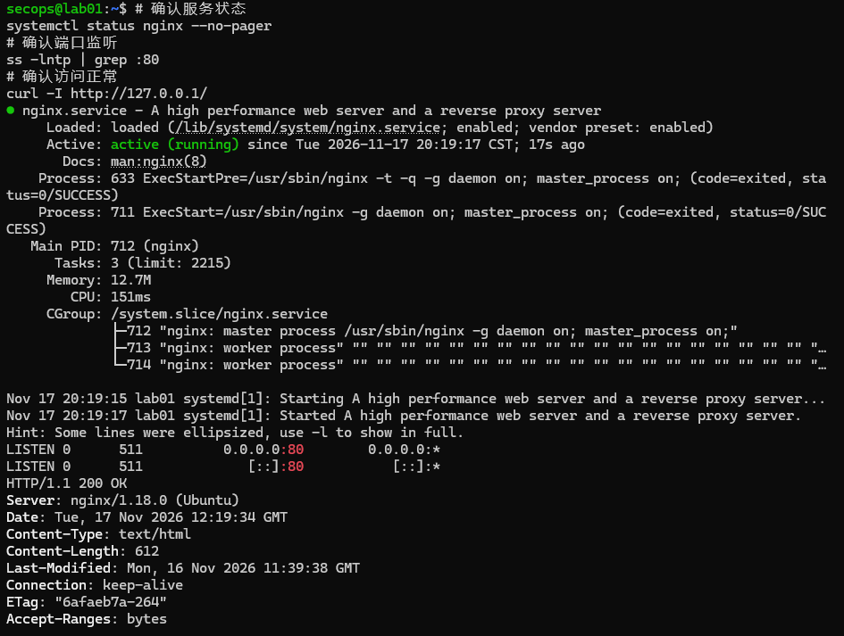
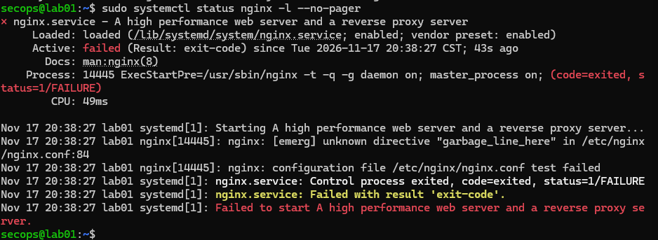
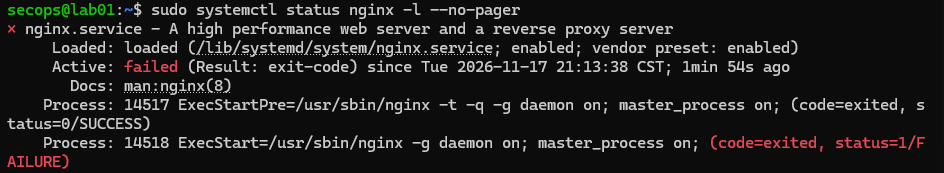
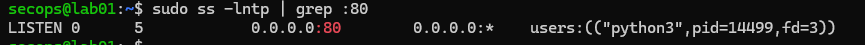
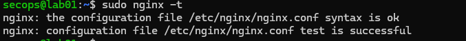
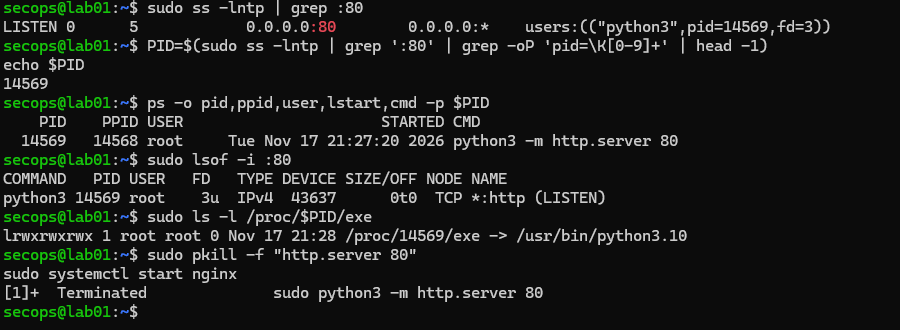

# Linux systemd 服务与端口类故障排查笔记

> 本文覆盖「配置语法错」「端口被占用导致服务起不来」「端口占用溯源」「自建 unit」四类服务侧故障，全部在 Ubuntu 22.04.5 LTS + nginx 1.18.0 的 QEMU 隔离虚拟机中实测。读完可掌握：**服务三步法**的固定顺序、用 `Process:` 行条数一眼区分「配置错」与「端口冲突」、`nginx -t` 通过后剩下的三条边界、以及从端口反查「谁 / 什么身份 / 何时启动 / 真实二进制」的四步溯源链。

**快速导航**：[⑤-A 与 ⑤-B 对比表](#32-⑤-b-端口被占用)（核心结论） · [服务三步法](#22-服务三步法顺序不可交换) · [退出码对照](#23-退出码从-process-那一行读出病因) · [误判与踩坑复盘](#4-误判与踩坑复盘) · [常用命令速查表](#5-常用命令速查表)

---

## 1. 实验环境与基线状态

| 项目 | 值 |
|---|---|
| 操作系统 | Ubuntu 22.04.5 LTS |
| 虚拟化平台 | QEMU（`lab-qemu.ps1` 管理，隔离网络） |
| 主机名 / IP | lab01 / 192.168.56.12（SSH 端口 2241） |
| 磁盘 / 内存规格 | 本次未采集 |
| 关键工具 | systemctl、journalctl、ss、lsof、fuser、nginx、curl |
| nginx 版本 | nginx/1.18.0 (Ubuntu) |
| 服务基线状态 | `active (running)`，Main PID **712** |
| HTTP 基线 | `curl -I http://127.0.0.1/` → **200** |
| 端口基线 | `LISTEN 0 511 0.0.0.0:80`，Recv-Q = **0**（无积压） |

基线必须先钉死再注入故障，否则后期无法区分「自己注的」和「本来就有问题」。`511` 是 nginx 编译期 `listen(2)` 的 backlog 值，`Recv-Q=0` 表示 accept 队列无积压——这两个数字在后面 3.2 节会和 python3 的 `LISTEN 0 5` 形成对照，是判断「谁在正经监听」的第二条线索。



*注入任何故障之前先取这一屏：`Process:` 两行都是 `status=0/SUCCESS`，`LISTEN 0 511`，200 OK。后面所有「异常」都以此为参照。*

---

## 2. 核心底层原理

### 2.1 systemd 管的是 unit，不是程序

一个 `nginx.service` 描述的是：用哪个用户跑（`User=`）、执行什么（`ExecStart=`）、依赖谁（`After=` / `Requires=`）、失败后怎么办（`Restart=`）。

这解释了一个高频反直觉现象：**程序本身完全没坏，但 unit 写错了就起不来**。二进制能手工跑通、`systemctl start` 却 failed，问题必然在 unit 层——`User`、`Environment`、`ExecStart` 路径、`Type`、`WorkingDirectory`，五者之一。

unit 文件按目录优先级覆盖，低优先级被高优先级完全遮蔽（不是合并）：

| unit 文件位置 | 优先级 | 谁放的 |
|---|---|---|
| `/etc/systemd/system/` | 最高（管理员自定义） | 手工编写、包管理器的 override 配置 |
| `/run/systemd/system/` | 中（运行时生成） | 临时配置，重启即消失 |
| `/lib/systemd/system/` | 最低（软件包自带） | `apt install` 时落盘的原始 unit |

`systemctl cat <svc>` 一次列出该服务**所有生效片段**及其来源路径。排查「我明明改了配置却不生效」，第一步就是 `systemctl cat` 看改的是不是被遮蔽的那一份。

### 2.2 服务三步法：顺序不可交换

| 步骤 | 命令 | 看什么 | 这一步排除什么 |
|---|---|---|---|
| 1 | `systemctl status <svc> -l --no-pager` | Active 状态、`Process:` 行条数与退出码、尾部日志 | 服务是「从没起来」还是「起来后退出」 |
| 2 | `journalctl -u <svc> -n 50 --no-pager` | **第一行** error，不是最后一行 | 配置错、权限错、依赖缺失、路径不存在 |
| 3 | 手工验证：`nginx -t` / `sshd -t` / 直接执行 `ExecStart` | 语法是否通过；端口能否绑定 | 区分「配置写错」与「端口被占 / 权限不足」 |

第 1 步给的是**分类**，第 2 步给的是**位置**，第 3 步给的是**归因**。跳过第 3 步，就只能靠读日志猜；跳过第 2 步直奔第 3 步（一上来就 `nginx -t`），语法错能查出来，但端口冲突和权限问题查不出来——这正是本册最典型的绕路。

### 2.3 退出码：从 `Process:` 那一行读出病因

| 退出码 | 含义 | 典型原因 | 下一步 |
|---|---|---|---|
| `1/FAILURE` | 程序自己返回非 0 | 配置语法错、端口被占、依赖服务未起 | `journalctl -u`；`nginx -t` |
| `203/EXEC` | 找不到或无法执行 `ExecStart` | 路径写错、文件无 x 位、shebang 错 | `ls -l` 该路径；直接执行它 |
| `217/USER` | `User=` 指定的用户不存在 | 改过用户名或删过账号 | `getent passwd <user>` |
| `200/CHDIR` | `WorkingDirectory` 不存在 | 目录被删或改名 | `ls` 该目录 |
| `226/NAMESPACE` | 沙箱隔离失败 | `PrivateTmp` / `ProtectSystem` 与程序冲突 | `systemctl cat` 看沙箱指令 |
| `209/STDOUT` | 标准输出配置错 | `StandardOutput` 指向无效目标 | `systemctl cat` 看重定向 |

**关键**：同为 `1/FAILURE` 时，退出码本身不区分病因，必须靠 `Process:` 行的**条数**二次切分（见 3.1 / 3.2 对比）。

### 2.4 核心判定对照表

| 故障形态 | 判定命令 | 关键特征 | 修复方式 |
|---|---|---|---|
| 配置语法错 | `nginx -t` | `[emerg] unknown directive ... in <file>:<line>`，直接给行号 | 删/改该行 → `nginx -t` → reload（服务已 failed 时用 restart） |
| 端口被占用 | `ss -lntp \| grep :<port>` | `bind() ... failed (98: ...)`，`nginx -t` **通过** | 终止占用者 → start |
| 运行用户读不到文件 | `sudo -u www-data cat <file>` | worker 起来后 403 / `Permission denied` | 修 owner/ACL，而非改 nginx.conf |
| 证书与私钥不匹配 | `openssl x509 -noout -dates` + `openssl rsa -check` | `cannot load certificate` / `key values mismatch` | 重签或换配对证书 |
| ExecStart 不可执行 | `ls -l <path>` + 直接执行 | `203/EXEC` | 修路径或补 x 位 |
| unit 被高优先级遮蔽 | `systemctl cat <svc>` | 片段来源不是你以为的那个目录 | 改高优先级那一份 |

### 2.5 `nginx -t` 通过 ≠ 服务能起：三条边界

`nginx -t` 只做一件事——把配置读一遍，看语法对不对、`include` 的文件在不在。它**不检查**以下三件事：

| 边界 | `nginx -t` 行为 | 失败症状 | 判定命令 |
|---|---|---|---|
| 端口能否绑定 | 不检查 | `bind() to 0.0.0.0:80 failed (98: Address already in use)` | `ss -lntp \| grep :80` |
| 运行用户能否读文件 | 不检查 | worker 启动后 `Permission denied` / 403 | `sudo -u www-data cat <file>` |
| 证书与密钥是否匹配 | 不检查 | `cannot load certificate` / `key values mismatch` | `openssl x509 -noout -dates` |

理解这条边界，`nginx -t` 从「证明服务没问题」变成「划掉语法这一整类」，排查范围立刻收敛。

### 2.6 端口占用溯源链（四步固定）

「80 被占了」是现象不是结论。要追到「谁、什么身份、什么时候起的」，链路固定：

| 步骤 | 命令 | 得到什么 |
|---|---|---|
| 1 谁在听 | `ss -lntp \| grep :80` | 进程名 + PID |
| 2 确认占用 | `sudo lsof -i :80` 或 `sudo fuser -n tcp 80` | 该端口完整持有者（含 fork 出的子进程） |
| 3 什么时候起的 | `ps -o pid,ppid,user,lstart,cmd -p <PID>` | 启动时间、父进程、运行用户 |
| 4 真正的二进制 | `ls -l /proc/<PID>/exe` | 内核符号链接指向的真实路径 |

第 4 步是应急响应的决定性证据：进程名和 `cmdline` 都可以被改写伪装，`/proc/<PID>/exe` 由内核维护，指向真正被 `execve` 的那个文件。

---

## 3. 分故障实操记录

### 3.1 ⑤-A 配置语法错

#### 复现方法

```bash
echo 'garbage_line_here;' | sudo tee -a /etc/nginx/nginx.conf
sudo systemctl restart nginx
```

在 `nginx.conf` 末尾追加一行非法指令（nginx 不认识 `garbage_line_here` 这个 directive），然后 restart。restart 立即报 `Job for nginx.service failed because the control process exited with error code`。

#### 故障现象

服务进入 `failed`，80 端口无监听，`curl -I` 连接被拒。

#### 排查流程

```bash
# 第 1 步：状态与退出码
sudo systemctl status nginx -l --no-pager

# 第 2 步：真实报错（看第一行 error，不是最后一行）
sudo journalctl -u nginx -n 20 --no-pager

# 第 3 步：手工验证语法
sudo nginx -t
```

| 步骤 | 实测输出 | 排除了什么 |
|---|---|---|
| 1 status | `Active: failed`；`Process:` 行**仅 1 条**：`14445 ExecStartPre ... status=1/FAILURE` | 服务是「起来后退出」还是「根本没跑到主程序」 |
| 2 journalctl | `nginx: [emerg] unknown directive "garbage_line_here" in /etc/nginx/nginx.conf:84` | 直接定位到文件 + 行号，语法类嫌疑成立 |
| 3 nginx -t | `nginx: configuration file /etc/nginx/nginx.conf test failed` | 语法错被**独立复现**，彻底排除端口与权限因素 |



*一条 `Process:` 行 + `[emerg] ... :84`，就是「配置错」的完整指纹，到这一步根因已经确定。*

**关键观察**：`Process:` 行只有一条，且进程号 14445 对应的是 `ExecStartPre`。Ubuntu 的 nginx unit 里 `ExecStartPre=/usr/sbin/nginx -t -q -g 'daemon on; master_process on;'`，也就是说 master 进程还没被拉起，`nginx -t` 这一步就先挂了。这一条 `Process:` 行本身就是「配置错」的指纹。

#### 根因结论

`/etc/nginx/nginx.conf` 第 84 行存在非法指令 `garbage_line_here`，`ExecStartPre` 阶段的配置校验失败，主进程从未启动。

#### 修复方案

```bash
sudo sed -i '/garbage_line_here/d' /etc/nginx/nginx.conf
sudo nginx -t && sudo systemctl restart nginx
curl -I http://127.0.0.1/
```

**踩坑说明**：习惯性动作是「删行 + `reload`」，但此处 `reload` 会失败——服务处于 `failed`，master 进程根本不存在，`reload` 没有对象可发 HUP 信号。**reload 只在服务还活着时才有意义**；服务已 failed 时必须 `restart`。这一条与「改配置优先用 reload」并不矛盾：前者针对「服务活着」，后者针对「服务已死」。

#### 实测时间线

| 时刻 | 事件 |
|---|---|
| 20:38:27 | 注入非法指令并 `restart`，失败 |
| 20:38:27（同一秒） | `journalctl` 已指到 `nginx.conf:84` |
| 20:55:46 | `curl -I` 返回 200，恢复完成 |

全程 **17 分 19 秒**，超出 15 分钟限时约 2 分钟。超时不在定位环节（84 行第一次读日志就出现了），而在**反复通读配置确认没有第二处问题**——这是低效的部分，见第 4 节复盘。

#### 预防措施

- 变更流程固化：改配置 → `nginx -t` → 校验通过才 reload/restart → `curl -I` 验证。
- CI/发布前拦截：`nginx -t` 作为网关，失败即阻断，见 `scripts/nginx-safe-reload.sh`。
- 监控 `ExecStartPre` 失败：`systemctl is-active nginx` 非 active 即告警。

---

### 3.2 ⑤-B 端口被占用

#### 复现方法

```bash
sudo systemctl stop nginx
sudo python3 -m http.server 80 &     # 用一个假服务占住 80
sudo systemctl start nginx
```

`python3 -m http.server 80` 以 root 身份绑定 `0.0.0.0:80`（1024 以下端口需特权，不加 `sudo` 会 `Permission denied`），此时 nginx 再启动就会撞端口。

#### 故障现象

`systemctl start nginx` 返回 Job failed，`Active: failed`。表面症状与 ⑤-A **完全一致**——都是「服务起不来 + status=1/FAILURE」。

#### 排查流程

```bash
sudo systemctl status nginx -l --no-pager
sudo journalctl -u nginx -n 20 --no-pager
sudo nginx -t          # 关键：这次它会通过
sudo ss -lntp | grep :80
```

| 步骤 | 实测输出 | 结论 |
|---|---|---|
| 1 status | `status=1/FAILURE`，但 `Process:` 有**两行**：`14517 ExecStartPre=0/SUCCESS`、`14518 ExecStart=1/FAILURE` | 与 ⑤-A 同码不同形，靠行数区分 |
| 2 journalctl | `bind() to 0.0.0.0:80 failed (98: Unknown error)`，连续 5 行，末行 `still could not bind()` | 指向「端口」而非「语法」 |
| 3 nginx -t | `syntax is ok` / `test is successful` | **语法无罪**，配置错整类被排除 |
| 4 ss | `LISTEN 0 5 0.0.0.0:80 users:(("python3",pid=14499,fd=3))` | 定位到真正的占用者 |



*与 3.1 的⑤-A 逐行对比：退出码完全相同，差别只在 `Process:` 的行数。看到两行，就该往端口和权限方向走。*

**反直觉点一：`(98: Unknown error)` 不是权限问题。** 教程里常见的是 `(98: Address already in use)`，这里却显示 `Unknown error`。二者是同一个故障——98 就是 `errno EADDRINUSE`，只是 nginx 自带的 `strerror` 文案表里没有收录 98，回落成了 `Unknown error`。**判断时认数字不认文字**，再用 `ss` 交叉验证。

**反直觉点二：5 行相同的 `bind()` 不是 5 个进程。** nginx 连续重试 5 次后才打印 `still could not bind()`，那是一个进程在重试。把它误读成「起了多个 worker 抢端口」会把排查带向完全错误的方向。

![journalctl 全程实拍：20:38:27 的 [emerg] unknown directive 属⑤-A，21:13:36 起连续 5 行 bind() (98: Unknown error) 属⑤-B，PID 分别是 14445 与 14518](../images/02-journal-both-faults.png)

*一屏同时躺着两个故障：上半段是配置错（PID 14445），下半段是端口冲突（PID 14518）。5 行 bind 的 PID 完全一致，证明是一个进程在重试。*

**反直觉点三：`Send-Q` 的 5 与 511 不是流量指标。** `ss` 在 LISTEN 态下 `Send-Q` 是 `listen(2)` 传入的 backlog 上限：nginx 编译期是 511，python3 `http.server` 是 5。与当前连接数、流量大小无关。



*backlog 从基线的 511 掉到 5，`users` 里的进程名也从 nginx 变成 python3 —— 两条线索同时否掉了「nginx 在监听」。*



*整册最关键的一屏：语法校验全绿，服务却起不来。它证明「配置错」整类已被排除，剩下的只有端口和权限。*

#### 根因结论

80 端口已被 `python3 -m http.server`（PID 14499，root 身份）独占监听，nginx 的 `bind()` 返回 `EADDRINUSE`，主进程启动失败。

#### 修复方案

```bash
sudo pkill -f "http.server 80"
sudo systemctl start nginx
curl -I http://127.0.0.1/
```

**踩坑说明**：直接 `systemctl restart nginx` 无效——端口仍被占用，只会再失败一次并让日志堆叠更多 `bind()` 行。必须先释放端口再启动服务。另外收尾时要确认 nginx 真的起来了（`curl -I` 得 200），只 kill 进程忘记 start 会让基线处于「服务没跑」的状态。

#### 预防措施

- 建端口台账：新增服务前先 `ss -lntp` 查目标端口是否空闲。
- 监控预期端口必须有监听：`ss -lntp | grep :80` 为空即告警。
- 用 `Restart=on-failure` + `RestartSec` 自愈，但要配 `NRestarts` 阈值告警，避免崩溃循环打满日志。

---

### 3.3 ③ 端口占用溯源

#### 复现方法

承接 3.2 的场景：80 端口被一个 `python3` 占着，此时不急着 kill，先把「它到底是谁」追到底。

#### 排查流程

```bash
# 1 谁在听
sudo ss -lntp | grep :80

# 2 提取 PID（避免手抄）
PID=$(sudo ss -lntp | grep ':80' | grep -oP 'pid=\K[0-9]+' | head -1); echo $PID

# 3 什么时候起的、谁起的
sudo ps -o pid,ppid,user,lstart,cmd -p $PID

# 4 交叉确认占用者（含子进程）
sudo lsof -i :80
sudo fuser -n tcp 80

# 5 真实二进制
sudo ls -l /proc/$PID/exe
```

| 命令 | 回答的问题 | 实测结果 |
|---|---|---|
| `ss -lntp` | 谁在监听 | `python3`，PID **14569** |
| `ps -o pid,ppid,user,lstart,cmd -p` | 什么时候起的、谁起的 | ppid **14568**、user **root**、`lstart` **Tue Nov 17 21:27:20** |
| `lsof -i :80` | 该端口完整持有者（含子进程） | 同一 PID 持有监听 socket |
| `fuser -n tcp 80` | 最简的一行答案 | 输出 PID |
| `ls -l /proc/$PID/exe` | 真实二进制路径 | → `/usr/bin/python3.10` |

**实测注意点**：溯源时 80 上的实例已经是 PID **14569**，而 3.2 节记录的是 **14499**——说明中间 `http.server` 被重起过一次。这类 PID 漂移在实时排查里很常见，凡是跨小节引用 PID 都要重新取一次，不能沿用上一段的数字。

#### 根因结论

监听者身份：`root` 启动的 `python3`（`/usr/bin/python3.10`），启动时间 `Tue Nov 17 21:27:20`，父进程 14568，占用 `0.0.0.0:80`。

#### 修复方案

```bash
sudo kill -TERM <PID>
sudo systemctl start nginx
```

**踩坑说明**：只靠 `ps` 的 `COMMAND` 列判断不可靠——进程名（`prctl(PR_SET_NAME)`）和 `cmdline` 都能被改写。把 `/proc/<PID>/exe` 当作最终判据：它是内核维护的符号链接，指向真正被 `execve` 的文件，改名伪装在这里暴露无遗。



*一条链拿齐四要素，最后一步指向 `/usr/bin/python3.10` 是整段溯源的关键证据——进程名和 cmdline 都能改，这个符号链接不能。*

#### 预防措施

- 交付物层面：任何「端口被占用」结论都必须带齐四要素——**进程名、运行用户、启动时间、真实二进制**，缺一条就不算溯源完成。
- 自动化：`scripts/port-owner-trace.sh` 一次输出四要素。
- 纳入应急响应 SOP：可疑进程优先取 `/proc/<PID>/exe`、`/proc/<PID>/cwd`、`/proc/<PID>/cmdline` 三件套留证。

---

### 3.4 自建 unit：验证「unit 层」故障的成因

#### 复现方法

```bash
sudo tee /etc/systemd/system/lab-hello.service > /dev/null <<'EOF'
[Unit]
Description=Lab Hello Timer
After=network.target

[Service]
Type=oneshot
ExecStart=/bin/bash -c 'echo "hello from lab-hello at $(date)" >> /var/log/lab-hello.log'

[Install]
WantedBy=multi-user.target
EOF

sudo systemctl daemon-reload
sudo systemctl start lab-hello
sudo systemctl status lab-hello -l --no-pager
sudo cat /var/log/lab-hello.log
```

#### 现象与判据

| 检查项 | 期望 |
|---|---|
| `systemctl status` | `Active: active (exited)` —— `Type=oneshot` 正常跑完即退出，不是 failed |
| `/var/log/lab-hello.log` | 有带时间戳的 `hello from lab-hello at ...` |
| unit 落盘位置 | `/etc/systemd/system/lab-hello.service`（最高优先级，不被包管理器覆盖） |

#### 为什么值得写一遍

亲手写 unit 才能理解三步法第 3 步「手工执行成功、systemctl 失败」的成因：

- `User=` 写了一个不存在的账号 → `217/USER`，程序根本没跑；
- `ExecStart=` 写成不带绝对路径的命令名 → systemd 不做 `PATH` 查找 → `203/EXEC`；
- `WorkingDirectory=` 指向不存在的目录 → `200/CHDIR`；
- `Type=simple` 而程序自己 daemon 化退出 → systemd 认为主进程已结束，判定 failed（这是最隐蔽的一类）；
- 环境变量差异：登录 shell 有 `PATH`/`HOME`/`LANG`，systemd 只给 unit 里 `Environment=` 显式写的东西。

#### 结论

`daemon-reload` 是修改 unit 后的必要动作——systemd 读取的是内存中的 unit 缓存，不 reload 就改不生效。这一条与「改了 nginx.conf 要 reload」是两回事，容易混淆。

---

## 4. 误判与踩坑复盘

| # | 最初误判 | 实际原因 | 为什么误判 | 后续规避 |
|---|---|---|---|---|
| 1 | nginx 挂了，要改配置或重装 | 80 被 root 起的 `python3 http.server` 占着 | 看到 `failed` 就直奔配置文件，跳过 `nginx -t` 与 `ss` 两步 | `nginx -t` 一旦通过，立刻 `ss -lntp \| grep :80`，不再二次通读配置 |
| 2 | `(98: Unknown error)` 是权限或内核限制 | `errno 98 = EADDRINUSE`，端口已被占用 | nginx 的 `strerror` 表无 98 的文案，回落成 `Unknown error`；且退出码与 ⑤-A 完全相同 | 认 errno 数字不认文字：98 → 端口占用 → `ss` 验证 |
| 3 | 把 `journalctl` 最后一行当报错 | 第一行 `[emerg]` 才是根因，后面的都是连锁反应 | 终端输出习惯性看末尾 | 固定 `journalctl -u <svc> -n 50 --no-pager \| grep -m1 -iE 'error\|emerg\|fail'` 取首条 |
| 4 | 服务 failed 后仍用 `reload` 恢复 | 服务已 failed，master 进程不存在，`reload` 无对象可发信号 | 「改配置用 reload 不断连接」成了条件反射，忘了它依赖服务存活 | 先 `systemctl is-active` 判存活：active → reload；failed/inactive → restart |
| 5 | 定位到 84 行后决定通读整份配置复查 | 单次排障耗时 17 min（超时 2 min），超时全在复查 | 担心「还有第二处问题」，用人工通读代替工具校验 | 通读交给 `nginx -t`（它也做 include 递归校验），人只处理工具报出的那一条 |
| 6 | 5 行相同的 `bind()` 视为多个进程抢端口 | 是一个进程重试 5 次后打印 `still could not bind()` | 相同行堆叠直觉上等于多主体 | 看 PID 是否相同；相同即同一进程重试 |
| 7 | `python3 -m http.server 80` 不加 `sudo` 也能起 | 1024 以下端口需特权，会 `Permission denied` | 混淆了「普通用户可监听」与「可监听低端口」 | 复现类操作统一 `sudo`，先确认监听成功再进入下一步 |
| 8 | 恢复时只 kill 占用进程，忘了起 nginx | 基线变成「服务没跑」 | 把「排除障碍」误当「完成任务」 | 收工判据固定为 `curl -I` 返回 200 |

---

## 5. 常用命令速查表

| 场景 | 命令 | 关键看什么 |
|---|---|---|
| 服务状态 | `systemctl status <svc> -l --no-pager` | `Active:`、`Process:` 行**条数**与退出码 |
| 真实报错 | `journalctl -u <svc> -n 50 --no-pager` | 第一行 `error`/`[emerg]`，不是最后一行 |
| 生效的 unit | `systemctl cat <svc>` | 所有片段与来源路径（判断是否被遮蔽） |
| 语法校验 | `nginx -t` / `sshd -t` | `syntax is ok` / `test is successful` |
| 端口监听 | `ss -lntp` | 谁在听、哪个用户、backlog（Send-Q） |
| 端口占用 | `sudo lsof -i :<port>` / `sudo fuser -n tcp <port>` | PID（含子进程） |
| 进程详情 | `ps -o pid,ppid,user,lstart,cmd -p <PID>` | 启动时间、父进程、运行用户 |
| 真实二进制 | `ls -l /proc/<PID>/exe` | 符号链接目标（识破改名伪装） |
| 重启次数 | `systemctl show <svc> -p NRestarts --value` | 崩溃循环 |
| 全部失败服务 | `systemctl --failed` | 一次性看清所有异常项 |
| 用运行用户复跑 | `sudo -u www-data /usr/sbin/nginx -t` | 权限差异 |
| 重载 unit 缓存 | `systemctl daemon-reload` | 改 unit 文件后必做 |

---

## 6. 思考题解答

### Q1 `systemctl status` 显示 failed，但手工执行程序却成功，问题可能在哪？怎么验证？

问题在 **unit 层**，不在程序层。按下面顺序验证，每步排掉一个字段：

```bash
# (1) 看生效的 unit，定位候选字段
systemctl cat nginx           # 关注 User= / ExecStart= / WorkingDirectory= / Environment= / Type=

# (2) 用运行用户复跑，权限差异立刻暴露
sudo -u www-data /usr/sbin/nginx -t

# (3) 比环境变量：登录 shell 有 PATH/HOME/LANG，systemd 只给 Environment= 写的东西
sudo systemctl show nginx -p Environment --value
echo "$PATH"

# (4) 看 Type 是否与程序行为匹配
sudo systemctl show nginx -p Type --value
```

**结论**：`User=` 不存在 → `217/USER`；`ExecStart=` 写相对路径或命令名（systemd 不做 `PATH` 查找）→ `203/EXEC`；`WorkingDirectory=` 不存在 → `200/CHDIR`；`Type=simple` 而程序自行 daemon 化 → systemd 认为主进程已退出。定位到字段后改 unit，**必须 `daemon-reload` 才生效**。

### Q2 `ss -lnt` 中 LISTEN 态 `Recv-Q` 不为 0 说明什么？`Send-Q` 呢？

```bash
ss -lnt
```

- `Recv-Q`（LISTEN 态）：已完成三次握手、但应用尚未 `accept()` 的连接数。持续不为 0 说明 accept 队列在积压——worker 卡住或 backlog 已满，新连接会被内核丢弃（表现为客户端超时、`SYN` 重传）。此时查应用是否卡在慢查询/锁上，而不是调大 backlog。
- `Send-Q`（LISTEN 态）：`listen(2)` 传入的 backlog 上限，**与流量无关**。

本册两组实测正好构成对照：nginx `LISTEN 0 511`，python3 `http.server` `LISTEN 0 5`——511 与 5 是各自代码里的 backlog 常量。

### Q3 为什么「先 reload 再 restart」？什么情况下必须 restart？

```bash
sudo nginx -t && sudo systemctl reload nginx
```

`reload` 给 master 发 `SIGHUP`：重读配置、拉起新 worker、老 worker 处理完存量连接后退出，**不断连接**。`restart` 是 stop + start，直接掐断在途请求。

必须 `restart` 的四种情况：

1. 改了 **unit 文件本身**（`User`/`ExecStart`/`Type`），`reload` 不会重读 unit；
2. 升级了二进制，旧 master 仍在内存中运行旧代码；
3. 进程已僵死，`SIGHUP` 发不进去；
4. **服务本来就是 `failed` 状态**——没有 master 可发信号。本册 ⑤-A 正是这种，`reload` 必然失败，只能 `restart`。

判据一句话：`systemctl is-active nginx` 返回 `active` 才考虑 reload，否则 restart。

### Q4 怎么判断一个失败是「程序自己退出的」还是「根本没执行到程序」？

看 `systemctl status` 里 `Process:` 行的**条数**与退出码：

```bash
sudo systemctl status <svc> -l --no-pager
```

| 形态 | `Process:` 行 | 判据 |
|---|---|---|
| 执行到程序、程序自己失败 | `ExecStartPre=0/SUCCESS` + `ExecStart=1/FAILURE`（**两行**） | 本例 ⑤-B，journalctl 能读到程序自己打的 `[emerg]` |
| 根本没执行到程序 | 仅 `ExecStartPre=1/FAILURE`（**一行**） | 本例 ⑤-A，还挂在 `nginx -t` 阶段 |
| 找不到/不可执行 | `status=203/EXEC` | 查 `ExecStart` 路径与 x 位 |
| 用户不存在 | `status=217/USER` | `getent passwd <user>` |
| 工作目录不存在 | `status=200/CHDIR` | `ls <WorkingDirectory>` |

辅助判据：`ps` 里从未出现该进程、`ss` 从未出现该端口，同样说明程序没跑起来过。

---

## 7. 总结与方法论沉淀

### 核心排障原则

1. **先分类，再定位，后归因。** status 给分类（起没起来）、journalctl 给位置（哪个文件哪一行）、手工验证给归因（配置/端口/权限）。顺序不可交换，跳步必然重复劳动。
2. **`nginx -t` 的价值是「划掉一整类」，不是「证明服务没问题」。** 它通过 = 语法无罪，排查范围立即收敛到端口与权限两项。
3. **首条 error 才是根因，末行都是连锁反应。** 日志越长，越要往上翻。
4. **认 errno 数字，不认 strerror 文案。** 98 永远是 `EADDRINUSE`，即使显示成 `Unknown error`。
5. **`Process:` 行条数 > 退出码。** 同为 `1/FAILURE` 时，一行 vs 两行才是「配置错」与「端口冲突」的分水岭。
6. **reload 依赖服务存活。** `is-active` 判存活，再决定 reload 还是 restart。
7. **端口结论必须带齐四要素：** 进程名 + 运行用户 + 启动时间 + 真实二进制（`/proc/<PID>/exe`）。
8. **任务完成判据是 `curl -I` 返回 200，不是「障碍已清除」。**

### 排查优先级

```
failed
 ├─ status 看 Process 行
 │   ├─ 1 行（ExecStartPre 失败）→ 配置错 → nginx -t → 改那一行
 │   ├─ 2 行（ExecStart 失败）  → 起后退出 → journalctl 首条 error
 │   │                              ├─ [emerg] unknown directive → 配置错（含 include 文件）
 │   │                              └─ bind()/permission      → 资源层 → nginx -t + ss
 │   └─ 203/217/200/226         → unit 字段错 → systemctl cat
 └─ 三条都过仍失败 → 证书配对 / 沙箱指令（PrivateTmp、ProtectSystem）/ 内核限制
```

### 常见误区

- 一上来 `nginx -t`：语法错能查，端口和权限查不出来。
- 看到 `failed` 就改配置：80% 的「服务起不来」不是配置问题。
- 通读整份配置复查：工具做的递归校验（`nginx -t` 会跟 `include`）比人眼可靠，人也更慢。
- 服务已 failed 还发 reload。
- 只 kill 进程、忘记 start 服务，基线被破坏。
- 只看进程名不看 `/proc/<PID>/exe`，被改名伪装误导。

### 可迁移的通用思路

- **分层排查**：进程层（是否启动）→ 配置层（语法/语义）→ 资源层（端口/权限/证书/沙箱）。每层有独立的验证工具，层内结论不跨层推断。
- **工具边界意识**：任何校验工具都有「不检查」的清单，先想清楚它证明了什么、没证明什么，再决定下一步。这个思路可平移到 `sshd -t`、`promtool check config`、`named-checkconf`、`nginx -t` 等一切 `-t` 类工具。
- **身份溯源四要素**（进程名/用户/时间/真实路径）是端口类、进程类应急响应的通用模板，Wazuh Manager、Suricata、自研 Agent 起不来时同样适用：status 看哪行 Process 失败 → journalctl 首条 emerg → 配置 `-t` + `ss` 查端口，**不重装**。
- **把「顺序」写成脚本**：`nginx -t` 通过才 reload、`curl` 通过才算成功——顺序一旦固化成脚本，就不依赖人的记性。

---

## 本章节产出脚本

### 1. `scripts/service-triage.sh`

服务三步法一键采集。自动判存活、抓 `Process:` 行、取首条 error、按 unit 内容推断校验命令，最后给出「配置错 / 资源错 / unit 错」的初步结论。

```bash
#!/usr/bin/env bash
# service-triage.sh —— 服务三步法一键采集
# 用法: sudo ./service-triage.sh <service-name>
#       sudo ./service-triage.sh nginx

set -uo pipefail
SVC="${1:-}"
[[ -z "$SVC" ]] && { echo "用法: $0 <service-name>"; exit 2; }
have() { command -v "$1" >/dev/null 2>&1; }

echo "===== [1/4] systemctl status (分类) ====="
systemctl status "$SVC" -l --no-pager 2>&1 | sed -n '1,20p'

echo
echo "===== [1b] Process 行与退出码 ====="
# 条数决定病因层：1 行=没跑到主程序；2 行=跑到主程序后失败
PROC=$(systemctl status "$SVC" -l --no-pager 2>&1 | grep -E '^\s*(Process|Main PID|Status):' || true)
echo "${PROC:-（未采集到 Process 行）}"
PROC_CNT=$(echo "$PROC" | grep -c 'ExecStart')
echo "--> ExecStart 相关行数: ${PROC_CNT}（1=配置/前置失败, 2=程序自身失败）"

echo
echo "===== [2/4] journalctl 首条 error (定位) ====="
FIRST=$(journalctl -u "$SVC" -n 200 --no-pager 2>/dev/null \
        | grep -m1 -iE 'emerg|error|failed|denied|bind\(\)' || true)
echo "${FIRST:-（最近 200 行未匹配到 error/emerg）}"
echo "--> 注意: 首条才是根因, 后续行多为连锁反应"

echo
echo "===== [3/4] 生效的 unit 片段 (来源) ====="
systemctl cat "$SVC" 2>/dev/null | grep -E '^(#|User=|ExecStart|ExecStartPre|WorkingDirectory|Type=|Environment=|Restart=)' || true

echo
echo "===== [4/4] 手工验证 (归因) ====="
BIN=$(systemctl cat "$SVC" 2>/dev/null | grep -m1 '^ExecStart=' | sed -E 's/^ExecStart=-?//; s/ .*//')
echo "ExecStart 二进制: ${BIN:-未知}"
if [[ -n "${BIN}" && -x "${BIN}" ]]; then
  case "$(basename "$BIN")" in
    nginx)  echo "--- nginx -t ---";  "${BIN}" -t 2>&1 ;;
    sshd)   echo "--- sshd -t ---";   "${BIN}" -t 2>&1 ;;
    httpd)  echo "--- httpd -t ---";  "${BIN}" -t 2>&1 ;;
    *)      echo "--- 无内置 -t 校验，直接试运行 ---"; timeout 5 "${BIN}" --version 2>&1 | head -2 ;;
  esac
else
  echo "[!] ExecStart 不存在或不可执行 -> 疑似 203/EXEC"
fi

# 从 unit 里抽出监听端口，检查是否被占
PORTS=$(systemctl cat "$SVC" 2>/dev/null | grep -oE ':(80|443|[0-9]{4,5})\b' | tr -d ':' | sort -u | head -5)
for P in $PORTS; do
  echo "--- ss :${P} ---"
  ss -lntp "sport = :${P}" 2>/dev/null || ss -lntp | grep ":${P} "
done

echo
echo "===== 初步结论 ====="
if [[ "${PROC_CNT}" -le 1 ]]; then
  echo "配置/前置层失败 -> 看 nginx -t 输出定位行号，改完再 restart"
else
  echo "程序已执行 -> 若 -t 通过则是端口/权限问题；-t 失败则是配置问题"
fi
echo "存活判据: systemctl is-active ${SVC} = $(systemctl is-active "$SVC" 2>/dev/null)"
```

**使用方式**：`sudo ./service-triage.sh nginx`。适合接到告警后第一轮采集，一条命令拿齐三步法全部输出。

---

### 2. `scripts/port-owner-trace.sh`

端口占用四步溯源。输出「进程名 / 运行用户 / 启动时间 / 真实二进制」四要素，并用 `ss` / `lsof` / `fuser` 三方交叉验证。

```bash
#!/usr/bin/env bash
# port-owner-trace.sh —— 端口占用四步溯源
# 用法: sudo ./port-owner-trace.sh <port>
#       sudo ./port-owner-trace.sh 80

set -uo pipefail
PORT="${1:-}"
[[ -z "$PORT" ]] && { echo "用法: $0 <port>"; exit 2; }

echo "===== 目标端口: ${PORT} ====="

echo
echo "--- [1] ss 谁在监听 ---"
ss -lntpH "sport = :${PORT}" 2>/dev/null || ss -lntp | grep -w ":${PORT}"

PIDS=$(ss -lntpH "sport = :${PORT}" 2>/dev/null \
       | grep -oP 'pid=\K[0-9]+' | sort -u)
# 兜底: 旧版 ss 不支持过滤表达式
[[ -z "$PIDS" ]] && PIDS=$(ss -lntp | grep -w ":${PORT}" | grep -oP 'pid=\K[0-9]+' | sort -u)

if [[ -z "$PIDS" ]]; then
  echo "[!] 端口 ${PORT} 无监听者（可能未启动，或仅处于非 LISTEN 状态）"
  ss -antp 2>/dev/null | grep -w ":${PORT}" || true
  exit 0
fi
echo "--> 监听 PID: $(echo $PIDS | tr '\n' ' ')"

echo
echo "--- [2] 完整持有者交叉验证 ---"
if command -v lsof >/dev/null 2>&1; then
  lsof -nP -i :"${PORT}" 2>/dev/null || echo "(lsof 无输出)"
else
  echo "(lsof 未安装: apt install lsof)"
fi
if command -v fuser >/dev/null 2>&1; then
  echo -n "fuser -n tcp ${PORT}: "; fuser -n tcp "${PORT}" 2>/dev/null; echo
fi

for PID in $PIDS; do
  echo
  echo "===== PID ${PID} 详情 ====="
  echo "--- [3] 启动时间 / 父进程 / 用户 ---"
  ps -o pid,ppid,user,lstart,etime,cmd -p "$PID" 2>/dev/null || echo "(进程已退出)"

  echo "--- [4] 真实二进制 (内核维护, 无法伪装) ---"
  ls -l "/proc/${PID}/exe" 2>/dev/null || echo "(无权限或进程已退出, 需 root)"
  echo -n "readlink: "; readlink -f "/proc/${PID}/exe" 2>/dev/null || echo "N/A"

  echo "--- 辅助: cmdline / cwd / 环境差异 ---"
  echo -n "cmdline: "; tr '\0' ' ' < "/proc/${PID}/cmdline" 2>/dev/null; echo
  echo -n "cwd    : "; readlink -f "/proc/${PID}/cwd" 2>/dev/null || echo "N/A"
  echo -n "状态   : "; awk '/^State|^PPid|^Uid/{print}' "/proc/${PID}/status" 2>/dev/null | tr '\n' ' '; echo

  echo "--- 结论四要素 ---"
  PNAME=$(cat "/proc/${PID}/comm" 2>/dev/null || echo "unknown")
  PUSER=$(ps -o user= -p "$PID" 2>/dev/null | tr -d ' ')
  PSTART=$(ps -o lstart= -p "$PID" 2>/dev/null)
  PEXE=$(readlink -f "/proc/${PID}/exe" 2>/dev/null)
  printf '进程名: %s\n运行用户: %s\n启动时间: %s\n真实二进制: %s\n' \
    "$PNAME" "${PUSER:-?}" "${PSTART:-?}" "${PEXE:-?}"
done
```

**使用方式**：`sudo ./port-owner-trace.sh 80`。`-H` 去掉表头、`-p` 显示进程，`readlink -f` 解出真实路径（`ls -l` 在部分环境只显示未解析的链接目标）。

---

### 3. `scripts/nginx-safe-reload.sh`

「校验通过才生效」的变更封装。`nginx -t` 失败即中止、线上配置不动；reload 后强制 HTTP 健康检查，失败自动回滚到备份。

```bash
#!/usr/bin/env bash
# nginx-safe-reload.sh —— 校验通过才 reload，失败自动回滚
# 用法: sudo ./nginx-safe-reload.sh [config-path] [health-url]
#       sudo ./nginx-safe-reload.sh /etc/nginx/nginx.conf http://127.0.0.1/

set -uo pipefail
CONF="${1:-/etc/nginx/nginx.conf}"
URL="${2:-http://127.0.0.1/}"
TS=$(date +%Y%m%d-%H%M%S)
BAK="/var/backups/nginx-conf-${TS}.tar.gz"

log() { printf '[%s] %s\n' "$(date +%H:%M:%S)" "$*"; }

# 0) 备份当前配置（回滚依赖它）
mkdir -p /var/backups
if tar -czf "$BAK" -C /etc nginx 2>/dev/null; then
  log "[+] 配置已备份: $BAK"
else
  log "[!] 备份失败，中止（不带备份做变更等于赌博）"; exit 1
fi

# 1) 语法校验：唯一闸门
if ! nginx -t 2>/tmp/nginx-t.err; then
  log "[!] 配置校验失败，已中止，线上配置未变"
  sed -n '1,5p' /tmp/nginx-t.err
  log "    定位方法: 取报错里的 <file>:<line>，只改那一行，不要通读整份配置"
  exit 1
fi
log "[+] nginx -t 通过"

# 2) 服务存活判断决定 reload 还是 restart
if [[ "$(systemctl is-active nginx)" == "active" ]]; then
  log "[*] 服务 active -> reload（不断连接）"
  systemctl reload nginx || { log "[!] reload 失败"; exit 1; }
else
  log "[!] 服务非 active -> reload 无对象可发信号，改用 restart"
  systemctl restart nginx || { log "[!] restart 失败"; exit 1; }
fi

# 3) 健康检查：完成判据是 HTTP 2xx，不是「命令没报错」
sleep 1
if curl -fsS -o /dev/null -m 5 "$URL"; then
  log "[+] 健康检查通过: $URL"
  nginx -v 2>&1 | sed 's/^/    /'
  exit 0
fi

# 4) 回滚
log "[!] 健康检查失败，回滚配置"
tar -xzf "$BAK" -C /etc
nginx -t && systemctl restart nginx
log "[!] 已回滚到 $TS 之前的配置，请人工复核"
exit 1
```

**使用方式**：`sudo ./nginx-safe-reload.sh /etc/nginx/nginx.conf http://127.0.0.1/`。把「改配置 → 校验 → 生效 → 验证 → 回滚」五步固化成一条命令，避免「改完配置忘了 `-t`」和「reload 成功但服务实际 502」。

---

### 4. `scripts/unit-audit.sh`

unit 文件静态体检。逐项验证 `User` / `ExecStart` / `WorkingDirectory` / `Type` / `Restart`，提前命中 `217/USER`、`203/EXEC`、`200/CHDIR` 这类「程序没坏但起不来」的故障。

```bash
#!/usr/bin/env bash
# unit-audit.sh —— systemd unit 静态体检
# 用法: sudo ./unit-audit.sh <service-name>
#       sudo ./unit-audit.sh nginx

set -uo pipefail
SVC="${1:-}"
[[ -z "$SVC" ]] && { echo "用法: $0 <service-name>"; exit 2; }

UNIT_TXT=$(systemctl cat "$SVC" 2>/dev/null) || {
  echo "[!] unit 不存在: ${SVC}.service"; exit 1; }

echo "===== ${SVC}.service 片段来源 ====="
echo "$UNIT_TXT" | grep '^#' || true
echo

get() { echo "$UNIT_TXT" | grep -m1 "^$1=" | cut -d= -f2-; }

FAIL=0
check() { # name  result  detail
  if [[ "$2" == "OK" ]]; then printf '  [ OK ] %-18s %s\n' "$1" "$3"
  else printf '  [FAIL] %-18s %s\n' "$1" "$3"; FAIL=$((FAIL+1)); fi
}

echo "===== 字段体检 ====="

# 1) User
U=$(get User)
if [[ -z "$U" ]]; then
  check "User" "OK" "未指定 -> 以 root 运行（安全基线建议显式指定）"
elif getent passwd "$U" >/dev/null 2>&1; then
  check "User" "OK" "$U 存在"
else
  check "User" "FAIL" "$U 不存在 -> 会报 217/USER"
fi

# 2) ExecStart 绝对路径 + 可执行
ES=$(get ExecStart | sed -E 's/^-//; s/ .*//')
if [[ -z "$ES" ]]; then
  check "ExecStart" "FAIL" "未配置"
elif [[ "$ES" != /* ]]; then
  check "ExecStart" "FAIL" "'$ES' 非绝对路径（systemd 不做 PATH 查找）-> 203/EXEC"
elif [[ ! -e "$ES" ]]; then
  check "ExecStart" "FAIL" "$ES 不存在 -> 203/EXEC"
elif [[ ! -x "$ES" ]]; then
  check "ExecStart" "FAIL" "$ES 无 x 位 -> 203/EXEC"
else
  check "ExecStart" "OK" "$ES 可执行"
fi

# 3) WorkingDirectory
WD=$(get WorkingDirectory)
if [[ -n "$WD" && ! -d "$WD" ]]; then
  check "WorkingDirectory" "FAIL" "$WD 不存在 -> 200/CHDIR"
else
  check "WorkingDirectory" "OK" "${WD:-未指定（使用 /）}"
fi

# 4) Type 与 Restart
T=$(get Type)
check "Type" "OK" "${T:-simple（默认）}"
R=$(get Restart)
if [[ -z "$R" || "$R" == "no" ]]; then
  check "Restart" "FAIL" "未配置自愈 -> 崩溃后不自恢复"
else
  check "Restart" "OK" "$R$(get RestartSec | sed 's/^/ , RestartSec=/')"
fi

# 5) Environment 完整性（登录 shell 与 systemd 的差异来源）
ENVN=$(get Environment | wc -w)
echo "  [INFO] Environment= 条目数: ${ENVN}（0 表示 systemd 只给最小环境，PATH 需显式声明）"

echo
echo "===== 当前运行态 ====="
printf '  is-active   : %s\n' "$(systemctl is-active "$SVC")"
printf '  NRestarts   : %s\n' "$(systemctl show "$SVC" -p NRestarts --value)"
printf '  MainPID     : %s\n' "$(systemctl show "$SVC" -p MainPID --value)"
echo "  Process 行  : $(systemctl status "$SVC" -l --no-pager 2>&1 | grep -c 'ExecStart') 条（1=前置失败, 2=程序失败）"

echo
[[ "$FAIL" -eq 0 ]] && echo "结论: unit 静态检查全部通过，故障可能在程序内部或资源层（端口/权限/证书）" \
                     || echo "结论: 命中 ${FAIL} 项 unit 缺陷，先修 unit 再查程序（改完记得 daemon-reload）"
```

**使用方式**：`sudo ./unit-audit.sh nginx`。适合在「手工执行成功、systemctl 失败」时直接定位到具体字段，不用逐行读 unit 文件。

---

## 8. 系列预告

> 下一篇：**权限与认证类故障排障**——本册 ⑤-B 的「path 能读但服务读不到」已经触到文件权限边界（`sudo -u www-data cat` 那条），下一篇把这个边界完整拆开：`Permission denied` 的六种来源与各自一条判定命令、目录 `x` 位为什么能让 644 的文件也读不到、以及 SSH 连不上的四种造法（服务停 / 改端口 / 防火墙 DROP / 认证被拒）如何只靠客户端现象先分层再定位；另有一条独立主线是**改 SSH 前的保险绳**。本系列持续更新，未完待续。

---

## 附：实测数据汇总

| 指标 | 实测值 |
|---|---|
| nginx 版本 / 基线 PID | 1.18.0 (Ubuntu) / 712 |
| 基线监听 | `LISTEN 0 511 0.0.0.0:80`，Recv-Q=0 |
| ⑤-A 退出码 | `1/FAILURE`（仅 `ExecStartPre` 一行，PID 14445） |
| ⑤-A 根因 | `nginx.conf:84` 非法指令 `garbage_line_here` |
| ⑤-A 耗时 | 17 min 19 s（20:38:27 注入 → 20:55:46 恢复 200），超时 2 min |
| ⑤-B 退出码 | `1/FAILURE`（`ExecStartPre=0/SUCCESS` + `ExecStart=1/FAILURE`，PID 14517/14518） |
| ⑤-B 根因 | `python3 http.server`（PID 14499）占 `0.0.0.0:80` |
| ⑤-B 关键日志 | `bind() ... failed (98: Unknown error)` ×5 → `still could not bind()` |
| ⑤-B 耗时 | 10 min |
| ③ 溯源结果 | PID 14569 / ppid 14568 / root / Tue Nov 17 21:27:20 / `/usr/bin/python3.10` |
| ③ 耗时 | 2 min |
| 平均耗时 | 9.7 min |
| unit 自愈基线 | 未配 `Restart=`（Ubuntu 默认 unit），不符合自愈要求 |
