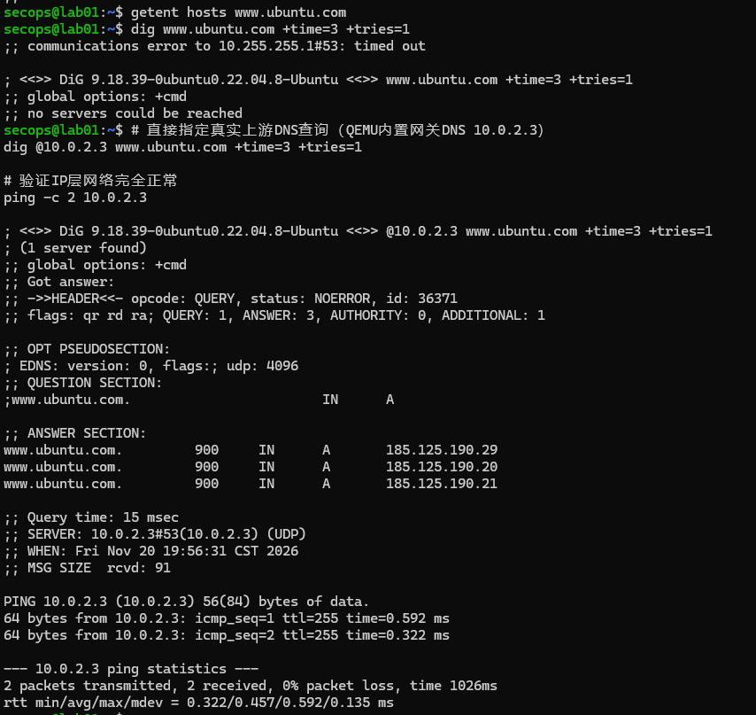
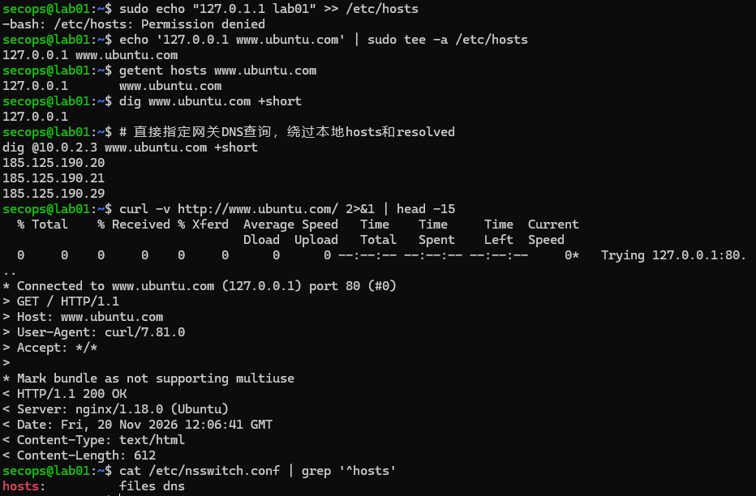

# Linux 网络协议类故障排查笔记

> 本文覆盖「DNS 解析失败」「hosts 写错」「防火墙误拦」「证书过期」四类故障，分别落在 **DNS / TCP / TLS / HTTP** 四层，环境为 Ubuntu 22.04.5 LTS（lab01）+ Kali（attacker）双机。核心方法论：**先用 `curl -v` 的断点定层，再进层内取证** —— 四层里任何一层没通，都不要去看上一层的配置。本册最值钱的一条结论：**Ubuntu 上默认的 `dig` 并不等于「纯 DNS 视角」**，它问的是 `systemd-resolved` 存根，存根会把 `/etc/hosts` 一起合并返回，所以「dig 正常」这句话本身要打问号。

**快速导航**：[四层决策树](#21-网络四层决策树核心判定表) · [curl -v 断点对照](#22-curl--v-的断点就是层的边界) · [dig 与 getent 的差别](#23-dig-与-getent-走的不是同一条路) · [tcpdump 判据](#25-tcpdump-怎么区分被拦与没开) · [误判与踩坑复盘](#4-误判与踩坑复盘) · [常用命令速查表](#5-常用命令速查表)

---

## 1. 实验环境与基线状态

| 项目 | 值 |
|---|---|
| 排障主机 | lab01 / Ubuntu 22.04.5 LTS / **192.168.56.12** |
| 客户端 | attacker / Kali Linux / **192.168.56.100** |
| 虚拟化平台 | QEMU（`lab-qemu.ps1` 管理，qcow2 快照） |
| 网卡 | `ens3`（NAT，DNS 走 10.0.2.3）、`ens4`（host-only，承载 192.168.56.12） |
| 接入方式 | 宿主机转发 2241 → lab01:22，**未转发 80**，所以 Web 客户端只能用 attacker |
| Web 服务 | nginx 1.18.0 (Ubuntu) |
| 磁盘 / 内存规格 | 本次未采集 |
| 关键工具 | `getent`、`dig`、`resolvectl`、`nslookup`、`nc`、`tcpdump`、`openssl`、`iptables`、`chrony` |

| 基线项 | 实测值 |
|---|---|
| `/etc/resolv.conf` | 符号链接 → `../run/systemd/resolve/stub-resolv.conf`，`resolv.conf mode: stub` |
| DNS 上游 | `Link 2 (ens3)` → `10.0.2.3`；`Link 3 (ens4)` → `Current Scopes: none`（未配 DNS） |
| `nsswitch.conf` | `hosts: files dns`（files 优先） |
| Web 基线 | `HTTP/1.1 200 OK`，`Content-Length: 612`，`ETag: "6afaeb7a-264"` |
| iptables | `policy ACCEPT`，`0 packets, 0 bytes`，无任何自定义规则 |
| 时间同步 | chrony，`set-ntp true` |

**这一册的基线有三层结构必须先看懂**，否则 3.1 节的注入手法讲不通：

```
应用程序 → nsswitch(files→dns) → /etc/hosts
                              → 127.0.0.53:53 (systemd-resolved 存根)
                                     → 上游 10.0.2.3
```

`/etc/resolv.conf` 只是一个指向存根的符号链接，真正的上游由 `resolvectl` 管理。所以「改 DNS」有两条路：改 `resolvectl`（换存根往哪转发）或换掉 `/etc/resolv.conf`（把存根从链路上摘掉）。本册实际用的是后者——故障现象更干净，代价是必须先备份那条符号链接本身。


*`ls -l` 是符号链接、`resolvectl status` 是上游——这两条命令合起来才是完整的解析链，只看其中一条都会漏掉一半。*

---

## 2. 核心底层原理

### 2.1 网络四层决策树（核心判定表）

「网站打不开」这句话信息量为零。分层的意义是把它变成有坐标的问题：**先确认域名能不能变成 IP，再确认端口通不通，再确认 TLS 能不能握手，最后才是 HTTP 返回了什么**。顺序不能反——DNS 没通就去看 nginx 配置，等于在查一个不存在的错误。

| 层 | 要回答的问题 | 判定命令 | 结论形态 | 本册故障 |
|---|---|---|---|---|
| ① DNS | 域名能不能变成 IP | `getent hosts <域名>`；`dig <域名>`；`dig @<上游> <域名>` | 解析成功 / 失败 / 解析到错的 IP | ⑧ ⑨ |
| ② TCP | 这个 IP 的端口通不通 | `nc -zv <ip> <port>`；`ss -lntp` | succeeded / refused / timeout | ⑩ |
| ③ TLS | 证书能不能验证 | `curl -v`；`openssl s_client` | unknown CA / expired / 握手失败 | ⑪ |
| ④ HTTP | 应用返回了什么 | `curl -I`；`nginx error.log` | 200 / 403 / 500 / 502 | （分册二） |

**每层的「终止条件」**：DNS 拿到正确 IP 才能进 TCP；TCP `succeeded` 才能进 TLS；TLS `verify return code 0` 才能进 HTTP；拿到状态码就到最底层，再按 4xx/5xx 分应用侧问题。任何一层不满足，**往下的命令全部不用敲**。

### 2.2 `curl -v` 的断点就是层的边界

一条命令看穿四层，关键在于它会「断在哪一行」。学会读断点，就不用一层层试命令。

| 输出里断在哪 | 卡在哪一层 | 常见原因 |
|---|---|---|
| `Could not resolve host` | ① DNS | 解析器不可用、域名错、hosts 覆盖 |
| `Failed to connect ... Connection refused` | ② TCP | 端口没监听，或被 `REJECT` |
| `Connection timed out` | ② TCP | 包被 `DROP`（防火墙 / 路由 / 安全组） |
| `No route to host` | ② TCP / 链路 | 路由不可达、ARP 失败 |
| `SSL certificate problem: certificate has expired` | ③ TLS | 证书过期，或系统时间错 |
| `SSL: no alternative certificate subject name matches` | ③ TLS | 证书域名不匹配（SNI） |
| `Empty reply from server` | ③/④ 边界 | 把 HTTPS 当 HTTP 访问，或服务崩了 |
| `HTTP/1.1 502 Bad Gateway` | ④ HTTP | 反代连不上后端 |

这张表的价值在于：**它是「一条命令换一张地图」，而不是「一个命令查一个问题」**。真正的排障顺序是先跑 `curl -v` 看断点，再决定去哪一层深挖，而不是把四层的命令挨个敲一遍。

### 2.3 `dig` 与 `getent` 走的不是同一条路

这是本册最值钱、也最容易讲错的一条。

| 命令 | 问谁 | 经过 nsswitch | 读 `/etc/hosts` | 代表谁的视角 |
|---|---|---|---|---|
| `getent hosts` | 按 nsswitch 顺序（files → dns） | **经过** | **会** | **应用程序** |
| `dig <域名>`（默认） | `127.0.0.53` 的 systemd-resolved 存根 | 不经过，但存根内部合并 hosts | **会（实测）** | 解析器存根 |
| `dig @<上游> <域名>` | 直连真实 DNS 服务器 | 不经过 | 不会 | **纯 DNS** |

教科书说「`dig` 不看 hosts」，**在 Ubuntu 22.04 上这句话只对一半**。默认的 `dig` 把查询发给 `127.0.0.53`，而 resolved 在处理时会把自己读到的 `/etc/hosts` 条目一并返回。本册实测：写完 hosts 之后 `dig www.ubuntu.com +short` 同样返回 `127.0.0.1`，与 `getent` 完全一致。真正能绕开本地数据源的只有 `dig @10.0.2.3`——指定上游、不经过存根。

由此得出两条固定用法，不要混：

- **要复现应用行为** → `getent hosts <域名>`
- **要证明「DNS 世界里这条记录是什么」** → `dig @<上游> <域名>`，**不能用默认 `dig`**

### 2.4 `ss` 的两个队列：Recv-Q 与 Send-Q

| 状态 | Recv-Q 含义 | Send-Q 含义 | 不为 0 说明什么 |
|---|---|---|---|
| `LISTEN` | 已完成三次握手、等待应用 `accept()` 的连接数 | 监听队列最大长度（backlog） | Recv-Q 持续 > 0：应用 `accept` 太慢或卡死，新连接会被内核丢弃 |
| `ESTABLISHED` | 已收到但应用还没读的字节数 | 已发送但对方还没确认的字节数 | Recv-Q 大：应用处理不过来；Send-Q 大：对方不收（网络或对端问题） |
| `CLOSE_WAIT` | —— | —— | **这是 bug**：应用没 `close()`，不是配置问题 |
| `TIME_WAIT` | —— | —— | 正常现象，主动关闭方保留 2MSL |

`LISTEN` 态的 `Send-Q` 就是 backlog，这一点在分册二已经用过（nginx 511 vs python3 5）。本册多一条：**`LISTEN` 态 `Recv-Q` 才是「应用有没有在取连接」的指标**，它比看 CPU 更直接。

### 2.5 `tcpdump` 怎么区分「被拦」和「没开」

| 抓到什么 | 说明 | 结论 |
|---|---|---|
| 只有 `SYN`，无 `SYN-ACK`/`RST` | 包到了本机，但被 `DROP` 规则丢弃 | **防火墙问题** |
| `SYN` 到达后立刻回 `RST` | 没有进程监听该端口 | **服务没起** |
| `SYN` 与 `SYN-ACK` 都有 | 三次握手完成 | 网络层没问题，往应用层查 |
| 连 `SYN` 都没抓到 | 包在到达本机前就丢了 | 路由 / 上游安全组 |

单看客户端是不够的：`refused` 与 `timeout` 只能告诉你「有没有回应」，**只有抓包能告诉你「回应发生在哪一段消失」**。本册 3.3 节就是靠「5 个 SYN、0 个 SYN-ACK」定死根因。

### 2.6 控制变量法：`:443` 上叠加的两个错误

自签证书 + 证书过期，是两个独立错误。不加处理地 `curl https://...`，客户端会先在「自签不受信」那一关失败，**永远走不到「过期」检查**——两个错误叠在一起，很容易以为是一个问题。

```bash
curl -v --cacert /etc/nginx/ssl/lab.crt https://127.0.0.1/
```

`--cacert` 把这张自签证书临时当成受信 CA，**自签这一层被消除，剩下的就只有 expired**。这不是 curl 的技巧，是排障的通用手法：**一次只留一个变量，才能确定是哪一个在报错**。同理，`openssl s_client | openssl x509 -dates` 是把证书从 HTTP 里剥离出来单独看，不受浏览器缓存、HSTS、SNI 影响。

---

## 3. 分故障实操记录

### 3.1 ⑧ DNS 解析失败

#### 复现方法

```bash
# 1. 备份原来的符号链接（-a 保留链接本身，不是复制内容）
sudo cp -a /etc/resolv.conf /etc/resolv.conf.bak
# 2. 删掉符号链接，写一个静态文件指向不可达地址
sudo rm /etc/resolv.conf
echo "nameserver 10.255.255.1" | sudo tee /etc/resolv.conf
```

注入手法与常见模板不同，是实测后改的。`resolvectl dns` 改的是 resolved 的 **per-link 运行时配置**，存根还在，查询仍走 `127.0.0.53` 再由 resolved 转发，故障多绕一层；把 `/etc/resolv.conf` 换成静态文件，等于**把存根从链路上摘掉**，任何程序（包括 `dig`）都会直接撞上不可达的上游，现象更干净。

**注入成功的第一个信号不是 `dig`，是 `sudo` 自己**：

```
sudo: unable to resolve host lab01: Temporary failure in name resolution
nameserver 10.255.255.1
```

`sudo` 解析自己的主机名也要走 DNS，DNS 一坏它第一个中招。这个连带现象比任何验证命令都先到。


*注意 `cp -a` 而不是 `cp`——恢复时要还原的是「符号链接」这个对象，不是它指向的内容。*

#### 故障现象

```bash
dig www.ubuntu.com +time=3 +tries=1
```

```
;; communications error to 10.255.255.1#53: timed out

; <<>> DiG 9.18.39-0ubuntu0.22.04.8-Ubuntu <<>> www.ubuntu.com +time=3 +tries=1
;; global options: +cmd
;; no servers could be reached
```

注意报错里点名的是 **`10.255.255.1#53`**，而不是 `127.0.0.53`——这直接证明存根已经不在链路上，查询被发到了静态文件里写死的地址。**报错里出现的 IP，就是「当前实际在用哪个上游」的最直接证据。**

#### 排查流程

| # | 命令 | 这一步在排除什么 | 实测输出 |
|---|---|---|---|
| 1 | `getent hosts www.ubuntu.com` | 应用视角能不能解析 | **无输出**，静默失败（`echo $?` 才是 `2`） |
| 2 | `dig www.ubuntu.com +time=3 +tries=1` | 解析器视角能不能通 | `communications error to 10.255.255.1#53: timed out` / `no servers could be reached` |
| 3 | `dig @10.0.2.3 www.ubuntu.com` | **换一个 DNS 对照**：网络本身通不通 | 正常返回 A 记录 |
| 4 | `ping -c 2 10.0.2.3` | IP 层与路由 | 0% 丢包 |

第 3 步是全篇最关键的一步：**一条对照命令把排查范围砍掉一半**。如果第 3 步也失败，问题在链路（往 ⑩ 走）；第 3 步成功，问题就锁定在本机 DNS 配置。**不做对照就下结论，等于把「本机配置错」误判成「网络断了」**——这正是 5.3 节第 2 条误判的来源。

`getent` 的静默失败值得单独记一笔：它失败时不打印任何东西，退出码才是 `2`。所以脚本里判断它必须看 `$?`，不能看输出是否为空——输出为空也可能是「域名不存在」之外的其他原因。



*同一台机器、同一秒，换个 DNS 服务器就通了。这一屏就是「本机配置坏」与「网络坏」的分界线。*

#### 根因结论

`/etc/resolv.conf` 被换成静态文件，指向不可达的 `10.255.255.1`，存根被摘掉，所有解析请求直接超时。

#### 修复方案

```bash
sudo rm /etc/resolv.conf
sudo mv /etc/resolv.conf.bak /etc/resolv.conf
sudo resolvectl flush-caches
getent hosts www.ubuntu.com        # 应返回三条 A 记录
```

必须先 `rm` 再 `mv`——如果直接 `mv` 覆盖，会得到一个「普通文件覆盖在符号链接上」的畸形状态，`systemd-resolved` 不会重新接管。

**错误做法**：不备份就 `rm`，恢复时只能手写一个静态 `nameserver`，从此这台机器的 DNS 再也不受 `resolvectl` 管理，下次换网络必然再炸一次。

恢复后 `sudo` 还会短暂报 `unable to resolve host lab01`，**这不是没恢复好**：`/etc/hosts` 里没有 `lab01` 这一条，`sudo` 解析自己的主机名仍要走 DNS。`getent` 能返回正常结果就说明解析已通。要彻底消掉这个提示，往 `/etc/hosts` 补一行 `127.0.0.1 lab01`——注意追加方式，`sudo echo ... >>` 会失败，原因见 3.2。

#### 预防措施

- **监控**：`dig +short <关键域名> +time=2`，连续 3 次失败告警。
- **配置加固**：至少配两个上游，且不要指向不可达网段；`resolvectl status` 要能看到每个网卡的实际上游，而不是只有 `127.0.0.53`。
- **自动化**：把 `/etc/resolv.conf` 是符号链接这件事纳入巡检；一旦发现它变成普通文件，说明有人手工改过。

---

### 3.2 ⑨ hosts 写错：`dig` 正常，应用却打到本机

#### 复现方法

```bash
echo '127.0.0.1 www.ubuntu.com' | sudo tee -a /etc/hosts
getent hosts www.ubuntu.com     # 返回 127.0.0.1
dig www.ubuntu.com +short       # 实测：也返回 127.0.0.1
```

**先记一个必踩的坑**：很多人第一反应是

```bash
sudo echo "127.0.0.1 lab01" >> /etc/hosts
# -bash: /etc/hosts: Permission denied
```

失败原因是**重定向由当前 shell 执行，`sudo` 只提权了 `echo`**——`>>` 在 `sudo` 生效之前就已经以普通用户身份打开了文件。正确写法是把整个写入动作交给提权后的进程：

```bash
echo '127.0.0.1 www.ubuntu.com' | sudo tee -a /etc/hosts
```

#### 故障现象

```bash
curl -v http://www.ubuntu.com/ 2>&1 | head -15
```

```
* Connected to www.ubuntu.com (127.0.0.1) port 80 (#0)
> GET / HTTP/1.1
> Host: www.ubuntu.com
< HTTP/1.1 200 OK
< Server: nginx/1.18.0 (Ubuntu)
< Date: Fri, 20 Nov 2026 12:06:41 GMT
< Content-Length: 612
```

**最迷惑的地方**：请求「成功」了，`200 OK`，一切正常。只有注意到 `Connected to www.ubuntu.com (127.0.0.1)` 里的 IP 是本机回环，才知道自己访问的是本地 nginx，而不是真的 ubuntu.com。

#### 排查流程

| # | 命令 | 这一步在排除什么 | 实测输出 |
|---|---|---|---|
| 1 | `getent hosts www.ubuntu.com` | 应用会解析到哪 | `127.0.0.1  www.ubuntu.com` |
| 2 | `dig www.ubuntu.com +short` | 「DNS 是不是也这么说」 | **同样是 `127.0.0.1`** —— 存根合并了 hosts |
| 3 | `dig @10.0.2.3 www.ubuntu.com +short` | 纯 DNS 的答案 | `185.125.190.20` / `.21` / `.29` |
| 4 | `curl -v` | 现象落地 | `Connected to www.ubuntu.com (127.0.0.1) port 80`，`200` |
| 5 | `cat /etc/nsswitch.conf \| grep '^hosts'` | 为什么 files 优先 | `hosts: files dns` |

第 2 步是整册的分水岭。**如果只跑第 2 步，你会得到「dig 也是 127.0.0.1，说明 DNS 记录被改了」的错误结论**——实际 DNS 记录完好，是本地 hosts 污染了存根。必须跑第 3 步指定上游，才能看到真正的 A 记录。



*一张图三种视角。左边两条是「被污染的答案」，右边一条才是「DNS 世界的真相」。面试里能说清这一屏，比背 50 条命令有说服力。*

#### 根因结论

`/etc/hosts` 被追加 `127.0.0.1 www.ubuntu.com`，而 `nsswitch.conf` 里 `files` 排在 `dns` 之前，应用（以及 resolved 存根）都优先采用 hosts 条目。

#### 修复方案

```bash
sudo sed -i '\|127.0.0.1 www.ubuntu.com|d' /etc/hosts
getent hosts www.ubuntu.com
```

用 `\|...|d` 而不是 `/.../d`，因为要匹配的字符串里含 `/`（`www.ubuntu.com/` 这类写法很常见）。这是 `sed` 的通用习惯：**匹配串里有分隔符就换分隔符，不要转义**。

**错误做法**：看到 `dig` 也返回 `127.0.0.1` 就去查 DNS 服务器、甚至怀疑上游被投毒。方向一错，后面全白做——真正的脏数据在本地文件里。

#### 预防措施

- **监控**：`sha256sum /etc/hosts` 入库比对，内容变化即告警（这是最快的 hosts 篡改检测）。
- **配置加固**：`/etc/hosts` 只保留必要条目；`nsswitch.conf` 的 `hosts:` 行纳入基线，改动需审批。
- **自动化**：CI / 巡检脚本里对比 `getent hosts <域名>` 与 `dig @<上游> <域名>` 的结果，两者不一致就报警——这条比单看任何一个都有效。

---

### 3.3 ⑩ 防火墙误拦：外部 timeout，本机 200

#### 复现方法

先确认基线（**attacker 上执行**）：

```bash
curl -I http://192.168.56.12/        # 期望 200
nc -zv 192.168.56.12 80
```

再注入（**lab01 上执行**）：

```bash
sudo iptables -I INPUT 1 -i ens4 -p tcp --dport 80 -j DROP
sudo iptables -vnL INPUT --line-numbers | head -5
```

网卡是 `ens4`（承载 192.168.56.12 的 host-only 网卡），不是 `ens3`。**`-i` 指定错网卡，规则写了等于没写**，而且 `ss` 和 `curl` 都看不出异常。

#### 故障现象

客户端侧：

```
curl: (28) Connection timed out after 5001 milliseconds
nc: connect to 192.168.56.12 port 80 (tcp) timed out: Operation now in progress
```

**`timeout` 而不是 `refused`**——这是 `DROP` 与「端口没开」的分界线。`refused` 说明对方回了 RST（包到了、端口没人听）；`timeout` 说明包被静默丢弃（连拒绝都没有）。

#### 排查流程

| # | 侧 | 命令 | 这一步在排除什么 | 实测输出 |
|---|---|---|---|---|
| 1 | attacker | `curl -I http://192.168.56.12/` | 从外部能不能通 | `Connection timed out after 5001 ms` |
| 2 | attacker | `nc -zv -w 3 192.168.56.12 80` | 是 `refused` 还是 `timeout` | `timed out` → 包被丢，不是端口没开 |
| 3 | lab01 | `curl -I http://127.0.0.1/` | 服务本身是否正常 | **`200 OK`** → 服务没问题，是路径被拦 |
| 4 | lab01 | `sudo iptables -vnL INPUT --line-numbers` | 规则有没有命中 | 第 1 条 `DROP tcp -- ens4 tcp dpt:80`，**`pkts 8, bytes 480`** |
| 5 | lab01 | `sudo tcpdump -i ens4 -nn 'tcp port 80' -c 5` | 包走到哪一步消失 | **5 个包全是 `Flags [S]`**，无一个 SYN-ACK |

第 3 步是「本机 200 / 外部 timeout」这个反差的核心：**服务的健康状态与网络的连通状态是两个独立变量**。本机 `127.0.0.1` 走 `lo`，不受 `-i ens4` 影响，所以它 200 只能证明 nginx 活着，不能证明外部能访问。

第 4 步的 `pkts 8 / bytes 480` 是防火墙类故障的唯一硬证据：**规则存在 ≠ 规则命中**。`480 ÷ 8 = 60`，正好是一个 SYN 包的字节数——计数增长与「客户端重试了几次」严格对应。

第 5 步把「丢弃」和「拒绝」彻底分开：`DROP` 下只有 `SYN` 进来、没有 `SYN-ACK` 出去；若是 `REJECT`，抓包会看到本机回的 `RST`。

![⑩ 决定性证据实拍：本机 curl 200；iptables 第 1 条 8 pkts/480 B；tcpdump 5 个包全是 Flags [S]，源 192.168.56.100](../images/04-iptables-syn-only.png)

*三行证据指向同一个结论：包到了、服务活着、但没有一个包回去。这一屏能同时否掉「服务挂了」和「网络断了」两种猜测。*

#### 根因结论

`iptables INPUT` 链第 1 条 `DROP` 丢弃了 `ens4` 上所有目标 80 的 TCP 包，`SYN` 到不了 nginx，客户端只能等到超时。

#### 修复方案

```bash
sudo iptables -D INPUT 1
sudo iptables -S | head
# attacker 侧再 curl 一次，恢复 200
```

**关于 `DROP` 与 `REJECT`**：同样叫「防火墙拦」，客户端表现完全相反。`DROP` 静默丢弃 → 客户端一直等到超时（`curl: (28)`）；`REJECT` 回 RST 或 ICMP port-unreachable → 客户端立刻 `refused`。区别就在「有没有回应」。安全上常用 `DROP`（不暴露端口是否存在），**排障时 `REJECT` 更好定位**——它让「被拦」和「端口没开」在客户端就分开了。

**错误做法**：看到 `timeout` 就去 `systemctl restart nginx`。服务一直是好的，重启只会让问题多一层。

#### 预防措施

- **监控**：`nc -zv <ip> <port>` 从**外部节点**拨测，而不是本机自检——本机永远自检通过。
- **配置加固**：`iptables -S` 纳入基线，规则变更走审批；规则加 `-m comment --comment "..."` 便于事后定位。
- **自动化**：变更脚本自带 `trap` 回滚，避免 `-D INPUT 1` 按序号删的幂等问题（分册三已踩过这个坑）。

---

### 3.4 ⑪ 证书过期：两个错误叠在一起

#### 复现方法

```bash
sudo mkdir -p /etc/nginx/ssl
sudo openssl req -x509 -newkey rsa:2048 -nodes -days 1 \
  -keyout /etc/nginx/ssl/lab.key -out /etc/nginx/ssl/lab.crt \
  -subj "/CN=127.0.0.1"

sudo tee /etc/nginx/sites-enabled/lab-ssl > /dev/null <<'EOF'
server {
    listen 443 ssl;
    server_name 127.0.0.1;
    ssl_certificate     /etc/nginx/ssl/lab.crt;
    ssl_certificate_key /etc/nginx/ssl/lab.key;
    root /var/www/html;
}
EOF
sudo nginx -t && sudo systemctl reload nginx
```

第一层现象：自签证书 → `SSL certificate verify result: self-signed certificate (18), continuing anyway`。**这是「信任链缺失」，不是过期**——记住这个区别，下一步要拿它做对照。


*`(18)` 是 `X509_V_ERR_DEPTH_ZERO_SELF_SIGNED_CERT`。证书本身完全有效，只是没人给它背书。*

#### 故障现象

```bash
echo | openssl s_client -connect 127.0.0.1:443 2>/dev/null | openssl x509 -noout -dates
echo | openssl s_client -connect 127.0.0.1:443 2>/dev/null | openssl x509 -noout -subject
```

```
notBefore=Nov 20 12:49:54 2026 GMT
notAfter=Nov 21 12:49:54 2026 GMT
subject=CN = 127.0.0.1
```

只有 1 天有效期。把系统时间推过去：

```bash
sudo timedatectl set-ntp false
sudo date -s '+3 days'
date        # Mon Nov 23 08:53:17 PM CST 2026
```

#### 排查流程

| # | 命令 | 这一步在排除什么 | 实测输出 |
|---|---|---|---|
| 1 | `curl -vk https://127.0.0.1/` | 客户端怎么报 | `self-signed certificate (18), continuing anyway` → 自签，不是过期 |
| 2 | `s_client \| x509 -noout -dates` | 证书到底什么时候到期 | `notBefore=Nov 20 12:49:54` / `notAfter=Nov 21 12:49:54` |
| 3 | `s_client \| x509 -noout -subject` | 证书签给谁 | `subject=CN = 127.0.0.1` |
| 4 | `date -s '+3 days'` 后再 `curl` | 时间越过 `notAfter` 会怎样 | `certificate expired (557)` / `curl: (60)` |
| 5 | 加 `--cacert lab.crt` | 消掉自签变量，只留过期 | 报错收敛为唯一一条 `certificate has expired` |

第 2 步是这一节的技术核心：**把证书从 HTTP 里剥离出来单独看**。不依赖浏览器、不依赖 curl 的信任库，`s_client` 只做一件事——把服务端证书取回来，`x509` 只做一件事——打印字段。这个组合在任何环境都能用，包括没有图形界面的服务器。

**`-days` 无法直接生成「已过期」的证书**，因为「过期」的本质是 `当前时间 > notAfter`，不是一个可以签出来的属性。所以复现过期的唯一办法是把时间推过去——这同时也演示了「时间漂移为什么会引发证书错误」。

#### 根因结论

证书只签了 1 天，系统时间被推后 3 天（`Nov 20 → Nov 23`），越过 `notAfter=Nov 21 12:49:54 GMT`，TLS 握手阶段直接拒绝。

#### 修复方案

```bash
# 时间复位
sudo timedatectl set-ntp true
sudo systemctl restart chrony
timedatectl | grep -i synchronized

# 收尾清理
sudo rm -f /etc/nginx/sites-enabled/lab-ssl
sudo nginx -t && sudo systemctl reload nginx
sudo rm -rf /etc/nginx/ssl
```

**错误做法一**：不加 `--cacert` 就断言「证书过期了」。实际客户端先报的是 `self-signed certificate (18)`，`expired` 根本没机会出现——两个错误叠在一起，结论就是错的。

**错误做法二**：改完时间不复位。`set-ntp false` 之后如果只 `date -s` 不恢复，这台机器的时间会一直漂着，后面所有依赖时间的服务（证书、Kerberos、日志、cron）全部连带出问题。**`timedatectl | grep -i synchronized` 显示 `yes` 才算收工。**

#### 预防措施

- **监控**：`openssl x509 -enddate -noout -in <crt>` 解析剩余天数，`< 30 天`告警；这是唯一能在故障发生前拦住它的手段。
- **配置加固**：证书自动续签（certbot / acme.sh）+ reload 钩子；`date` 与 `chronyc tracking` 纳入巡检，`offset > 100 ms` 告警。
- **自动化**：把「证书剩余天数」和「系统时间偏差」放进同一个看板——它们经常一起出问题，本册 ⑪ 就是人为把两者拉到一起。

---

## 4. 误判与踩坑复盘

| # | 最初误判 | 实际原因 | 为什么误判 | 后续规避 |
|---|---|---|---|---|
| 1 | `dig` 返回正常，说明 DNS 没问题 | 默认 `dig` 问的是 `127.0.0.53` 存根，存根把 hosts 条目一起返回 | 把 `dig` 当成纯 DNS 查询，不知道 Ubuntu 的 `dig` 走 systemd-resolved | 纯 DNS 只看 `dig @<上游>`；应用行为只信 `getent` |
| 2 | 解析失败就是网络断了 | `dig @10.0.2.3` 立刻返回 3 条 A 记录，`ping` 0% 丢包 | 没做「换服务器对照」就下结论 | 解析失败先换一个 DNS 对照，一条命令砍掉一半范围 |
| 3 | `timeout` 就是「端口没开」 | `timeout` = 包被丢；`refused` = 端口没人听 | 把两种完全不同的网络事实混成一类 | 先看客户端「快还是慢」，再看 `nc` 报的是哪个词 |
| 4 | 本机 `curl 127.0.0.1` 通，说明服务对外可用 | 走 `lo`，与 `ens4` 无关 | 用「本机自检」代替「外部拨测」 | 连通性问题必须从对端验证，本机 200 只能证明进程活着 |
| 5 | `iptables -vnL` 里规则在第一条，肯定生效了 | 规则存在 ≠ 命中，要看 `pkts` 是否增长 | 把「配置」当成「行为」 | 让客户端再连一次，看 `pkts`/`bytes` 增量；`480/8=60` 正好一个 SYN |
| 6 | DROP 和 REJECT 都是「拦」，客户端表现一样 | DROP 超时、REJECT refused | 只关心「拦没拦住」，没关心「有没有回应」 | 记住：`refused` 排除网络层，`timeout` 才指向丢弃 |
| 7 | 自签证书报错就是证书过期 | 报的是 `self-signed certificate (18)`，`expired` 还没出现 | 两个错误叠在一起，只读了第一行 | 加 `--cacert` 消掉自签变量，再看剩下的是什么 |
| 8 | `openssl req -days 0` 能造出过期证书 | `-days` 只能往后签，「过期」是时间与 `notAfter` 的关系 | 把「证书属性」当成「可构造的负数」 | 要复现过期只能推系统时间；这也是时间漂移的复现手法 |
| 9 | `sudo echo "..." >> /etc/hosts` 能提权写入 | 重定向由当前 shell 执行，`sudo` 只提权了 `echo` | 以为 `sudo` 作用于整条命令行 | 用 `\| sudo tee -a`；这是 shell 语义问题，不是权限问题 |
| 10 | 改完 `/etc/resolv.conf` 直接 `mv` 回去就行 | 直接 `mv` 覆盖会得到「普通文件压在符号链接上」的畸形状态 | 没意识到要还原的是「链接对象」而不是「文件内容」 | 恢复顺序固定 `rm` → `mv`；备份用 `cp -a` |
| 11 | 恢复 DNS 后 `sudo` 还报警，说明没修好 | `/etc/hosts` 没有 `lab01`，`sudo` 解析主机名仍走 DNS | 把「残留告警」当成「故障未清除」 | 以 `getent hosts` 的结果为准；要消警就在 hosts 补 `127.0.0.1 lab01` |
| 12 | 状态码不用细看，反正都是「打不开」 | 502 指向后端不可用，403 指向权限，200 但 IP 不对指向 hosts —— 每个状态码都是下一层的入口 | 习惯直接翻应用配置，跳过「先看返回了什么」 | 先 `curl -v` 看断点与状态码，再决定进哪一层 |

---

## 5. 常用命令速查表

| 场景 | 命令 | 关键看什么 |
|---|---|---|
| 解析（应用视角） | `getent hosts <域名>` | `nsswitch` 顺序的结果；失败时看 `$?`（`2`） |
| 解析（存根视角） | `dig <域名> +short` | **会被 hosts 污染**，不能当纯 DNS 证据 |
| 解析（纯 DNS） | `dig @<上游> <域名> +short` | 真正的 A 记录 |
| 解析配置 | `ls -l /etc/resolv.conf`；`resolvectl status` | 是不是符号链接；每个网卡的上游 |
| 清解析缓存 | `sudo resolvectl flush-caches` | 改完 DNS 后必须做 |
| 端口连通 | `nc -zv -w 3 <ip> <port>` | `succeeded` / `refused` / `timed out` |
| 全链路 | `curl -v <url>` | 断在 DNS / TCP / TLS / HTTP 哪一段 |
| 抓包 | `sudo tcpdump -i <iface> -nn 'tcp port <p>' -c 20` | 有 `SYN` 无 `SYN-ACK` = DROP；有 `RST` = 端口没开 |
| 防火墙计数 | `sudo iptables -vnL INPUT --line-numbers` | `pkts` 是否随客户端重试增长 |
| 路由出口 | `ip route get <ip>` | 从哪个网卡、哪个源地址出去 |
| 监听队列 | `ss -lntp` | `LISTEN` 态 `Recv-Q` 是否持续 > 0 |
| 证书有效期 | `echo \| openssl s_client -connect <h>:443 2>/dev/null \| openssl x509 -noout -dates` | `notBefore` / `notAfter` |
| 证书主体 | 同上 `-subject` | `CN` 与访问域名是否一致 |
| 证书受信链 | `curl -v --cacert <crt> <url>` | 消掉自签变量后剩下的那个错误 |
| 时间同步 | `timedatectl`；`chronyc tracking` | `synchronized: yes`、`offset` |
| hosts 变更 | `sha256sum /etc/hosts` | 与基线比对 |
| 提权写文件 | `echo '...' \| sudo tee -a <file>` | 不要用 `sudo echo ... >>` |

---

## 6. 思考题解答

### Q1 `dig` 正常但应用解析到错误 IP，原因是什么？哪条命令能复现应用的行为？

```bash
getent hosts www.ubuntu.com          # 应用走 nsswitch：files → dns
dig www.ubuntu.com +short            # 实测也是 127.0.0.1（存根合并 hosts）
dig @10.0.2.3 www.ubuntu.com +short  # 185.125.190.20/.21/.29
```

**结论**：应用走 `nsswitch`，`files` 排在 `dns` 前，先读 `/etc/hosts`，所以拿到 `127.0.0.1`。复现应用行为用 `getent hosts`。但要注意：Ubuntu 22.04 默认的 `dig` 也走 `127.0.0.53` 存根，存根同样合并 hosts，所以「dig 正常」本身要打问号——要拿纯 DNS 答案必须 `dig @<上游>`。

### Q2 `tcpdump` 只看到 SYN 没有 SYN-ACK，有哪几种可能？

| 可能 | 判定 |
|---|---|
| ① 防火墙 `DROP`（最常见） | `iptables -vnL INPUT` 的 `pkts` 随 SYN 增长 |
| ② 回程路由不通 | `ip route get <客户端IP>`，看 SYN-ACK 从哪个网卡出去 |
| ③ 目标内核丢包（conntrack 满、SYN 队列溢出、syncookies） | `dmesg`、`ss -s`、`netstat -s \| grep -i listen` |
| ④ 中间设备单向丢弃（安全组 / IPS） | 两端同时抓包，看 SYN-ACK 在哪一段消失 |
| ⑤ 服务监听在别的地址/端口 | `ss -lntp` 看 `Local Address:Port` 是否匹配 |

**区分顺序**：先 `curl 127.0.0.1` 确认服务活着 → 再 `iptables -vnL` 看 DROP 计数 → 最后两端同时抓包定位消失点。

### Q3 `DROP` 与 `REJECT` 在客户端表现有何不同？为什么？

| 规则 | 客户端 | 原因 |
|---|---|---|
| `DROP` | 一直等到超时（`curl: (28)`、`nc: timed out`） | 包被静默丢弃，没有任何回应 |
| `REJECT` | 立刻 `refused` | 回 RST 或 ICMP port-unreachable |

**结论**：区别就在「有没有回应」。安全上常用 `DROP`（不暴露端口是否存在），**排障时 `REJECT` 更好定位**——它让「被拦」和「端口没开」在客户端就分开，不用上服务器抓包。

### Q4 系统时间比真实时间慢 3 天，会导致哪些服务异常？

```bash
timedatectl | grep -i synchronized
chronyc tracking
```

**结论**：① TLS 证书校验失败（未到 `notBefore` 报 `not yet valid`，过了 `notAfter` 报 `expired`）；② Kerberos 票据失效（默认允许偏差 5 分钟）；③ 日志时间错乱，审计与取证失去意义；④ `cron`/`at` 错点执行或漏跑；⑤ 集群心跳与数据库主从判定异常；⑥ 监控时间轴错位。本册 ⑪ 就是靠「把时间推到证书之后」复现过期的——反过来看，**任何「证书突然报过期」的工单，第一条命令都应该是 `date`**。

### Q5 `ss` 里 `LISTEN` 状态 `Recv-Q` 持续大于 0 说明什么？

```bash
ss -lntp
ss -s
```

**结论**：说明三次握手已完成、连接排在 `accept` 队列里没被应用取走。常见原因：应用卡死或死锁、`accept` 循环被慢操作阻塞、backlog 太小、worker 数不够。处理：对比 `Recv-Q` 与 `Send-Q`（后者是 backlog 上限），看应用日志与 CPU，必要时重启或加 worker。**持续增长会导致新连接被内核直接丢弃**，此时客户端表现是「连不上但服务看着是 running」——这是最容易误判成网络问题的一种应用层故障。

---

## 7. 总结与方法论沉淀

### 核心排障原则

1. **先定层，再定因。** `curl -v` 的断点就是层的边界；四层里任何一层没通，都不要去看上一层的配置。
2. **「打不开」不是症状，是待分解的问题。** DNS / TCP / TLS / HTTP 四层各有各的判定命令，混在一起查必然绕远。
3. **`refused` 与 `timeout` 是两种物理事实。** 前者 = 收到 RST（端口没人听），后者 = 包被静默丢弃（防火墙/路由）。方向相反，不可互换。
4. **本机 200 不等于对外可用。** `127.0.0.1` 走 `lo`，绕过所有外部路径；连通性必须从对端验证。
5. **规则存在 ≠ 规则命中。** 防火墙问题只认 `pkts` 增量，不认「我看规则写对了」。
6. **`dig` 默认不是纯 DNS。** Ubuntu 上它问 `127.0.0.53` 存根，存根会合并 `/etc/hosts`；要纯 DNS 答案必须 `dig @<上游>`。
7. **应用行为只信 `getent`。** 它走 `nsswitch`，是唯一与应用程序同路径的解析方式。
8. **`getent` 失败是静默的。** 输出为空不代表失败，`$?` 才是判据。
9. **证书问题先剥变量。** 自签与过期会叠加，`--cacert` 消掉前者才能看见后者。
10. **`s_client` + `x509` 是不依赖浏览器的证书取证组合。** 服务器上没有图形界面时，这是唯一可靠手段。
11. **改系统时间是不可逆操作。** `set-ntp false` 之后必须恢复并确认 `synchronized: yes`。
12. **`sudo echo ... >> file` 不提权重定向。** 重定向由当前 shell 执行，改用 `| sudo tee -a`。

### 排查优先级

```
「网站打不开」
  └─ curl -v <url>            ← 一条命令定层
      ├─ Could not resolve host        → ① DNS
      │     ├─ getent hosts <域名>          应用视角
      │     ├─ dig <域名>                   存根视角（含 hosts）
      │     └─ dig @<上游> <域名>            纯 DNS 视角
      │            ├─ 成功 → 本机配置坏（resolv.conf / hosts / nsswitch）
      │            └─ 失败 → 网络坏（往 ② 走）
      ├─ Connection refused            → ② TCP（端口没人听）
      │     └─ ss -lntp | grep <port>；systemctl status <svc>
      ├─ Connection timed out          → ② TCP（包被丢）
      │     ├─ 本机 curl 127.0.0.1 → 200 ? 排除服务问题
      │     ├─ iptables -vnL  → pkts 增长 ?
      │     └─ tcpdump        → 只有 SYN 无 SYN-ACK ?
      ├─ certificate ...               → ③ TLS
      │     ├─ s_client | x509 -dates    拿 notBefore/notAfter
      │     ├─ date                      比对当前时间
      │     └─ --cacert <crt>            消掉自签变量
      └─ HTTP/1.1 4xx/5xx              → ④ HTTP（查 error.log）
```

### 常见误区

- **拿默认 `dig` 当纯 DNS 证据**：它和 `getent` 一样被 hosts 污染。
- **把 `timeout` 当「端口没开」**：那是 `refused` 的语义，`timeout` 指向丢包。
- **用本机自检代替外部拨测**：`127.0.0.1` 永远通，证明不了任何对外连通性。
- **只看规则不看计数**：`iptables -vnL` 的 `pkts` 才是命中证据。
- **证书报错只读第一行**：自签与过期叠加时，第一行永远不是根因。
- **改完时间不复位**：`set-ntp false` 是个不可逆动作，必须显式恢复。
- **以为 `sudo` 能提权重定向**：`>>` 在 `sudo` 之前就由当前 shell 打开了文件。

### 可迁移的通用思路

这套「分层 + 对照」的框架不限于网络协议，任何「某功能不工作」的问题都能套：

| 步骤 | 动作 | 本册对应 |
|---|---|---|
| 1 | **找到第一个失败的环节**，而不是先看配置 | `curl -v` 断点 |
| 2 | **做对照实验**，把范围砍一半 | `dig @10.0.2.3` vs 默认 `dig` |
| 3 | **控制变量**，一次只留一个错误 | `--cacert` 消掉自签 |
| 4 | **在正确的位置取证**，不在下游猜测上游 | `tcpdump` 在本机抓，不看客户端猜 |
| 5 | **用增量而非状态判断行为** | `pkts` 从 0 涨到 8 |

一句话概括：**排障的效率不取决于会多少命令，而取决于「下一个命令能不能排除掉一半可能性」。**

---

## 本章节产出脚本

### 1. `scripts/net-layer-triage.sh`

给定一个 URL，按 DNS → TCP → TLS → HTTP 顺序逐层探测，遇到第一个失败层就停下并打印结论。相当于把 `curl -v` 的断点判断自动化。

```bash
#!/usr/bin/env bash
# net-layer-triage.sh —— 四层逐段探测，定位「打不开」卡在哪一层
# 用法: ./net-layer-triage.sh <url> [上游DNS]
#       ./net-layer-triage.sh https://example.com 8.8.8.8
#
# 逻辑: 每层通过才进下一层; 第一个失败层即为结论, 不再往下跑。

set -uo pipefail
URL="${1:-}"
UPSTREAM="${2:-}"
[[ -z "$URL" ]] && { echo "用法: $0 <url> [upstream-dns]"; exit 2; }
have() { command -v "$1" >/dev/null 2>&1; }

# 从 URL 里拆出 host / port / scheme
HOST=$(printf '%s' "$URL" | sed -E 's#^[a-z]+://##; s#/.*$##; s#:.*$##')
SCHEME=$(printf '%s' "$URL" | sed -E 's#^([a-z]+)://.*#\1#')
PORT=$(printf '%s' "$URL" | sed -nE 's#^[a-z]+://[^:/]+:([0-9]+).*#\1#p')
if [[ -z "$PORT" ]]; then
  [[ "$SCHEME" == "https" ]] && PORT=443 || PORT=80
fi

echo "目标: $URL"
echo "解析: host=$HOST port=$PORT scheme=$SCHEME"
echo

echo "===== ① DNS ====="
if ! getent hosts "$HOST" >/dev/null 2>&1; then
  echo "[FAIL] getent 解析失败（应用视角）"
  have dig && dig "$HOST" +time=2 +tries=1 | sed -n '1,8p'
  if [[ -n "$UPSTREAM" ]]; then
    echo "--- 对照: dig @$UPSTREAM ---"
    if dig "@$UPSTREAM" "$HOST" +short +time=2 +tries=1 | grep -qE '^[0-9]'; then
      echo "[结论] 网络与上游正常 -> 本机解析配置坏（resolv.conf / hosts / nsswitch）"
      dig "@$UPSTREAM" "$HOST" +short | sed 's/^/    /'
    else
      echo "[结论] 换上游也失败 -> 网络层问题，往 ② 查"
    fi
  else
    echo "[提示] 传第二个参数（上游 DNS）可自动做对照"
  fi
  exit 1
fi
echo "[OK] $(getent hosts "$HOST" | head -1)"
if [[ -n "$UPSTREAM" ]] && have dig; then
  SYS=$(getent hosts "$HOST" | awk '{print $1}' | head -1)
  REAL=$(dig "@$UPSTREAM" "$HOST" +short +time=2 +tries=1 | grep -E '^[0-9]' | head -1)
  if [[ -n "$REAL" && "$SYS" != "$REAL" ]]; then
    echo "[!] 系统解析=$SYS 但上游=$REAL -> 存在 hosts / 本地覆盖"
  fi
fi
echo

echo "===== ② TCP ====="
if have nc; then
  OUT=$(nc -zv -w 3 "$HOST" "$PORT" 2>&1)
  RC=$?
  echo "$OUT"
  if [[ $RC -ne 0 ]]; then
    case "$OUT" in
      *refused*) echo "[结论] refused -> 端口没人听：查 ss -lntp / systemctl status" ;;
      *timed*|*"in progress"*) echo "[结论] timeout -> 包被丢：查 iptables -vnL 的 pkts 与 tcpdump 有无 SYN-ACK" ;;
      *) echo "[结论] 未知失败，返回码 $RC" ;;
    esac
    exit 1
  fi
else
  echo "（nc 未安装，跳过）"
fi
echo

echo "===== ③ TLS ====="
if [[ "$SCHEME" == "https" ]]; then
  if have openssl; then
    DATES=$(echo | openssl s_client -connect "$HOST:$PORT" -servername "$HOST" 2>/dev/null \
            | openssl x509 -noout -dates -subject 2>/dev/null)
    if [[ -z "$DATES" ]]; then
      echo "[FAIL] 取不到证书 -> 握手失败或不是 TLS 服务"
      exit 1
    fi
    echo "$DATES" | sed 's/^/  /'
    echo "当前时间: $(date -u '+%b %e %H:%M:%S %Y GMT')"
    NOT_AFTER=$(echo "$DATES" | sed -n 's/^notAfter=//p')
    if [[ -n "$NOT_AFTER" ]] && [[ $(date -d "$NOT_AFTER" +%s 2>/dev/null || echo 0) -lt $(date +%s) ]]; then
      echo "[结论] 证书已过期 -> 续签；若时间异常先查 date / chronyc"
      exit 1
    fi
    echo "[OK] 证书在有效期内"
  fi
else
  echo "（非 https，跳过）"
fi
echo

echo "===== ④ HTTP ====="
if have curl; then
  curl -sS -o /dev/null -w '状态码: %{http_code}  总耗时: %{time_total}s\n' --max-time 10 "$URL"
  curl -sS -I --max-time 10 "$URL" 2>/dev/null | sed -n '1,6p'
else
  echo "（curl 未安装）"
fi
```

**使用方式**：`./net-layer-triage.sh https://example.com 10.0.2.3`。第二个参数给上游 DNS 时，会自动做「系统解析 vs 纯 DNS」的对照，这是本册最核心的那一步。

---

### 2. `scripts/dns-view-compare.sh`

把同一个域名的三种视角并排打出来：`getent`（应用）、`dig`（存根）、`dig @上游`（纯 DNS）。三者不一致，就说明本地有覆盖。

```bash
#!/usr/bin/env bash
# dns-view-compare.sh —— 三视角对照，暴露 hosts / 存根污染
# 用法: ./dns-view-compare.sh <域名> [上游DNS...]
#       ./dns-view-compare.sh www.ubuntu.com 10.0.2.3 8.8.8.8
#
# 判读: getent 与 dig 一致、但与 @上游 不同 -> hosts 或本地覆盖
#       getent 有、dig 无 -> nsswitch 走了 files
#       三者全不同 -> 多个解析路径并存，逐个排查

set -uo pipefail
DOMAIN="${1:-}"
shift || true
UPSTREAMS=("$@")
[[ -z "$DOMAIN" ]] && { echo "用法: $0 <域名> [上游DNS...]"; exit 2; }
have() { command -v "$1" >/dev/null 2>&1; }

hr() { printf '%.0s-' {1..64}; echo; }

echo "===== ① getent（应用视角，走 nsswitch）====="
G=$(getent hosts "$DOMAIN" 2>/dev/null)
if [[ -z "$G" ]]; then
  echo "  （无结果，退出码 $?）"
else
  echo "$G" | sed 's/^/  /'
fi
hr

if have dig; then
  echo "===== ② dig 默认（问 127.0.0.53 存根，会合并 hosts）====="
  D=$(dig "$DOMAIN" +short +time=2 +tries=1 2>/dev/null)
  [[ -z "$D" ]] && echo "  （无结果；可能是存根不可用）" || echo "$D" | sed 's/^/  /'
  hr

  if [[ ${#UPSTREAMS[@]} -gt 0 ]]; then
    for U in "${UPSTREAMS[@]}"; do
      echo "===== ③ dig @$U（直问上游，纯 DNS）====="
      R=$(dig "@$U" "$DOMAIN" +short +time=2 +tries=1 2>/dev/null)
      [[ -z "$R" ]] && echo "  （无结果；该上游不可达或域名不存在）" || echo "$R" | sed 's/^/  /'
      hr
    done
  else
    echo "===== ③ 未指定上游，跳过纯 DNS 对照 ====="
    echo "  提示: 加一个上游 DNS 才能区分「DNS 记录改了」和「本地文件覆盖了」"
    hr
  fi
else
  echo "（dig 未安装：apt install dnsutils）"
fi

echo "===== 解析配置 ====="
ls -l /etc/resolv.conf 2>/dev/null | sed 's/^/  /'
grep -E '^hosts:' /etc/nsswitch.conf 2>/dev/null | sed 's/^/  /'
have resolvectl && resolvectl status 2>/dev/null | grep -E 'Link|DNS Server|Current DNS' | sed 's/^/  /'
grep -vE '^\s*(#|$)' /etc/hosts 2>/dev/null | sed 's/^/  hosts: /'

echo
echo "===== 判读 ====="
echo "  getent 与 dig 一致、但 @上游 不同  -> hosts 或存根覆盖（查 /etc/hosts）"
echo "  getent 有、dig 无                -> nsswitch 的 files 命中，DNS 侧没有这条记录"
echo "  三者全不同                        -> 多条解析路径并存，逐个隔离"
```

**使用方式**：`./dns-view-compare.sh www.ubuntu.com 10.0.2.3`。输出末尾自带判读规则，不用回去翻笔记。

---

### 3. `scripts/tls-cert-check.sh`

不依赖浏览器、不依赖 curl 信任库，直接取服务端证书并算出剩余天数，按剩余天数分级返回退出码，可直接接监控。

```bash
#!/usr/bin/env bash
# tls-cert-check.sh —— 远程/本地证书体检（s_client + x509）
# 用法: ./tls-cert-check.sh <host> [port] [警告天数]
#       ./tls-cert-check.sh 127.0.0.1 443 30
#
# 退出码: 0=正常 1=即将过期 2=已过期 3=取不到证书

set -uo pipefail
HOST="${1:-}"
PORT="${2:-443}"
WARN_DAYS="${3:-30}"
[[ -z "$HOST" ]] && { echo "用法: $0 <host> [port] [warn-days]"; exit 2; }
have() { command -v "$1" >/dev/null 2>&1; }
have openssl || { echo "openssl 未安装"; exit 3; }

echo "===== 证书信息: $HOST:$PORT ====="
RAW=$(echo | timeout 10 openssl s_client -connect "$HOST:$PORT" -servername "$HOST" 2>/dev/null)
if [[ -z "$RAW" ]]; then
  echo "[FAIL] 连接或握手失败（端口不通？不是 TLS 服务？）"
  exit 3
fi

INFO=$(printf '%s' "$RAW" | openssl x509 -noout -subject -issuer -dates 2>/dev/null)
if [[ -z "$INFO" ]]; then
  echo "[FAIL] 拿到了连接但解析不出证书"
  exit 3
fi
echo "$INFO" | sed 's/^/  /'

# 验证链结果（自签会在这里暴露）
VERIFY=$(printf '%s' "$RAW" | grep -E 'Verify return code' | tail -1)
echo "  ${VERIFY:-（无 Verify return code 行）}"

NOT_AFTER=$(echo "$INFO" | sed -n 's/^notAfter=//p')
NOT_BEFORE=$(echo "$INFO" | sed -n 's/^notBefore=//p')
NOW=$(date +%s)
EXP=$(date -d "$NOT_AFTER" +%s 2>/dev/null || echo 0)
STA=$(date -d "$NOT_BEFORE" +%s 2>/dev/null || echo 0)

if [[ $EXP -eq 0 ]]; then
  echo "[WARN] notAfter 解析失败，请手工核对: $NOT_AFTER"
  exit 1
fi

DAYS=$(( (EXP - NOW) / 86400 ))
echo
echo "  当前时间 : $(date -u '+%b %e %H:%M:%S %Y GMT')"
echo "  生效时间 : $NOT_BEFORE"
echo "  到期时间 : $NOT_AFTER"
echo "  剩余天数 : $DAYS 天"

if [[ $NOW -lt $STA ]]; then
  echo "[FAIL] 尚未生效（notBefore 在未来）-> 检查系统时间是否偏慢"
  exit 2
elif [[ $NOW -gt $EXP ]]; then
  echo "[FAIL] 已过期 -> 续签；若刚续签，先核对 date / chronyc"
  exit 2
elif [[ $DAYS -lt $WARN_DAYS ]]; then
  echo "[WARN] 剩余 $DAYS 天（阈值 $WARN_DAYS）-> 安排续签"
  exit 1
else
  echo "[OK] 证书有效"
  exit 0
fi
```

**使用方式**：`./tls-cert-check.sh 127.0.0.1 443 30`。退出码分级，可直接写进监控：`0` 正常、`1` 临期、`2` 过期/未生效、`3` 取不到证书。

---

### 4. `scripts/port-reach-triage.sh`

端口连通性的三件套：`nc` 判类型、`iptables` 看计数、`tcpdump` 看有没有 SYN-ACK。专治「`refused` 还是 `timeout`」分不清。

```bash
#!/usr/bin/env bash
# port-reach-triage.sh —— 端口可达性分层判定（nc + iptables + tcpdump）
# 用法: sudo ./port-reach-triage.sh <ip> <port> [网卡]
#       sudo ./port-reach-triage.sh 192.168.56.12 80 ens4
#
# 判读: refused=RST(端口没开) / timeout=丢弃(防火墙或路由)

set -uo pipefail
IP="${1:-}"
PORT="${2:-}"
IFACE="${3:-}"
[[ -z "$IP" || -z "$PORT" ]] && { echo "用法: $0 <ip> <port> [iface]"; exit 2; }
have() { command -v "$1" >/dev/null 2>&1; }

echo "===== [1] nc 探活（最快的分类器）====="
if have nc; then
  OUT=$(nc -zv -w 3 "$IP" "$PORT" 2>&1); RC=$?
  echo "$OUT"
  case "$OUT" in
    *succeeded*|*open*) echo "[结论] 端口可达，网络与服务都正常" ;;
    *refused*)          echo "[结论] refused -> 对方回了 RST，端口没人监听（查 ss -lntp / systemctl）" ;;
    *timed*|*"in progress"*) echo "[结论] timeout -> 包被静默丢弃（查 iptables / 路由 / 安全组）" ;;
    *) echo "[结论] 返回码 $RC，输出未归类" ;;
  esac
else
  echo "（nc 未安装）"
fi

echo
echo "===== [2] 本机监听（仅在目标机上有意义）====="
ss -lntp 2>/dev/null | grep -E ":${PORT}\b" || echo "  本机无 $PORT 监听（若当前就在目标机上，说明服务未起）"

echo
echo "===== [3] iptables 计数（规则存在 ≠ 命中）====="
if have iptables && [[ $EUID -eq 0 ]]; then
  iptables -vnL INPUT --line-numbers 2>/dev/null | head -8
  echo "  --> 让对端再连一次，对比 pkts 是否增长；增长才是命中"
else
  echo "  （需 root 或 iptables 不可用）"
fi

echo
echo "===== [4] 抓包命令（另开窗口执行）====="
IF="${IFACE:-$(ip -br link 2>/dev/null | awk 'NR==1{print $1}')}"
echo "  sudo tcpdump -i ${IF} -nn 'tcp port ${PORT}' -c 20"
echo "  只有 SYN、无 SYN-ACK  -> DROP"
echo "  SYN 后立刻 RST        -> 端口没开"
echo "  SYN + SYN-ACK         -> 网络没问题，往应用层查"

echo
echo "===== [5] 路由出口 ====="
have ip && ip route get "$IP" 2>/dev/null | sed 's/^/  /'
```

**使用方式**：`sudo ./port-reach-triage.sh 192.168.56.12 80 ens4`。在**目标机**上跑才有效（`ss` 和 `iptables` 都是本机视角）。

---

### 5. `scripts/hosts-drift-check.sh`

`/etc/hosts` 的基线比对：算哈希、列出非注释条目、标出可疑的「公网域名指向内网/回环」条目。对应本册 ⑨ 的预防措施。

```bash
#!/usr/bin/env bash
# hosts-drift-check.sh —— /etc/hosts 基线与异常条目检查
# 用法: ./hosts-drift-check.sh [基线文件]
#       ./hosts-drift-check.sh /var/lib/baseline/hosts.sha256
#
# 无基线文件时: 生成基线并打印当前指纹（首次运行）
# 有基线文件时: 比对，不一致返回 1

set -uo pipefail
HOSTS=/etc/hosts
BASE="${1:-}"
have() { command -v "$1" >/dev/null 2>&1; }

CUR=$(sha256sum "$HOSTS" 2>/dev/null | awk '{print $1}')
echo "===== 当前指纹 ====="
echo "  sha256: $CUR"
echo "  mtime : $(stat -c '%y' "$HOSTS" 2>/dev/null)"

echo
echo "===== 有效条目（非注释）====="
grep -vE '^\s*(#|$)' "$HOSTS" 2>/dev/null | nl -ba | sed 's/^/  /'

echo
echo "===== 可疑条目 ====="
# 公网域名被指向回环/内网，是 hosts 劫持或演练残留的典型形态
SUS=$(awk '!/^[[:space:]]*#/ && NF>=2 {
        ip=$1;
        for(i=2;i<=NF;i++){
          h=$i;
          if (h ~ /\.(com|net|org|cn|io|edu)$/ && (ip ~ /^127\./ || ip ~ /^10\./ || ip ~ /^192\.168\./ || ip ~ /^172\.(1[6-9]|2[0-9]|3[01])\./))
            print "  " ip "  " h "   <- 公网域名指向内网/回环"
        }
      }' "$HOSTS" 2>/dev/null)
[[ -z "$SUS" ]] && echo "  （未发现）" || echo "$SUS"

echo
echo "===== 与解析结果对照 ====="
for d in $(awk '!/^[[:space:]]*#/ && NF>=2 {for(i=2;i<=NF;i++) print $i}' "$HOSTS" 2>/dev/null | head -5); do
  printf '  %-32s getent: %s\n' "$d" "$(getent hosts "$d" 2>/dev/null | awk '{print $1}' | head -1)"
done

echo
if [[ -z "$BASE" ]]; then
  echo "===== 未指定基线文件 ====="
  echo "  首次运行，可保存当前指纹作为基线："
  echo "    sudo mkdir -p /var/lib/baseline && echo '$CUR  /etc/hosts' | sudo tee /var/lib/baseline/hosts.sha256"
  exit 0
fi

if [[ ! -f "$BASE" ]]; then
  echo "[FAIL] 基线文件不存在: $BASE"
  exit 2
fi
OLD=$(awk '{print $1}' "$BASE" | head -1)
echo "===== 基线比对 ====="
echo "  基线: $OLD"
echo "  当前: $CUR"
if [[ "$OLD" == "$CUR" ]]; then
  echo "[OK] 未变更"
  exit 0
else
  echo "[ALERT] /etc/hosts 已变更，请核对上面的条目列表"
  exit 1
fi
```

**使用方式**：第一次 `./hosts-drift-check.sh` 生成基线指纹，之后 `./hosts-drift-check.sh /var/lib/baseline/hosts.sha256` 做比对，变更即返回 `1`。可疑条目检测能直接抓出「公网域名指向 127.0.0.1」这类演练残留。

---

## 8. 系列说明

本册是 Linux 排障系列的第四册，四册合起来覆盖了从存储到网络的完整链路：

| 分册 | 故障域 | 核心判据 |
|---|---|---|
| 01 | 磁盘与文件系统 | `df -h` 与 `df -i` 同时看，区分块耗尽与 inode 耗尽 |
| 02 | 服务与端口 | `Process:` 行条数区分「配置错」与「端口冲突」 |
| 03 | 权限与认证 | 客户端现象分层（refused / timeout / denied），再回服务端定因 |
| 04 | 网络协议 | `curl -v` 断点定层，`dig @上游` 做对照，`tcpdump` 看包走到哪 |

四册的方法论是同一条：**先量化现象，再提出假设，用最便宜的命令证伪，最后才动手改。** 第四册的特殊性在于——它把「打不开」这句话拆成了四层，而**分层的价值不在于多知道几条命令，而在于知道「下一个命令能不能排除掉一半可能性」**。

---

## 附：实测数据汇总

| 指标 | 实测值 |
|---|---|
| 环境 | lab01 Ubuntu 22.04.5 LTS / 192.168.56.12；attacker Kali / 192.168.56.100 |
| `/etc/resolv.conf` | 符号链接 → `../run/systemd/resolve/stub-resolv.conf`，`mode: stub` |
| DNS 上游 | ens3 → `10.0.2.3`；ens4 → `Current Scopes: none` |
| nginx 基线 | `200 OK`，`Content-Length: 612`，`ETag: "6afaeb7a-264"` |
| ⑧ 注入 | `resolv.conf` 换为静态文件，`nameserver 10.255.255.1` |
| ⑧ 连带现象 | `sudo: unable to resolve host lab01: Temporary failure in name resolution` |
| ⑧ dig 报错 | `communications error to 10.255.255.1#53: timed out` / `no servers could be reached` |
| ⑧ 对照 | `dig @10.0.2.3` 返回 A 记录；`ping 10.0.2.3` 0% 丢包 |
| ⑧ 耗时 | 约 10 min |
| ⑨ getent | `127.0.0.1  www.ubuntu.com` |
| ⑨ dig 默认 | **`127.0.0.1`**（存根合并 hosts，与教科书说法不同） |
| ⑨ dig @10.0.2.3 | `185.125.190.20` / `.21` / `.29` |
| ⑨ curl -v | `Connected to www.ubuntu.com (127.0.0.1) port 80`，`200`，`nginx/1.18.0` |
| ⑨ nsswitch | `hosts: files dns` |
| ⑨ 耗时 | 约 8 min |
| ⑩ 注入 | `iptables -I INPUT 1 -i ens4 -p tcp --dport 80 -j DROP` |
| ⑩ 客户端 | `curl: (28) Connection timed out after 5001 ms`；`nc: timed out: Operation now in progress` |
| ⑩ 本机 | `curl -I http://127.0.0.1/` → `200 OK` |
| ⑩ 规则计数 | 第 1 条 `DROP tcp -- ens4 tcp dpt:80`，**8 pkts / 480 bytes** |
| ⑩ 抓包 | 5 packets，全部 `Flags [S]`，源 `192.168.56.100.32980`，无 `SYN-ACK` |
| ⑩ 耗时 | 约 12 min |
| ⑪ 自签报错 | `SSL certificate verify result: self-signed certificate (18), continuing anyway` |
| ⑪ 证书有效期 | `notBefore=Nov 20 12:49:54 2026 GMT` / `notAfter=Nov 21 12:49:54 2026 GMT` |
| ⑪ 证书主体 | `subject=CN = 127.0.0.1`（`issuer` 相同，自签） |
| ⑪ 推时间 | `Mon Nov 23 08:53:17 PM CST 2026`（较证书签发晚 3 天） |
| ⑪ 过渡期报错 | `TLSv1.3 (OUT), TLS alert, certificate expired (557)` / `curl: (60)` |
| ⑪ 耗时 | 约 15 min |
| 平均耗时 | 约 11 min |
| 收尾状态 | `lab-ssl` 站点与 `/etc/nginx/ssl` 已删除；NTP 已恢复 |
