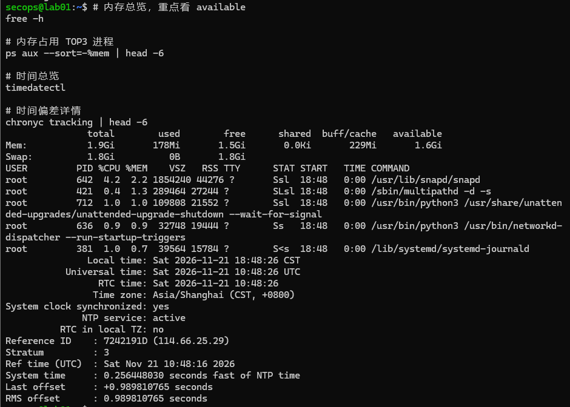
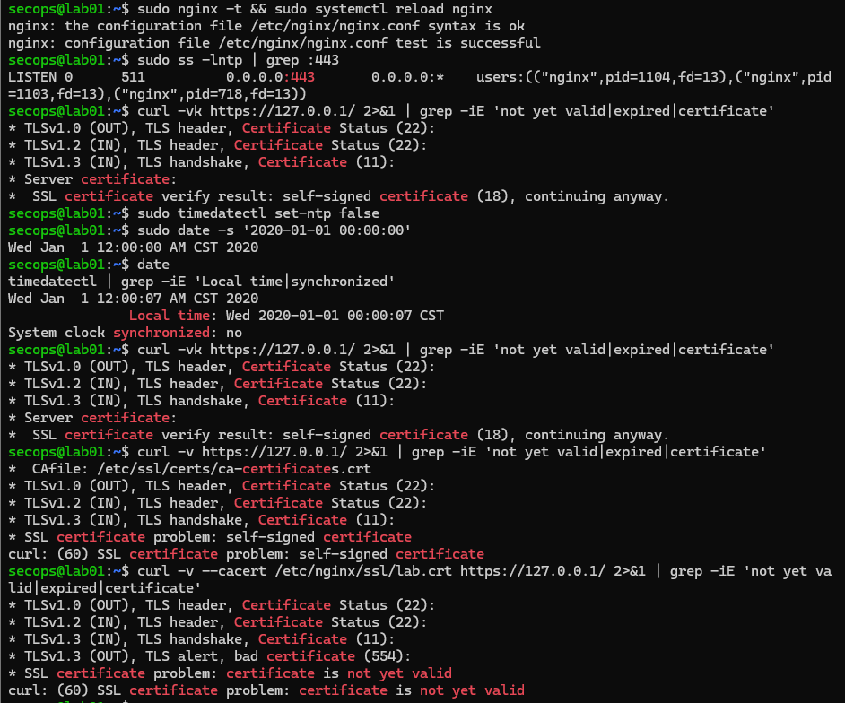
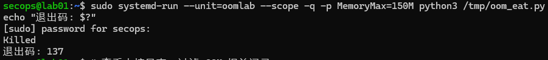
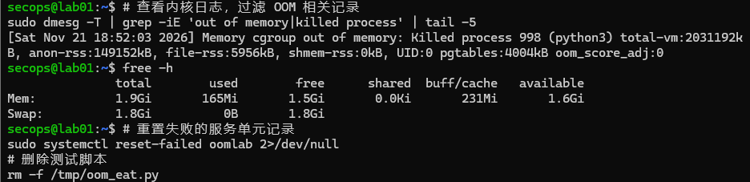
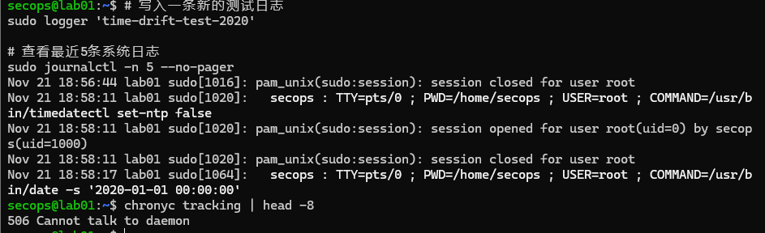

# Linux 资源与调度类故障排查笔记

> 本文覆盖「内存耗尽被 OOM Killer 杀掉」「系统时间不同步」两类故障，环境为 Ubuntu 22.04.5 LTS（lab01，2048 MB）。这两类故障的共同点是**系统没死、服务却莫名消失，而应用日志里一个字都没有**——现象里没有报错、没有堆栈、没有退出记录，只能靠内核留下的信号（`dmesg`、`oom_score`、`anon-rss`、时钟偏移）反向还原。核心方法论：**现象层没有证据时，往下走一层去内核里取**。本册最值钱的一条结论：**`curl -k` 看不见时间错误**——它跳过的是整条校验链，「时间错了」这个事实被 `-k` 和被自签证书两层遮住，只有给出信任锚之后，`certificate is not yet valid` 才会露出来。

**快速导航**：[核心判定对照表](#21-两类故障的共同点证据不在现象层核心判定表) · [free 的五个数字](#22-free-的五个数字哪个才是还能用多少) · [VSZ 与 RSS](#25-vsz-与-rss为什么-total-vm-会是限额的-13-倍) · [cgroup OOM vs 全局 OOM](#24-cgroup-oom-与全局-oom证据完全不同) · [curl -k 为什么看不见时间错误](#28-为什么-curl--k-看不见时间错误控制变量法) · [误判与踩坑复盘](#4-误判与踩坑复盘) · [常用命令速查表](#5-常用命令速查表)

---

## 1. 实验环境与基线状态

| 项目 | 值 |
|---|---|
| 排障主机 | lab01 / Ubuntu 22.04.5 LTS |
| 内存规格 | **2048 MB**（`free` 可见 1.9 Gi） |
| Swap | 1.8 Gi，注入前后均 `0B` 使用 |
| 虚拟化平台 | QEMU（qcow2 快照） |
| 接入方式 | SSH（本册全部操作可远程完成，无图形依赖） |
| 关键工具 | `free`、`vmstat`、`ps`、`systemd-run`、`dmesg`、`timedatectl`、`chronyc`、`curl`、`logger` |
| 磁盘规格 | 本次未采集 |

**基线锚点**：采样时刻 `Local time: Sat 2026-11-21 18:48:26 CST`，本册所有时间戳都以它为参照。

| 基线项 | 实测值 |
|---|---|
| 内存总览 | `total 1.9Gi / used 178Mi / free 1.5Gi / buff-cache 229Mi / **available 1.6Gi**` |
| 内存 TOP1 | `snapd`（PID 642），`%MEM 4.2`，`RSS 44276 kB ≈ 43 MB` |
| 内存 TOP2/3 | `multipathd` 27244 kB、`python3`（unattended-upgrades）21552 kB |
| 时间同步 | `synchronized: yes`，`NTP service: active` |
| chrony 层级 | `Stratum: 3`，`Reference ID: 7242191D (114.66.25.29)` |
| 时间偏差 | `System time: 0.256448030 seconds fast of NTP time`，`Last offset: +0.989910765 s` |
| `:443` 监听 | `LISTEN 0 511`，`nginx` 三条 fd=13：PID `1104` / `1103` / `718` |



*基线四件套一次性采齐：`free -h` 的 available、`ps` 的 TOP、`timedatectl` 的同步态、`chronyc` 的偏差量。后面所有「回到基线了吗」的判断都以这张表为准。*

**为什么基线要记 `available` 而不是 `free`**：注入后 `free` 字段同样是 1.5Gi，`used` 却从 178Mi 掉到 165Mi——单看 `free` 会以为内存根本没动过。`available` 才是「还能给新进程用多少」的口径，也是唯一与 OOM 距离挂钩的数字。

**`:443` 为什么要有三条 nginx 记录**：`master`（1104）与两个 worker（1103、718）共享同一个 `listen` socket，三条记录的 `fd` 都是 13，正是「同一份配置被 inherit 到多个进程」的形态。这是确认自签证书服务真的起在 443 上的判据——少了这一步，后面 `curl` 报 `Connection refused` 会被误读成网络故障。

---

## 2. 核心底层原理

### 2.1 两类故障的共同点：证据不在现象层（核心判定表）

这两类故障在现象层几乎是同一副面孔：服务没了，但没有任何人留下遗言。原因是它们都由**内核**执行，而内核不写应用日志。

| 故障形态 | 判定命令 | 关键特征 | 修复方式 |
|---|---|---|---|
| **cgroup OOM** | `sudo dmesg -T \| grep -i 'killed process'` | 首行 `Memory cgroup out of memory: Killed process ...`，带 `total-vm` / `anon-rss` 统计 | 调 `MemoryMax`、修泄漏；其他服务无感 |
| **全局 OOM** | 同上 | 首行 `Out of memory: Killed process ...`（**无** `Memory cgroup` 前缀） | 重启或回滚快照；被杀范围含 `sshd` |
| **进程自退（非信号）** | `echo $?` | 退出码非 137/143，通常是 1 或自定义码 | 查应用日志，有堆栈 |
| **被 SIGKILL 杀** | `echo $?` | `137` = 128 + 9 | 先怀疑 OOM 或 `kill -9` |
| **被 SIGTERM 终止** | `echo $?` | `143` = 128 + 15 | 查是谁发的 TERM（`systemctl stop`、关机） |
| **时间漂移（系统时钟）** | `timedatectl`；`date` | `Local time` 与真实时间不符，`synchronized: no` | `set-ntp true` + `makestep` |
| **时间源丢失** | `chronyc sources -v` | 可用源数 < 2，或 `^*` 标记消失 | 补源、查 UDP 123 通路 |
| **同步服务被停** | `systemctl is-active chrony` + `chronyc tracking` | `506 Cannot talk to daemon` | 起服务，报错本身不是故障 |

**这张表最该记住的一行是退出码**。`137` 和 `143` 的区别不是数字游戏：`137` 意味着进程没有机会做任何清理（handler 来不及跑），所以**日志一定是断的**；`143` 意味着进程收到了 TERM、可以写「我准备退出」。看到 `137` 还在应用日志里找出错记录，本身就是方法错了。

### 2.2 free 的五个数字，哪个才是「还能用多少」

| 字段 | 含义 | 能否用于判断「内存够不够」 |
|---|---|---|
| `total` | 物理内存总量 | 仅参考 |
| `free` | 完全未被碰过的内存 | **不能**——缓存也算「用过」，但随时可回收 |
| `buff/cache` | 内核页缓存与缓冲区 | 可被瞬间回收，属于「可用」 |
| `available` | 内核估算的可用内存（`free` + 可回收缓存） | **看这个** |
| `used` | 已分配内存 | 参考 |

所以「`free` 只剩 80 MB 了」通常不是问题，「`available` 只剩 80 MB」才是问题。

**为什么两者能差几百 MB**：本册基线 `free 1.5Gi`、`available 1.6Gi`，差值约 100 MB，来自 `buff/cache 229Mi` 里可回收的那部分。机器跑得越久、读写越多，缓存堆积越多，差值就越大。判断内存水位只看 `available`，这一条在面试里被问到的频率远高于它的难度。

### 2.3 OOM Killer 是怎么挑人杀的

内存真的不够时，内核不会「慢慢变卡」，而是直接挑一个进程发 `SIGKILL`。挑谁由 `oom_score` 决定：

| 因素 | 对 `oom_score` 的影响 | 说明 |
|---|---|---|
| 进程占用内存（RSS） | 越大分越高 | **主要权重** |
| `oom_score_adj`（-1000 ~ 1000） | 可人为加减 | systemd 服务常设 `-900` 保护关键进程 |
| root 进程 | 有轻微扣分 | 内核倾向保护特权进程 |
| 已运行时间 | 影响较小 | 长期运行的服务略占便宜 |

查看某个进程的分数：`cat /proc/<PID>/oom_score`。分数最高者被优先杀死。

**这一点解释了一个常见困惑**：为什么 OOM 有时杀的是「看起来不大」的进程？因为分数是加权结果，一个刚启动、`oom_score_adj=0` 的中等进程，可能比一个跑了半年、`oom_score_adj=-900` 的大服务更容易被选中。

### 2.4 cgroup OOM 与全局 OOM：证据完全不同

| 对比项 | cgroup OOM（本册做这个） | 全局 OOM |
|---|---|---|
| 触发条件 | 该 cgroup 用量超过 `MemoryMax` | 整机物理内存 + swap 耗尽 |
| 被杀范围 | 只杀该 cgroup 内的进程 | 全系统任意进程，包括 `sshd` |
| dmesg 关键字 | `Memory cgroup out of memory: Killed process ...` | `Out of memory: Killed process ...` |
| 风险 | 安全，不影响其他服务 | 可能连 SSH 一起杀掉，实验机失联 |
| 退出码 | `137`（128 + 9） | 同样 `137`，但整个系统可能失稳 |

**为什么本册用 cgroup 复现**：全局 OOM 会随机杀掉 `sshd`、`systemd-journald`，实验机当场失联，而且你**看不到完整证据**（终端没了，`dmesg` 也读不到）。用 `systemd-run -p MemoryMax` 把凶猛进程关进笼子里，既能复现「被内核杀掉」的全部现象，又不会伤到系统——**这本身就是生产环境该用的方法**，不只是实验技巧。

### 2.5 VSZ 与 RSS：为什么 total-vm 会是限额的 13 倍

这是本册最容易读错的一个数。实测那行日志：

```
Memory cgroup out of memory: Killed process 998 (python3)
  total-vm:2031192kB, anon-rss:149152kB, file-rss:5956kB,
  shmem-rss:0kB, UID:0 pgtables:4004kB oom_score_adj:0
```

| 字段 | 实测值 | 换算 | 与 `MemoryMax=150M` 的关系 |
|---|---|---|---|
| `total-vm` | 2031192 kB | **≈ 1.94 GiB** | 是限额的 **13.2 倍** —— 看着像限额失效 |
| `anon-rss` | 149152 kB | **≈ 145.7 MiB** | **贴着 150M 天花板** —— 限额确实生效 |
| `file-rss` | 5956 kB | ≈ 5.8 MiB | 映射的文件页，也计入 cgroup |

`total-vm` 是**虚拟地址空间**：Python 解释器一启动就 `mmap` 一大片地址（堆预留、线程栈、arena），但从不真正触碰，所以不计入物理内存。真正计入 cgroup、真正决定被杀的是 `anon-rss`。

**判据**：看 OOM 日志只认 RSS，不认 VSZ。这条在排查内存泄漏时同样成立——`ps` 的 `VSZ` 一栏常年虚高，`RSS` 才是实际占用。

**顺带一个 cgroup v2 的细节**：v1 时代 dmesg 里会有一行单独打印限额（`memory: usage 153600kB, limit 153600kB` 之类），v2 把统计并进了同一行，**没有独立的限额行**。所以「限额生效」的证据不是某行写着 `limit`，而是 `anon-rss` 有没有贴着上限。本册 `145.7 MiB / 150 MiB = 97.1%`，这就是证据。

### 2.6 时间的三个层次与同步链

| 层 | 是什么 | 查看命令 | 漂移后果 |
|---|---|---|---|
| 硬件时钟（RTC） | 主板电池供电，关机也走时 | `timedatectl` 的 `RTC time` | 开机瞬间时间就错 |
| 系统时钟 | 内核维护，全系统共用 | `date`；`timedatectl` 的 `Local time` | 日志时序错乱、证书校验失败 |
| 同步服务 | NTP/chrony 持续校正系统时钟 | `chronyc tracking`；`timedatectl` 的 `synchronized` | 缓慢漂移累积 |

`chronyc tracking` 里最该看两个字段：**`System time`**（当前偏差，单位秒）和 **`Stratum`**（层级，`0` 表示本地时钟不可信）。偏差超过几秒，TLS、Kerberos、JWT、分布式锁、数据库主从都会开始出问题——**而它们报的错里一个字都不会提「时间」**。

本册基线 `System time: 0.256448030 seconds fast`、`Stratum: 3`，属于健康状态（毫秒级偏差 + 有上游源）。

### 2.7 时间漂移的隐藏影响面

| 系统 | 漂移后的表现 | 你看到的报错 |
|---|---|---|
| TLS/HTTPS | 证书「尚未生效」或「已过期」 | `certificate is not yet valid` / `has expired` |
| 日志 | `journalctl` 里出现未来时间或乱序 | 按时间排序时跳变 |
| cron/at | 任务不执行或重复执行 | 日志里没有记录 |
| 认证（Kerberos/JWT） | 票据无效 | `clock skew too great` / `token expired` |
| 数据库主从 | 复制延迟异常 | `Seconds_Behind_Master` 异常 |

这张表的价值在于：**上面前四行报的错，没有一条会提到时间**。所以「证书突然失效」「用户说密码没错但登不上」这类工单，时钟必须列入候选原因，而且要排在「证书真的过期」之前排查——因为它的成本只有一条命令。

### 2.8 为什么 `curl -k` 看不见时间错误（控制变量法）

本册最关键的一处方法论。同一个 `https://127.0.0.1/`，三条命令三种结果：

| 命令 | 实测输出 | 为什么看不到时间错误 |
|---|---|---|
| `curl -vk` | `SSL certificate verify result: self-signed certificate (18), continuing anyway` | `-k` 跳过**整条**校验链，连「自签不受信」都不拦，有效期更不会检查 |
| `curl -v` | `SSL certificate problem: self-signed certificate (60)` | 卡在信任链这一关，**根本走不到**有效期检查 |
| `curl -v --cacert /etc/nginx/ssl/lab.crt` | `TLS alert, bad certificate (554)` + `certificate is not yet valid` | 用这张自签证书当信任锚，信任链通过，**有效期成为唯一可能失败的环节** |

三条命令的差别，本质是**控制变量**：

```
错误来源 = { 信任链不可信, 有效期不符 }
- `-k`        → 两个都放过 → 结论「没问题」（假阴性）
- 默认        → 只放过有效期检查，先卡信任链 → 结论「自签」（真但无关）
- `--cacert`  → 消掉信任链变量 → 只剩有效期 → 结论「时间错了」✓
```

**要证明「是时间错了」，必须先让证书通过信任链，让「有效期」成为唯一可能失败的那一环。** 这个思路可以迁移到任何多因素叠加的验证场景：想把某个变量认定为根因，就得先把它之外的所有变量消掉。



*同一屏里还含 `nginx -t` 通过、`ss` 的 443 三条 nginx 记录、`set-ntp false` 与 `date -s` 的跳变结果。注入前后的 `curl -vk` 输出**完全一致**——这就是 `-k` 造成假阴性的直接证据。*

### 2.9 本册的标准排查顺序

```
服务「凭空消失」
├─ ① echo $? / 查退出码
│    ├─ 137 → 被 SIGKILL  → 进 ②
│    ├─ 143 → 被 SIGTERM  → 查 systemctl stop / 关机 / 部署脚本
│    └─ 其他 → 应用自身退出 → 查应用日志（此时才有日志可查）
├─ ② sudo dmesg -T | grep -i 'killed process'
│    ├─ 有 Memory cgroup 前缀 → cgroup OOM → 查 MemoryMax 与 anon-rss
│    ├─ 无前缀（Out of memory:）→ 全局 OOM → 整机内存水位
│    └─ 完全没有             → 人为 kill -9，查 audit / history / 编排系统
└─ ③ 应用日志（放在最后，因为 137 的情况下它一定是空的）

「时间不对 / 证书异常 / 登录莫名失败」
├─ ① timedatectl               → Local time / RTC time / synchronized
├─ ② chronyc tracking          → System time（偏差）/ Stratum
│    └─ 506 Cannot talk to daemon → 不是 chrony 坏了，先 is-active chrony
├─ ③ chronyc sources -v        → 可用源数（< 2 就要补）
└─ ④ 影响面取证：curl --cacert / journalctl --since / 应用认证日志
```

两条顺序都遵循同一个原则：**先确认「谁动的手」，再问「为什么」。** 服务消失先分信号（内核 or 人为），时间异常先分层次（RTC / 系统时钟 / 同步服务）。顺序颠倒的代价在本册是实打实的：⑫ 一开始从应用日志找原因，⑮ 一开始用 `curl -vk` 验证——两次都因为「问错了对象」而白跑一轮。

---

## 3. 分故障实操记录

### 3.1 ⑫ 内存耗尽触发 OOM Killer

#### 复现方法

```bash
# 造一个吃内存的程序：每次 1 MB，无 sleep，能吃多快吃多快
cat > /tmp/oom_eat.py <<'PYEOF'
a = []
while True:
    a.append(bytearray(1024 * 1024))   # 每次申请 1 MB，持续增长
PYEOF

# 关进 150 MB 的笼子里跑（--scope 同步执行，退出码原样传给 $?）
sudo systemd-run --unit=oomlab --scope -q -p MemoryMax=150M python3 /tmp/oom_eat.py
echo "退出码: $?"
```

**为什么用 `systemd-run --scope` 而不是直接跑**：`-p MemoryMax=150M` 给它套一个 cgroup，超限时内核只在这个笼子里杀人，`sshd`、`journald` 一概不碰。`--scope` 让进程在当前终端同步运行，所以 `$?` 拿到的是 `python3` 自己的退出码——这是后面拿到 `137` 的前提。如果改成 `--service` 后台跑，`$?` 只会是 `systemctl` 的返回码。

**为什么这个循环能在一秒内吃满 150 MB**：`bytearray(1024*1024)` 每次真写 1 MB（不是 `malloc` 后不碰），没有 `sleep`，内存带宽下 150 次分配远不到一秒。**OOM 是「瞬间」发生的，不存在「内存慢慢涨上去」的过渡**——这也解释了为什么事后看监控曲线，往往抓不到那个尖峰。

#### 故障现象

```
[sudo] password for secops:
Killed
退出码: 137
```

就这三行。**没有 Traceback，没有应用日志，没有 systemd 的失败详情**。

`Killed` 那一行还要单独说一句：**它是 bash 的作业控制提示（job control），不是 `systemd-run` 的输出**。bash 发现前台子进程被信号杀死，就打印这个词。把它当成程序自己的报错，会往「程序内部有 bug」的方向跑偏。



*`137 = 128 + 9`。整条故障链的起点只有这一行数字——不是 `1`、不是 `2`，是信号编码。看到它就该离开应用日志，转去 `dmesg`。*

#### 排查流程

| 步骤 | 命令 | 在排除什么 | 实测关键数据 |
|---|---|---|---|
| 1 退出码 | `echo $?` | 区分「自己退的」还是「被信号杀的」 | `137` = 128 + 9 → `SIGKILL` |
| 2 内核日志 | `sudo dmesg -T \| grep -iE 'out of memory\|killed process' \| tail -5` | 确认动手的是内核 | `[Sat Nov 21 18:52:03 2026] Memory cgroup out of memory: Killed process 998 (python3) ...` |
| 3 按单元名过滤 | `sudo dmesg -T \| grep -i 'oomlab' \| tail -5` | 关联到自己的实验单元 | 同一行（`oomlab` 是 scope 名，不进 `comm`，日志里认 `python3` + PID） |
| 4 journal 交叉确认 | `sudo journalctl -b -k \| grep -i 'out of memory' \| tail -5` | 排除「dmesg 环形缓冲被刷掉」 | 同一份内核日志的副本 |
| 5 整机水位 | `free -h` | 判断是 cgroup 还是全局 | `used 165Mi / free 1.5Gi / available 1.6Gi`，**几乎无变化** |
| 6 限额是否生效 | 读第 2 步那行的 `anon-rss` | cgroup v2 没有独立限额行 | `anon-rss:149152kB ≈ 145.7 MiB`，贴着 `MemoryMax=150M` 的 97.1% |

**每一步在排除什么，说明白一点**：

- 第 1 步排除「应用自己 return 了错误码」——`137` 是信号编码，不是程序能主动返回的值。
- 第 2 步排除「人为 `kill -9`」——人为 kill 不会有 `Memory cgroup out of memory` 前缀，也不会带 RSS 统计。**这一步是本册的分水岭**：会查 `dmesg` 找 `killed process`，是运维和「只会看应用日志」的人最关键的区别。
- 第 5 步排除「全局 OOM」——整机 `available` 没掉，说明死掉的内存全在笼子里，隔离生效了。这一步同时也是在做**反向验证**：如果这里 `available` 掉到几百兆，那才要担心是不是触发了全局 OOM。
- 第 6 步是补上 cgroup v2 的坑：没有限额行不等于限额没生效，判据是 `anon-rss` 有没有贴顶。

`free` 的前后对照还藏了一个细节：`used` 从 **178Mi 掉到 165Mi**。被杀进程的页立刻归还，所以数字不但没涨，反而降了 13 MB。**看到「内存没变化」就断定 OOM 没发生，是本册第 1 号误判。**



*一屏里同时给出两件事：内核确实动了手（`Killed process 998 (python3)`，带 `total-vm` / `anon-rss` 统计），以及整机水位几乎没变（`available 1.6Gi`）。这两条并排，就是「cgroup OOM 而非全局 OOM」的判据。*

#### 根因结论

cgroup 的内存用量撞到 `MemoryMax=150M` 上限，内核在该 cgroup 内按 `oom_score` 选中 `python3`（PID 998）发 `SIGKILL`。`anon-rss 149152 kB` 贴着上限、`total-vm 2031192 kB` 是虚拟地址空间（不计入），这两个数字一起构成「限额生效」的完整证据。

#### 修复方案

本实验无需修复（进程已被杀，内存已归还）。收尾只需清掉失败单元与测试脚本：

```bash
sudo systemctl reset-failed oomlab 2>/dev/null
rm -f /tmp/oom_eat.py
```

**错误做法踩坑**：

- ❌ **只查应用日志**。`SIGKILL` 不给进程任何执行机会，`finally`、`atexit`、日志 handler 全都跑不到。这一步注定一无所获，却最容易耗掉半天。
- ❌ **看到 `total-vm: 2031192kB` 就认定限额失效**。1.94 GiB 是限额的 13 倍，但这个数是 VSZ。按它判断会得出「`MemoryMax` 根本没用」的错误结论，然后跑去改 systemd 配置——方向全错。
- ❌ **不设限额直接吃内存做实验**。会触发全局 OOM，随机杀 `sshd`/`journald`，实验机失联，证据也拿不全。
- ❌ **把 `Killed` 当成程序 bug**。它是 bash 的 job control 提示。

#### 预防措施

**监控项**：

```bash
# 可用内存百分比（< 10% 持续 5 分钟告警）
free -m | awk '/Mem:/{printf "%.1f%%\n", $7/$2*100}'

# OOM 事件累计（计数增加即告警）
sudo dmesg -T | grep -c 'Killed process'

# 服务重启次数（短时间多次，往往是被杀的间接表现）
systemctl show <svc> -p NRestarts
```

**配置加固**：

```bash
# 给每个服务设内存上限，超限只杀自己
sudo systemctl edit <svc>
# [Service]
# MemoryMax=512M
# MemoryHigh=400M   # 软限，先限速再杀，给应用自救机会

# 关键进程 OOM 保护（sshd / systemd / 监控 agent）
# [Service]
# OOMScoreAdjust=-900
```

`MemoryHigh` 与 `MemoryMax` 的区别值得单独记：`MemoryHigh` 是**软限**，超过后内核会强力回收并节流（进程变慢但不死）；`MemoryMax` 是**硬限**，超过直接 OOM。生产上两个一起设，先软后硬。

**自动化方案**：见文末 [`oom-evidence-collect.sh`](#1-scriptsoom-evidence-collectsh) 与 [`mem-safe-run.sh`](#2-scriptsmem-safe-runsh)。

---

### 3.2 ⑮ 系统时间不同步

#### 复现方法

```bash
# 前置：确认 443 上有走 TLS 的服务（自签证书在分册四已配好）
sudo nginx -t && sudo systemctl reload nginx
sudo ss -lntp | grep :443

# 注入：先关自动对时，再把时钟拨回 2020
sudo timedatectl set-ntp false
sudo date -s '2020-01-01 00:00:00'
date
timedatectl | grep -iE 'Local time|synchronized'
```

**`set-ntp false` 的真实作用比字面更大**：它不只是「关掉自动对时开关」，而是**把当前正在跑的 NTP 客户端一起停掉**——这台机器上是 `chrony.service`。所以后面 `chronyc tracking` 报 `506 Cannot talk to daemon`，根因在这一行，不是 chrony 装坏了。这是本册第 8 号坑。

**为什么必须先关 NTP 再改时间**：chrony 默认每秒都在微调系统时钟。不关就 `date -s`，改完几秒内会被拉回接近真实时间，实验现象一闪而过甚至完全看不到。

**为什么用 2020-01-01 这个值**：要制造的是 `notBefore` 在未来——自签证书的生效时间晚于 2020，时钟回拨到 2020 就落在 `notBefore` 之前，正好触发 `certificate is not yet valid`。如果只回拨几天，可能仍在证书有效期内，什么都不会发生。

#### 故障现象

```
$ date
Wed Jan  1 12:00:07 AM CST 2020

$ timedatectl | grep -iE 'Local time|synchronized'
       Local time: Wed 2020-01-01 00:00:07 CST
System clock synchronized: no
```

四类影响面同时出现：

| 观测点 | 实测结果 |
|---|---|
| 证书校验 | `curl -v --cacert` 才报 `certificate is not yet valid`；`-k` 与默认都报别的东西 |
| 日志时序 | 新写的 `time-drift-test-2020` 在 `journalctl -n 5` 里**一条都没有** |
| chrony 状态 | `506 Cannot talk to daemon` |
| 同步标志 | `synchronized: no` |

#### 排查流程

**第一段：证书为什么「看不出问题」——三条命令的控制变量**

```bash
# ① 带 -k：跳过整条校验链
curl -vk https://127.0.0.1/ 2>&1 | grep -iE 'not yet valid|expired|certificate'
# → SSL certificate verify result: self-signed certificate (18), continuing anyway

# ② 去掉 -k：卡在信任链
curl -v https://127.0.0.1/ 2>&1 | grep -iE 'not yet valid|expired|certificate'
# → SSL certificate problem: self-signed certificate (60)

# ③ 给信任锚：有效期成为唯一变量
curl -v --cacert /etc/nginx/ssl/lab.crt https://127.0.0.1/ 2>&1 | grep -iE 'not yet valid|expired|certificate'
# → TLS alert, bad certificate (554)
# → SSL certificate problem: certificate is not yet valid
```

| 步骤 | 命令 | 在排除什么 | 实测输出 |
|---|---|---|---|
| 1 | `curl -vk` | （错误示范）以为能验证时间 | `(18) continuing anyway`，**注入前后完全一致** |
| 2 | `curl -v` | 排除「证书链本身有问题」以外的干扰 | `(60) self-signed certificate`，走不到有效期 |
| 3 | `curl -v --cacert` | 消掉信任链变量 | `(554)` + `certificate is not yet valid` ✓ |

第 1 步的「注入前后完全一致」是本册最值钱的对照：**同一个 `-k` 命令，时间正确时和错 2516 天时输出一模一样**。这说明它对这个故障的灵敏度是 0，用它做的任何「验证」都不成立。

**第二段：日志为什么找不到刚写的那条**

```bash
sudo logger "time-drift-test-2020"
sudo journalctl -n 5 --no-pager
```

实测输出五条，**全部是 18:56–18:58 的旧记录**：

```
Nov 21 18:56:44 lab01 sudo[1016]: pam_unix(sudo:session): session closed for user root
Nov 21 18:58:11 lab01 sudo[1020]:   secops : TTY=pts/0 ; PWD=/home/secops ; USER=root ;
                              COMMAND=/usr/bin/timedatectl set-ntp false
Nov 21 18:58:11 lab01 sudo[1020]: pam_unix(sudo:session): session opened for user root(uid=0) by secops(uid=1000)
Nov 21 18:58:11 lab01 sudo[1020]: pam_unix(sudo:session): session closed for user root
Nov 21 18:58:17 lab01 sudo[1064]:   secops : TTY=pts/0 ; PWD=/home/secops ; USER=root ;
                              COMMAND=/usr/bin/date -s '2020-01-01 00:00:00'
```

最后一条正是 `date -s` 那次 sudo，`time-drift-test-2020` 不在尾部。

**根因**：`journald` 按 `CLOCK_REALTIME` 给每条记录打戳。时钟跳回 2020，新日志就被标成 `2020-01-01`，在按时间排序的视图里**直接沉到最前面**。`-n 5` 取的是「时间上最新」的五条，自然拿不到它。

**取证上这是致命的**：你 `tail` 到的「最新」，可能反而是最旧的。要捞回那条日志，得按它自己的时间窗口找：

```bash
journalctl --since "2020-01-01" --until "2020-01-02" | grep time-drift-test-2020
```



*两张图合成一屏：上面是日志时序错乱（新记录沉底），下面是同步链路已断（506）。两者都由同一行 `set-ntp false` 引发，但一个在日志层、一个在服务层。*

**第三段：chrony 报 506 是不是 chrony 坏了**

```bash
chronyc tracking | head -8
# → 506 Cannot talk to daemon
```

**这不是 chrony 故障**，是上一步 `set-ntp false` 把 `chrony.service` 停了。没有守护进程，客户端自然连不上。

```bash
systemctl is-active chrony    # → inactive
```

**「读不到偏差」本身也是一条证据**——读不到说明对时链路已经断了。真实偏差只能自己算：注入后是 `2020-01-01 00:00:07`，真实时间 18:58，落后 **2516 天**，约 **−2.17 × 10⁸ 秒**。

#### 根因结论

`set-ntp false` 停掉了 `chrony.service`，系统失去所有自动校正；`date -s` 把 `CLOCK_REALTIME` 拨回 2020-01-01。此后**所有依赖系统时钟的判断同时失效**：TLS 有效期校验（`notBefore` 在未来）、`journald` 的时间戳排序、chrony 自身的可达性。时间本身没有"坏"，坏的是它现在指向一个错误的事实。

#### 修复方案

```bash
# ① 重新交给 NTP 管理（这一步会重新 enable + start chrony）
sudo timedatectl set-ntp true

# ② 确认服务真的起来了
sudo systemctl restart chrony
systemctl is-active chrony      # 应为 active，不是 active 后面全是空转

# ③ 等它先跑一次，再强制跳变
sleep 10
sudo chronyc makestep           # 立即跳变过去，而不是慢慢调整

# ④ 三处验证
chronyc tracking | head -6
timedatectl | grep -i synchronized
date
```

**`makestep` 与「持续校正」的区别**：chrony 默认用**渐进式**调整（`slew`），把偏差摊到很长时间里慢慢消化，因为时间**倒退**会让依赖单调时钟的程序出错。但偏差到 2516 天这个量级，`slew` 要跑几百年。`makestep` 是一次性跳变，专门用于「开机时偏差过大」或「手工改坏了时钟」。理解这两者的区别比记住命令重要：**校正是持续过程，`makestep` 是一次性跳变**。

**验证恢复**：

```bash
curl -kI https://127.0.0.1/ 2>&1 | head -3        # 应回到 HTTP/1.1 200 OK
sudo journalctl -n 3 --no-pager                    # 时间戳应回到当前
ls -l --time-style=full-iso /var/log/syslog        # mtime 应等于「现在」
```

三条判据的口径：`timedatectl` 的 `System clock synchronized` 回到 `yes`；`chronyc tracking` 的 `System time` 回到 0.1 秒以内；`ls -l` 看 `/var/log/syslog` 的 `mtime` 应该等于"现在"——**如果它还在按旧时间增长，说明写日志的进程没重新读时钟，重启 `rsyslog` 即可**。

**错误做法踩坑**：

- ❌ **用 `curl -k` 验证时间漂移**。`-k` 让「时间错了」这个事实完全不可见，会得出「时间不影响证书」的错误结论。本册第 3 号误判就是这么来的。
- ❌ **改时间前不停 NTP**。改完几秒内被拉回，现象一闪而过。
- ❌ **把 `506 Cannot talk to daemon` 当 chrony 故障**。先 `systemctl is-active chrony`，一看 `inactive` 就明白了。
- ❌ **恢复后不等同步完成就做验证**。`makestep` 之后要确认 `synchronized: yes` 再往下走，否则后续实验的时间基准还是错的。

#### 预防措施

**监控项**：

```bash
# 时间偏差（> 100 ms 告警）
chronyc tracking | awk '/System time/{print $4, $5, $6}'

# 同步状态（no 即告警）
timedatectl show -p NTPSynchronized --value

# 时间源数量（< 2 就要补）
chronyc sources -v | grep -c '^\^\*'
```

**配置加固**：

```bash
# 至少配两个时间源，单源一挂就是静默失步
cat /etc/chrony/chrony.conf
# pool ntp.ubuntu.com iburst
# server <内网NTP1> iburst
# server <内网NTP2> iburst

# 关键：允许开机时大偏差直接跳变，否则 slew 要跑很久
# makestep 1.0 3
```

`makestep 1.0 3` 的含义：前 3 次更新时，若偏差超过 1.0 秒就直接跳变。这一行是「机器断电几天后重启」场景的关键，不配的话时间会长时间停在错误值上。

**自动化方案**：见文末 [`time-drift-triage.sh`](#3-scriptstime-drift-triagsh) 与 [`time-sync-restore.sh`](#4-scriptstime-sync-restoresh)。

---

## 4. 误判与踩坑复盘

| # | 最初误判 | 实际原因 | 为什么误判 | 后续规避 |
|---|---|---|---|---|
| 1 | `free` 里 `available` 没掉，怀疑 OOM 没触发 | 只杀笼子里的进程，整机 `available` 不变 | 拿全局 OOM 的表象去套 cgroup OOM | 先看 `dmesg` 首行有无 `Memory cgroup` 前缀 |
| 2 | `total-vm 1.9 GB` 是限额 13 倍，以为限额没生效 | 计入 cgroup 的是 `anon-rss 146 MB`，贴着 150M | 把 VSZ 当成实际占用 | 只看 RSS / `anon-rss`，不看 VSZ |
| 3 | `curl -vk` 没报 `not yet valid`，以为时间不影响证书 | `-k` 跳过整条校验链，连「自签不受信」都不报 | 用 `-k` 做验证类实验 | 禁用 `-k`，用 `--cacert` 让有效期成为唯一变量 |
| 4 | `chronyc` 报 506，以为 chrony 坏了 | `set-ntp false` 停掉了 `chrony.service` | 没先看服务状态就解释输出 | 先 `systemctl is-active chrony` 再看报错 |
| 5 | 进程消失后先翻应用日志，翻不到就怀疑程序 bug | `SIGKILL` 不给进程任何执行机会，日志必然为空 | 默认「有故障就有日志」，忽略了信号这一层 | 先 `echo $?` 拿退出码，`137` 直接转 `dmesg` |
| 6 | 看到终端打 `Killed` 以为是程序自己报的错 | 那是 bash 的 job control 提示 | 把 shell 的提示当应用的输出 | 认退出码，不认提示词 |
| 7 | 时钟回跳后用 `journalctl -n` 找「最新日志」 | 新日志被标成 2020，排到最前，`-n` 取不到 | 默认「最新写入 = 时间最大」 | 用 `--since/--until` 按时间窗口捞，或 `--reverse` 配合 `_COMM` 过滤 |
| 8 | 以为 `set-ntp false` 只是「关个开关」 | 它把 `chrony.service` 一起停了 | 没有确认过这个命令的实际作用域 | 改时间前后都 `systemctl is-active chrony` |
| 9 | 以为 `dmesg` 里该有一行「限额=150M」 | cgroup v2 把统计并进同一行，没有独立限额行 | 拿 cgroup v1 的经验套 v2 | 判据改成 `anon-rss` 是否贴顶（97.1%） |
| 10 | 恢复时间后立刻验证，发现还是 `no` | 同步是持续过程，`makestep` 之后还要等一轮 | 以为改完命令就立刻生效 | `makestep` → `tracking` → 确认 `synchronized: yes` 才继续 |
| 11 | 只改系统时钟，没管 `rsyslog` 的 mtime | 写日志的进程若没重读时钟，文件会继续按旧时间增长 | 忽略了「时间是每个进程各自读的」 | 恢复后 `ls -l --time-style=full-iso /var/log/syslog` 复核 |

**第 1 条与第 5 条是本册最有价值的两条**，因为它们的错误都发生在「最符合直觉的那一步」：内存没了就去看内存（可整机内存确实没变），服务挂了就去看日志（可日志确实写不出来）。这两次误判的共同结构是——**把「上一个故障的经验」直接套到「这一个故障」上**。

---

## 5. 常用命令速查表

| 场景 | 命令 | 关键看什么 |
|---|---|---|
| 内存总览 | `free -h` | **`available`**，不是 `free` |
| 内存趋势 | `vmstat 1 5` | `si`/`so` 是否非 0（开始换页，离 OOM 不远） |
| 内存 TOP | `ps aux --sort=-%mem \| head` | 谁在吃，看 `RSS` 不看 `VSZ` |
| OOM 证据 | `sudo dmesg -T \| grep -i 'killed process'` | 有无 `Memory cgroup` 前缀 + `anon-rss` |
| OOM 日志交叉确认 | `sudo journalctl -b -k \| grep -i 'out of memory'` | 与 dmesg 是否同一份 |
| 进程 OOM 分 | `cat /proc/<PID>/oom_score` | 谁最可能被杀 |
| 进程保护等级 | `cat /proc/<PID>/oom_score_adj` | `-900` 是受保护，`0` 是默认 |
| 限额运行 | `sudo systemd-run --scope -p MemoryMax=150M <cmd>` | cgroup 隔离，`$?` 拿真实退出码 |
| 服务内存上限 | `systemctl show <svc> -p MemoryMax -p MemoryHigh` | `infinity` 等于没设 |
| 退出码语义 | `echo $?` | `137`=SIGKILL，`143`=SIGTERM |
| 时间总览 | `timedatectl` | `Local time` / `RTC time` / `synchronized` |
| 时间偏差 | `chronyc tracking` | `System time`（秒）、`Stratum`（0=不可信） |
| 时间源 | `chronyc sources -v` | `^*` 标记的可用源数量 |
| 立即校正 | `sudo chronyc makestep` | 跳变而非慢调 |
| 改时间前置 | `sudo timedatectl set-ntp false` | 会同时停掉 `chrony.service` |
| 修改时间 | `sudo date -s 'YYYY-MM-DD HH:MM:SS'` | 需先 `set-ntp false` |
| 证书 + 时间联合验证 | `curl -v --cacert <crt> https://...` | `not yet valid` / `has expired` |
| 按时间窗口捞日志 | `journalctl --since "2020-01-01" --until "2020-01-02"` | 时钟回跳后唯一可靠的方式 |
| 日志文件是否重启 | `ls -l --time-style=full-iso /var/log/syslog` | `mtime` 是否等于「现在」 |

---

## 6. 思考题解答

### Q1 `free` 里 `free` 和 `available` 有什么区别？为什么两者能差几百 MB？

```bash
free -h
#                total        used        free      shared  buff/cache   available
# Mem:           1.9Gi       178Mi       1.5Gi       0.0Ki       229Mi       1.6Gi
```

`free` 是「完全没被碰过」的内存；`available` 是内核估算的「还能给新进程用多少」，把可回收的 page cache、可回收 slab 都算了进来。本册基线 `free 1.5Gi`、`available 1.6Gi`，差出的部分就是 `buff/cache 229Mi` 里可回收的那部分。机器跑得越久、缓存越多，差值越大，几百 MB 很正常。

**结论**：判断「内存够不够」只看 `available`。

### Q2 服务进程消失、应用日志无记录，怎么在三条命令内证明是 OOM？

```bash
# ① 内核有没有杀过
sudo dmesg -T | grep -i "killed process" | tail -3

# ② 内核日志在 journal 里的同一份副本，交叉确认
sudo journalctl -b -k | grep -i "out of memory" | tail -3

# ③ 进程若还在，看它离被杀有多近
cat /proc/<PID>/oom_score
```

核心判据只有一条：`dmesg` 里出现 `Killed process <pid> (<comm>)` 且带 `total-vm` / `anon-rss` 统计行。首行有无 `Memory cgroup` 前缀，进一步区分是限额触发还是整机耗尽。

### Q3 退出码 137 和 143 分别代表什么？

```bash
# 137 = 128 + 9  → SIGKILL
# 143 = 128 + 15 → SIGTERM
```

`137`：被 9 号信号 `SIGKILL` 杀死，常见于 OOM 或 `kill -9`。**进程没有机会做任何清理**，所以日志一定是断的。
`143`：被 15 号信号 `SIGTERM` 终止，常见于 `systemctl stop`、正常关机。进程可以捕获它做优雅退出。

**结论**：看到 `137` 先怀疑内存与 cgroup 限额，看到 `143` 先查是谁发的 TERM。判据是「有没有日志」——`143` 应该有退出日志，`137` 一定没有。

### Q4 系统时间慢 3 天，会导致哪些「看起来与时间无关」的故障？举三例。

| 例子 | 现象 | 命令复现 |
|---|---|---|
| ① TLS 证书校验 | 时间落在 `notBefore` 之前，报 `certificate is not yet valid` | `curl -v --cacert <crt> https://...` |
| ② 日志取证 | `journalctl` 按 `CLOCK_REALTIME` 排序，回跳后的新日志被标成旧时间，沉到最前面 | `sudo logger test && journalctl -n 5` |
| ③ 认证票据 | Kerberos 报 `clock skew too great`、JWT 的 `nbf`/`exp` 校验失败，用户侧表现是「密码没错但登不上」 | `chronyc tracking` 先确认偏差 |

三条的共同点：**报错文本里没有一条提到「时间」**。所以时间必须作为候选原因排在前面排查，成本只有一条 `timedatectl`。

### Q5 为什么生产环境应该给服务设 `MemoryMax`，而不是让它随便吃？

不设上限时，一个失控进程会把整机内存吃光，触发全局 OOM，内核按 `oom_score` 随机挑人杀，**可能把 `sshd`、`journald`、数据库一起带走**——故障面从一个服务扩大到整台机器，而且实验机当场失联、证据也拿不全。

设了 `MemoryMax`，超出只在这个 cgroup 内杀，其他服务无感，故障被关在一个格子里，`dmesg` 还明确写着 `Memory cgroup out of memory`。

**结论**：`MemoryMax` 的本质不是"限制用量"，是**把故障半径限制在一个服务内**。本册 3.1 与 2.4 的对比就是这个差别：同样一次 OOM，一个 `available` 掉 0（全局），一个 `available` 纹丝不动（cgroup）。

---

## 7. 总结与方法论沉淀

### 核心排障原则

1. **现象层没有证据时，往下走一层去内核取**。`SIGKILL` 不写应用日志，`journald` 的时间戳错乱也不写应用日志。`dmesg`、`/proc`、`ss` 是内核留下的现场。
2. **先看退出码，再谈别的**。`137` / `143` / 其他，三条分支决定三个完全不同的排查方向。跳过这一步就会在应用日志里空转。
3. **`available` 是内存的唯一口径**。`free` 会被缓存骗，`used` 会因进程死亡反而下降。
4. **RSS 是占用，VSZ 是地址空间**。`total-vm` 可以是限额的 13 倍而毫不矛盾。判「限额生效」看 `anon-rss` 是否贴顶。
5. **限流优于杀进程**。`MemoryHigh`（软限、节流）在前，`MemoryMax`（硬限、OOM）在后。只设硬限等于放弃自救机会。
6. **故障半径是设计指标，不是运气**。cgroup 的意义不在「限制用量」，在「一个服务炸了不牵连别人」。
7. **验证某个变量是根因之前，先把它之外的所有变量消掉**。`curl -k` 掩盖两个错误，`--cacert` 消掉一个只剩一个。这是本册 `curl` 三条命令的全部意义。
8. **负结果也是结果**。`chronyc tracking` 报 506 不是「查不到」，是「同步链已断」这条证据本身。
9. **时间是每个进程各自读的**。系统时钟改了，已经跑着的进程可能还持有旧的时间认知。`rsyslog` 的 `mtime` 不回头就是这个原因。
10. **不可逆操作前先确认恢复路径**。改系统时间、制造 OOM，都要先想清楚怎么回来——`set-ntp true` 能不能连上网、快照在不在。

### 排查优先级

**内存类**：退出码 → `dmesg` → `free` → `anon-rss`。顺序不能换，因为每一步都在缩小「谁动的手」的范围。

**时间类**：`timedatectl` → `chronyc tracking` → `systemctl is-active chrony` → `chronyc sources -v`。先看结果（时间对不对），再看偏差（差多少），再看服务（同步机制活着吗），最后看源（有没有东西可同步）。

### 常见误区

- **「内存没变化 = 没问题」**：cgroup OOM 杀完立刻归还，`available` 可能纹丝不动，`used` 甚至下降。
- **「没有日志 = 程序没跑」**：`SIGKILL` 让进程连写遗言的机会都没有。
- **「`total-vm` 大 = 吃内存多」**：Python 一启动就预留 1.9 GB 地址空间，实际 RSS 只有几十兆。
- **「`-k` 能验证证书问题」**：`-k` 是"跳过校验"，用跳过校验的方式验证校验逻辑，逻辑上就不成立。
- **「`chronyc` 报错 = chrony 坏了」**：先看服务在不在，`set-ntp false` 会把它停掉。
- **「`journalctl -n` 一定拿到最新日志」**：它按时间戳取，时钟错了它取到的就是错的。
- **「命令返回就是生效」**：`set-ntp true` 返回 0 不代表 chrony 起来了，`systemctl is-active` 才算数。

### 可迁移的通用思路

**「静默失效」这一类故障的统一解法**：找出那个「本该留下痕迹但没有」的位置，然后往下一层找替它记录的东西。

| 本该有痕迹的地方 | 实际没有 | 替它记录的层 |
|---|---|---|
| 应用日志 | 被 `SIGKILL`，写不出来 | `dmesg` 的 `Killed process` |
| 进程列表 | 进程已消失 | `systemctl show -p NRestarts`、`/proc/<PID>/oom_score`（若还在） |
| 日志时间顺序 | 时钟错了，排序失效 | `--since/--until` 时间窗口 |
| 证书报错 | `-k` 掩盖了 | `--cacert` + `openssl x509 -dates` |
| 服务健康检查 | 进程活着但功能坏了 | 端到端探测（`curl` 拿 200） |

这条思路可以直接迁移到面试和工作：**「这个问题为什么没有报错」本身就是第一个要回答的问题**。答案往往指向「执行者是内核，或者执行方式不给机会」。

---

## 本章节产出脚本

### 1. `scripts/oom-evidence-collect.sh`

**OOM 证据链一键采集**

按「退出码 → 内核日志 → 触发域 → 限额比 → 整机水位」五步取证，自动区分 cgroup OOM 与全局 OOM，并算出 `anon-rss` 占限额的百分比。服务「凭空消失」时第一个该跑的就是它。

**判据**：首行带 `Memory cgroup` 即限额触发；`anon-rss / MemoryMax > 90%` 才算限额真的生效（cgroup v2 没有独立的限额行，只能这么判）。

**使用**：

```bash
# 只看本次开机以来的 OOM 记录
sudo ./scripts/oom-evidence-collect.sh

# 附带查询某个还活着的进程的 oom_score
sudo ./scripts/oom-evidence-collect.sh 998

# dmesg 环形缓冲已被刷掉时，改走 journal 通道
sudo ./scripts/oom-evidence-collect.sh --since 1h
```

**退出码**：0 未发现 OOM / 1 发现 OOM 事件 / 2 非 root

```bash
#!/usr/bin/env bash
# oom-evidence-collect.sh —— OOM 证据链一键采集
#
# 适用场景：某个服务/进程「凭空消失」，应用日志里查不到任何报错。
# 本脚本按「退出码 → 内核日志 → 整机水位 → 限额比」的顺序取证，
# 每一步都在缩小「是谁动的手」的范围。
#
# 用法：
#   sudo ./oom-evidence-collect.sh              # 只看本次开机以来的 OOM 记录
#   sudo ./oom-evidence-collect.sh 998           # 附带查询指定 PID 的 oom_score
#   sudo ./oom-evidence-collect.sh --since 1h    # 只看最近 1 小时（dmesg -T 无法过滤，用 journal）
#
# 退出码：0 未发现 OOM / 1 发现 OOM 事件 / 2 环境不满足（非 root 等）

set -uo pipefail

RED=$'\033[31m'; YEL=$'\033[33m'; GRN=$'\033[32m'; DIM=$'\033[2m'; RST=$'\033[0m'
hit()  { printf '%s[HIT]%s %s\n' "$RED" "$RST" "$*"; }
warn() { printf '%s[!]%s   %s\n' "$YEL" "$RST" "$*"; }
ok()   { printf '%s[OK]%s  %s\n' "$GRN" "$RST" "$*"; }
info() { printf '%s%s%s\n' "$DIM" "$*" "$RST"; }
hr()   { printf '%s\n' "------------------------------------------------------------"; }

PID_ARG=""
SINCE=""
while [ $# -gt 0 ]; do
  case "$1" in
    --since) SINCE="${2:-}"; shift 2 ;;
    -h|--help) sed -n '2,16p' "$0" | sed 's/^# \{0,1\}//'; exit 0 ;;
    *) PID_ARG="$1"; shift ;;
  esac
done

if [ "$(id -u)" -ne 0 ]; then
  warn "dmesg 需要 root 权限，请用 sudo 运行"
  exit 2
fi

# ------------------------------------------------------------------
# ① 内核日志：OOM 的唯一现场
# ------------------------------------------------------------------
hr
echo "① 内核 OOM 记录"
hr

# dmesg -T 输出人类可读时间；环形缓冲可能已被刷掉，所以同时备一条 journal 通道
OOM_LINES=$(dmesg -T 2>/dev/null | grep -iE 'out of memory|killed process' || true)

if [ -n "$SINCE" ]; then
  info "使用 journal 通道（--since $SINCE），内核日志在 journal 里有一份副本"
  OOM_LINES=$(journalctl -b -k --since "-$SINCE" 2>/dev/null | grep -iE 'out of memory|killed process' || true)
fi

if [ -z "$OOM_LINES" ]; then
  ok "未发现 OOM 记录"
  echo
  info "如果确实有进程消失，往下排查："
  info "  · 退出码 143 → 被 SIGTERM，查 systemctl stop / 关机 / 部署脚本"
  info "  · 退出码 1   → 应用自身退出，此时应用日志应该有记录"
  info "  · 无任何痕迹 → 人为 kill -9，查 audit / 编排系统 / history"
  exit 0
fi

TOTAL=$(printf '%s\n' "$OOM_LINES" | grep -c 'Killed process' || true)
CG=$(printf '%s\n' "$OOM_LINES" | grep -c 'Memory cgroup out of memory' || true)
GL=$(printf '%s\n' "$OOM_LINES" | grep -cE '^\[[^]]*\] Out of memory' || true)

hit "共 $TOTAL 条 Killed process 记录（cgroup: $CG / 全局: $GL）"
echo
info "最近 5 条："
printf '%s\n' "$OOM_LINES" | grep 'Killed process' | tail -5 | sed 's/^/  /'
echo

# ------------------------------------------------------------------
# ② 判定触发域：cgroup 限额 or 整机耗尽
# ------------------------------------------------------------------
hr
echo "② 触发域判定"
hr

if [ "$CG" -gt 0 ] && [ "$GL" -eq 0 ]; then
  ok "全部为 cgroup OOM —— 触发域是 MemoryMax，整机内存健康"
  info "  判据：首行为 'Memory cgroup out of memory: Killed process ...'"
  info "  影响面：只杀该 cgroup 内的进程，其他服务无感"
elif [ "$GL" -gt 0 ] && [ "$CG" -eq 0 ]; then
  hit "存在全局 OOM —— 整机物理内存 + swap 已耗尽"
  info "  判据：首行为 'Out of memory: Killed process ...'（无 Memory cgroup 前缀）"
  info "  风险：被杀范围是全系统，可能含 sshd / journald / 数据库"
  info "  动作：先确认系统可用，再查谁吃光了内存"
else
  warn "两种记录并存 —— 可能先 cgroup 后升级为全局，按全局 OOM 处理"
fi

# ------------------------------------------------------------------
# ③ 限额是否真的生效：cgroup v2 没有独立限额行，看 anon-rss 贴不贴顶
# ------------------------------------------------------------------
hr
echo "③ 限额生效判定（cgroup v2 无独立限额行，看 anon-rss）"
hr

LAST=$(printf '%s\n' "$OOM_LINES" | grep 'Killed process' | tail -1)
ANON=$(printf '%s' "$LAST" | grep -oP 'anon-rss:\K[0-9]+' || true)
TVM=$(printf '%s'  "$LAST" | grep -oP 'total-vm:\K[0-9]+' || true)

if [ -n "$ANON" ]; then
  ANON_MIB=$(( ANON / 1024 ))
  echo "  被杀进程 anon-rss : ${ANON} kB  ≈ ${ANON_MIB} MiB"
  if [ -n "$TVM" ]; then
    TVM_MIB=$(( TVM / 1024 ))
    echo "  total-vm（VSZ）   : ${TVM} kB  ≈ ${TVM_MIB} MiB  ${DIM}← 虚拟地址空间，不计入 cgroup，不要用来看占用${RST}"
    if [ "$ANON" -gt 0 ] && [ "$TVM" -gt $(( ANON * 5 )) ]; then
      info "  VSZ 是 RSS 的 $(( TVM / ANON )) 倍，属正常（解释器/运行时预留地址空间）"
    fi
  fi
  echo
  info "  判据：anon-rss 贴着 MemoryMax 的上限（通常 > 90%），才能证明是限额触发"
  info "  查该单元的当前限额：systemctl show <unit> -p MemoryMax -p MemoryHigh"
else
  warn "未能从日志解析出 anon-rss（日志格式可能不同），请手工核对那一行"
fi

# ------------------------------------------------------------------
# ④ 整机水位：cgroup OOM 下应当几乎无变化
# ------------------------------------------------------------------
hr
echo "④ 整机内存水位"
hr
free -h | sed 's/^/  /'
echo
AVAIL=$(free -m | awk '/^Mem:/{print $7}')
TOTALM=$(free -m | awk '/^Mem:/{print $2}')
[ -n "$AVAIL" ] && [ -n "$TOTALM" ] && [ "$TOTALM" -gt 0 ] && \
  echo "  available 占比: $(( AVAIL * 100 / TOTALM ))%"
echo
if [ "$CG" -gt 0 ] && [ "$AVAIL" -gt $(( TOTALM / 3 )) ]; then
  ok "available 仍充足 —— 与 cgroup OOM 的预期一致（内存死在笼子里，已归还）"
  info "  注意：cgroup OOM 时 used 甚至可能比注入前更低，被杀进程的页会立刻回收"
else
  warn "available 偏低，注意是否已进入全局 OOM 区间"
fi

# ------------------------------------------------------------------
# ⑤ 可选：指定 PID 的 oom_score（进程还活着时才有意义）
# ------------------------------------------------------------------
if [ -n "$PID_ARG" ]; then
  hr
  echo "⑤ 进程 $PID_ARG 的 OOM 相关指标"
  hr
  if [ -d "/proc/$PID_ARG" ]; then
    echo "  comm          : $(cat /proc/$PID_ARG/comm 2>/dev/null)"
    echo "  oom_score     : $(cat /proc/$PID_ARG/oom_score 2>/dev/null)      ← 越高越先被杀"
    echo "  oom_score_adj : $(cat /proc/$PID_ARG/oom_score_adj 2>/dev/null)  ← -900 为受保护，0 为默认"
    echo "  VmRSS         : $(awk '/VmRSS/{print $2, $3}' /proc/$PID_ARG/status 2>/dev/null)"
    echo "  VmSize        : $(awk '/VmSize/{print $2, $3}' /proc/$PID_ARG/status 2>/dev/null)  ${DIM}← 不要用这个判断占用${RST}"
    echo
    info "  给关键进程加保护：systemctl edit <svc> → [Service] OOMScoreAdjust=-900"
  else
    warn "PID $PID_ARG 不存在（已被杀或从未存在）"
  fi
fi

hr
echo "结论"
hr
info "服务「凭空消失」的排查顺序：echo \$? → dmesg | grep 'Killed process' → free -h → anon-rss"
info "137 = 128+9  = SIGKILL（OOM 或 kill -9）→ 应用日志必然为空"
info "143 = 128+15 = SIGTERM（systemctl stop / 关机）→ 应该有退出日志"
exit 1
```

---

### 2. `scripts/mem-safe-run.sh`

**cgroup 限额运行 + 自动取证**

把目标命令关进 `MemoryMax` 笼子里跑，跑完自动对比内存前后值、按起始时间从 `dmesg` 捞本次的 OOM 记录、算 RSS 占限额比，一次性给出完整证据链。

**为什么用 `--scope`**：它让命令在当前终端同步执行，`$?` 拿到的就是命令自己的退出码——改成 `--service` 后台跑，只能拿到 `systemctl` 的返回码，永远看不到 `137`。

**使用**：

```bash
# 最基本的用法：限额 150M 跑一个吃内存脚本
sudo ./scripts/mem-safe-run.sh 150M python3 /tmp/oom_eat.py

# 同时限制 swap，观察「禁用 swap 后是否更早 OOM」
sudo ./scripts/mem-safe-run.sh 512M --swap 256M ./my_service

# 自定义单元名，便于事后按名字查
sudo ./scripts/mem-safe-run.sh 1G --unit mytest -- sleep 60
```

**退出码**：透传被运行命令的退出码（被 SIGKILL 时为 137），环境不满足时返回 2。

```bash
#!/usr/bin/env bash
# mem-safe-run.sh —— 在 cgroup 限额下运行命令，并自动采集 OOM 证据
#
# 解决的问题：想复现 / 验证「内存耗尽被内核杀掉」，但不能让失控进程吃光整机
# （全局 OOM 会随机杀 sshd、journald，机器当场失联，证据也拿不全）。
# 本脚本把目标进程关进 MemoryMax 笼子，跑完自动对比内存前后值、抓 dmesg、
# 算 anon-rss 与限额的比值，一次性给出完整的证据链。
#
# 用法：
#   sudo ./mem-safe-run.sh 150M python3 /tmp/oom_eat.py
#   sudo ./mem-safe-run.sh 512M --swap 256M ./my_service
#   sudo ./mem-safe-run.sh 1G --unit mytest -- sleep 60
#
#   --unit NAME   自定义 scope 单元名（默认 memlab-<pid>）
#   --swap SIZE   同时限制 swap（MemorySwapMax），测试「禁用 swap 后更早 OOM」
#   --          参数分隔，之后全部作为命令
#
# 退出码：透传被运行命令的退出码（被 SIGKILL 时为 137），
#         环境不满足时返回 2。
#
# 注意：--scope 让命令在当前终端同步执行，因此 $? 拿到的就是命令自己的退出码。
#       若改成 --service 后台运行，$? 只会是 systemctl 的返回码，拿不到 137。

set -uo pipefail

RED=$'\033[31m'; YEL=$'\033[33m'; GRN=$'\033[32m'; DIM=$'\033[2m'; RST=$'\033[0m'
hit()  { printf '%s[HIT]%s %s\n' "$RED" "$RST" "$*"; }
warn() { printf '%s[!]%s   %s\n' "$YEL" "$RST" "$*"; }
ok()   { printf '%s[OK]%s  %s\n' "$GRN" "$RST" "$*"; }
info() { printf '%s%s%s\n' "$DIM" "$*" "$RST"; }
hr()   { printf '%s\n' "------------------------------------------------------------"; }

usage() { sed -n '2,26p' "$0" | sed 's/^# \{0,1\}//'; exit 2; }

LIMIT=""
SWAP=""
UNIT=""
CMD=()

while [ $# -gt 0 ]; do
  case "$1" in
    --unit)  UNIT="${2:-}"; shift 2 ;;
    --swap)  SWAP="${2:-}"; shift 2 ;;
    --)      shift; CMD=("$@"); break ;;
    -h|--help) usage ;;
    *)
      if [ -z "$LIMIT" ]; then LIMIT="$1"; shift
      else CMD=("$@"); break
      fi ;;
  esac
done

[ -z "$LIMIT" ] && usage
[ ${#CMD[@]} -eq 0 ] && usage
[ "$(id -u)" -ne 0 ] && { warn "systemd-run 设置 cgroup 需要 root，请用 sudo 运行"; exit 2; }
command -v systemd-run >/dev/null || { warn "未找到 systemd-run"; exit 2; }

UNIT=${UNIT:-memlab-$$}
MEM_BEFORE=$(free -m | awk '/^Mem:/{print $7}')   # available，单位 MB
USED_BEFORE=$(free -m | awk '/^Mem:/{print $3}')
T0=$(date '+%Y-%m-%d %H:%M:%S')

hr
echo "限额运行"
hr
echo "  单元      : $UNIT"
echo "  内存上限  : MemoryMax=$LIMIT${SWAP:+  MemorySwapMax=$SWAP}"
echo "  命令      : ${CMD[*]}"
echo "  起始时刻  : $T0"
echo "  available : ${MEM_BEFORE} MB（used ${USED_BEFORE} MB）"
hr

# 记录运行前的时间戳，用于后面从 dmesg 里只捞本次的记录
START_EPOCH=$(date +%s)

RUN_ARGS=(-p "MemoryMax=$LIMIT")
[ -n "$SWAP" ] && RUN_ARGS+=(-p "MemorySwapMax=$SWAP")

systemd-run --unit="$UNIT" --scope -q "${RUN_ARGS[@]}" "${CMD[@]}"
RC=$?

hr
echo "运行结束"
hr
printf '  退出码    : %s\n' "$RC"
case "$RC" in
  137) hit "137 = 128 + 9 = SIGKILL —— 被信号杀死，应用日志必然为空" ;;
  143) warn "143 = 128 + 15 = SIGTERM —— 有人发了 TERM（stop / 关机 / 部署）" ;;
  0)   ok "正常退出（0）" ;;
  *)   warn "非信号退出（$RC）—— 应用自身返回，此时应用日志应该有记录" ;;
esac
echo

# ------------------------------------------------------------------
# 内存前后对比
# ------------------------------------------------------------------
MEM_AFTER=$(free -m | awk '/^Mem:/{print $7}')
USED_AFTER=$(free -m | awk '/^Mem:/{print $3}')
echo "  内存前后  : available ${MEM_BEFORE} → ${MEM_AFTER} MB   (${DIM}差 $(( MEM_AFTER - MEM_BEFORE )) MB${RST})"
echo "              used      ${USED_BEFORE} → ${USED_AFTER} MB   (${DIM}差 $(( USED_AFTER - USED_BEFORE )) MB${RST})"
echo
if [ "$RC" = "137" ] && [ $(( MEM_AFTER - MEM_BEFORE )) -gt -50 ]; then
  ok "available 基本未变 —— 内存死在 cgroup 笼子里并已归还，其他服务无感"
  info "  这正是 cgroup OOM 与全局 OOM 最直观的区别；used 甚至可能下降"
fi

# ------------------------------------------------------------------
# 从 dmesg 抓本次的记录（按起始时间之后过滤）
# ------------------------------------------------------------------
hr
echo "内核证据"
hr

# dmesg -T 的时间戳形如 [Sat Nov 21 18:52:03 2026]，按秒级 epoch 过滤更稳：
# 用 dmesg --time-format iso 拿到可比较的 ISO 时间，再交给 awk 比字符串。
OOM_LINE=$(dmesg --time-format iso 2>/dev/null \
  | grep -iE 'killed process|out of memory' \
  | awk -v since="$(date -d "@$START_EPOCH" '+%Y-%m-%dT%H:%M:%S')" '$1 >= since' \
  | tail -1)

if [ -z "$OOM_LINE" ]; then
  # 兜底：环形缓冲里若没有，试 journal 的内核通道
  OOM_LINE=$(journalctl -b -k --since "@$START_EPOCH" 2>/dev/null \
    | grep -iE 'killed process|out of memory' | tail -1)
fi

if [ -n "$OOM_LINE" ]; then
  echo "  ${OOM_LINE#*; }" | sed 's/^/  /'
  echo
  ANON=$(printf '%s' "$OOM_LINE" | grep -oP 'anon-rss:\K[0-9]+' || true)
  TVM=$(printf '%s'  "$OOM_LINE" | grep -oP 'total-vm:\K[0-9]+' || true)
  if printf '%s' "$OOM_LINE" | grep -q 'Memory cgroup out of memory'; then
    hit "首行含 'Memory cgroup' —— 触发域是 cgroup 限额，不是整机耗尽"
  elif printf '%s' "$OOM_LINE" | grep -qE 'Out of memory: Killed'; then
    hit "首行为 'Out of memory'（无 cgroup 前缀）—— 全局 OOM，整机内存已耗尽"
  fi
  if [ -n "$ANON" ]; then
    # 把限额换算成 kB 以便对比（支持 K/M/G 后缀）
    LIM_NUM=$(printf '%s' "$LIMIT" | grep -oP '^[0-9]+')
    LIM_UNIT=$(printf '%s' "$LIMIT" | grep -oP '[A-Za-z]+$' || echo '')
    case "$(printf '%s' "$LIM_UNIT" | tr '[:lower:]' '[:upper:]')" in
      G|GB|GIB) LIM_KB=$(( LIM_NUM * 1024 * 1024 )) ;;
      M|MB|MIB) LIM_KB=$(( LIM_NUM * 1024 )) ;;
      K|KB|KIB) LIM_KB=$(( LIM_NUM )) ;;
      *)        LIM_KB=$(( LIM_NUM / 1024 )) ;;
    esac
    if [ "$LIM_KB" -gt 0 ]; then
      PCT=$(( ANON * 100 / LIM_KB ))
      echo "  anon-rss  : ${ANON} kB ≈ $(( ANON / 1024 )) MiB"
      echo "  限额      : ${LIM_KB} kB ≈ $(( LIM_KB / 1024 )) MiB"
      echo "  占限额    : ${PCT}%"
      echo
      if [ "$PCT" -ge 90 ]; then
        ok "anon-rss 贴着上限（${PCT}%）—— 限额确实生效，进程是撞天花板被杀的"
      else
        warn "anon-rss 仅占 ${PCT}%，限额可能未生效，或内核按其他条件触发"
      fi
    fi
  fi
  [ -n "$TVM" ] && info "  total-vm ${TVM} kB ≈ $(( TVM / 1024 )) MiB 是虚拟地址空间（VSZ），不计入 cgroup，不要用来看占用"
else
  warn "本次运行未在 dmesg / journal 中找到 OOM 记录"
  info "  若退出码是 137，可能是人为 kill -9，或日志已被环形缓冲刷掉"
  info "  手工核对：sudo dmesg -T | grep -i 'killed process' | tail -5"
fi

# ------------------------------------------------------------------
# 收尾
# ------------------------------------------------------------------
hr
echo "收尾"
hr
systemctl reset-failed "$UNIT" 2>/dev/null && echo "  已清理失败单元 $UNIT" || echo "  单元 $UNIT 无需清理"

exit "$RC"
```

---

### 3. `scripts/time-drift-triage.sh`

**时间漂移分层诊断**

按「RTC → 系统时钟 → 同步服务 → 时间源 → 偏差量」五层往下走，每层给判据，最后输出结论与恢复动作。只读，不需要 root。

**它专门处理的几个坑**：`chronyc tracking` 报 `506` 时直接点明「不是 chrony 坏了，是 chronyd 没在跑」；RTC 与系统时钟差超过 1 小时时提示这是「UTC 被当本地时间」而非真漂移；`NTP 开关为 no 但服务在跑`这种「空转」状态单独告警。

**使用**：

```bash
./scripts/time-drift-triage.sh        # 分层诊断
./scripts/time-drift-triage.sh -v     # 额外打印 chronyc 原始输出
```

**退出码**：0 正常 / 1 偏差偏大或有告警 / 2 同步链路不通 / 3 严重漂移

```bash
#!/usr/bin/env bash
# time-drift-triage.sh —— 时间漂移分层诊断
#
# 适用场景：证书突然「尚未生效/已过期」、日志时间乱序、Kerberos/JWT 登录失败、
# cron 任务不执行——这些报错里都不会提「时间」，但根因可能在时钟上。
#
# 本脚本按「RTC → 系统时钟 → 同步服务 → 时间源 → 偏差量」五层往下走，
# 每层给出判据，最后输出结论与建议动作。
#
# 用法：
#   ./time-drift-triage.sh          # 只读诊断，不需要 root
#   ./time-drift-triage.sh -v       # 额外打印 chrony 原始输出
#
# 退出码：0 正常 / 1 有偏差但已同步 / 2 未同步或服务未运行 / 3 严重漂移

set -uo pipefail

RED=$'\033[31m'; YEL=$'\033[33m'; GRN=$'\033[32m'; DIM=$'\033[2m'; RST=$'\033[0m'
hit()  { printf '%s[HIT]%s %s\n' "$RED" "$RST" "$*"; }
warn() { printf '%s[!]%s   %s\n' "$YEL" "$RST" "$*"; }
ok()   { printf '%s[OK]%s  %s\n' "$GRN" "$RST" "$*"; }
info() { printf '%s%s%s\n' "$DIM" "$*" "$RST"; }
hr()   { printf '%s\n' "------------------------------------------------------------"; }

VERBOSE=0
[ "${1:-}" = "-v" ] && VERBOSE=1

RC=0

# ------------------------------------------------------------------
# ① 三层时钟总览
# ------------------------------------------------------------------
hr
echo "① 三层时钟"
hr
timedatectl 2>/dev/null | sed 's/^/  /' || { warn "timedatectl 不可用（非 systemd 系统？）"; exit 3; }
echo

LOCAL_T=$(timedatectl show -p LocalTime --value 2>/dev/null || true)
RTC_T=$(timedatectl show -p RTCTime   --value 2>/dev/null || true)
SYNC=$(timedatectl show -p NTPSynchronized --value 2>/dev/null || echo "unknown")
NTP_ON=$(timedatectl show -p NTP --value 2>/dev/null || echo "unknown")

if [ -n "$RTC_T" ] && [ -n "$LOCAL_T" ]; then
  # RTC 与系统时钟的差（秒）。正常应接近 0，差几小时通常是时区/UTC 标志问题
  RTC_EPOCH=$(date -d "${RTC_T%%.*}" +%s 2>/dev/null || echo 0)
  LOCAL_EPOCH=$(date -d "${LOCAL_T%%.*}" +%s 2>/dev/null || echo 0)
  if [ "$RTC_EPOCH" -gt 0 ] && [ "$LOCAL_EPOCH" -gt 0 ]; then
    DIFF=$(( LOCAL_EPOCH - RTC_EPOCH ))
    ABS=${DIFF#-}
    echo "  RTC 与系统时钟差: ${DIFF} 秒"
    if [ "$ABS" -gt 3600 ]; then
      warn "差值超过 1 小时 —— 常见于「RTC 存 UTC 但系统按本地时间解读」，不是真的漂移"
      info "  核对：timedatectl 的 'RTC in local TZ' 应为 no"
    elif [ "$ABS" -gt 60 ]; then
      warn "差值 ${ABS} 秒 —— RTC 电池或开机时未同步"
    else
      ok "RTC 与系统时钟基本一致"
    fi
  fi
fi
echo

# ------------------------------------------------------------------
# ② 同步服务是否活着（506 的根因往往在这里）
# ------------------------------------------------------------------
hr
echo "② 同步服务状态"
hr

SVC=""
for s in chrony systemd-timesyncd ntp; do
  if systemctl list-unit-files "$s.service" >/dev/null 2>&1 && \
     [ "$(systemctl show -p LoadState --value "$s.service" 2>/dev/null)" = "loaded" ]; then
    SVC="$s"; break
  fi
done

if [ -z "$SVC" ]; then
  hit "未找到任何 NTP 同步服务（chrony / systemd-timesyncd / ntp 都没有）"
  RC=2
else
  STATE=$(systemctl is-active "$SVC" 2>/dev/null || true)
  ENABLED=$(systemctl is-enabled "$SVC" 2>/dev/null || true)
  echo "  服务      : $SVC.service"
  echo "  is-active : $STATE"
  echo "  is-enabled: $ENABLED"
  echo
  if [ "$STATE" = "active" ]; then
    ok "$SVC 正在运行"
  else
    hit "$SVC 未运行（$STATE）—— 这是 '506 Cannot talk to daemon' 的真正原因"
    info "  'timedatectl set-ntp false' 会把正在跑的 NTP 客户端一起停掉，不只是关开关"
    info "  恢复：sudo timedatectl set-ntp true && sudo systemctl restart $SVC"
    RC=2
  fi
  if [ "$NTP_ON" = "no" ] && [ "$STATE" = "active" ]; then
    warn "NTP 开关为 no 但服务在跑 —— 系统不会自动校正，服务只是空转"
    RC=2
  fi
fi
echo

# ------------------------------------------------------------------
# ③ 偏差量（客户端能否读到，本身也是证据）
# ------------------------------------------------------------------
hr
echo "③ 时间偏差"
hr

if command -v chronyc >/dev/null 2>&1; then
  TRACK=$(chronyc tracking 2>&1)
  if printf '%s' "$TRACK" | grep -q '506'; then
    hit "chronyc tracking → 506 Cannot talk to daemon"
    info "  不是 chrony 坏了，是 chronyd 没在跑。读不到偏差 ≠ 没有漂移"
    RC=2
  else
    OFFSET=$(printf '%s\n' "$TRACK" | awk '/^System time/{print $4}')
    STRATUM=$(printf '%s\n' "$TRACK" | awk '/^Stratum/{print $3}')
    LASTOFF=$(printf '%s\n' "$TRACK" | awk '/^Last offset/{print $4}')
    LEAP=$(printf '%s\n' "$TRACK" | awk '/^Leap status/{$1="";$2="";print substr($0,3)}')
    [ "$VERBOSE" = "1" ] && { echo; printf '%s\n' "$TRACK" | sed 's/^/  /'; echo; }

    echo "  System time : ${OFFSET:-?} 秒（当前偏差）"
    echo "  Last offset : ${LASTOFF:-?} 秒（上次校正量）"
    echo "  Stratum     : ${STRATUM:-?}（0 表示本地时钟不可信）"
    echo "  Leap status : ${LEAP:-?}"
    echo

    if [ -n "${OFFSET:-}" ]; then
      # 用 awk 做浮点比较，避免 bc 依赖
      ABSO=$(awk -v o="$OFFSET" 'BEGIN{printf "%.6f", (o<0?-o:o)}')
      BIG=$(awk -v o="$ABSO" 'BEGIN{print (o>1.0)?1:0}')
      MID=$(awk -v o="$ABSO" 'BEGIN{print (o>0.1)?1:0}')
      if [ "$BIG" = "1" ]; then
        hit "偏差 ${ABSO} 秒 > 1 秒 —— TLS/Kerberos/JWT/分布式锁都会开始出错"
        info "  证书会报 not yet valid / has expired，而错误文本不会提时间"
        RC=3
      elif [ "$MID" = "1" ]; then
        warn "偏差 ${ABSO} 秒 > 100 ms —— 建议关注，常见阈值就在这里"
        [ "$RC" -lt 1 ] && RC=1
      else
        ok "偏差 ${ABSO} 秒，处于健康区间（< 100 ms）"
      fi
    fi
    if [ "${STRATUM:-99}" = "0" ]; then
      hit "Stratum 0 —— 本地时钟不可信，等同未同步"
      RC=3
    elif [ -n "${STRATUM:-}" ] && [ "$STRATUM" -gt 10 ] 2>/dev/null; then
      warn "Stratum $STRATUM 偏高（>10），上游链路可能很长"
    fi
  fi
else
  warn "未安装 chronyc，改用 timedatectl 的同步标志判断"
fi
echo

# ------------------------------------------------------------------
# ④ 时间源数量：单源一挂就是静默失步
# ------------------------------------------------------------------
hr
echo "④ 时间源"
hr

if command -v chronyc >/dev/null 2>&1 && ! printf '%s' "${TRACK:-}" | grep -q '506'; then
  SRC=$(chronyc sources -v 2>/dev/null || true)
  [ "$VERBOSE" = "1" ] && { printf '%s\n' "$SRC" | sed 's/^/  /'; echo; }
  CNT=$(printf '%s\n' "$SRC" | grep -c '^\^\*' || true)
  TOTAL_SRC=$(printf '%s\n' "$SRC" | grep -cE '^\^[*+-?]' || true)
  echo "  可达源（^*）: ${CNT:-0} / 配置源 ${TOTAL_SRC:-0}"
  echo
  if [ "${CNT:-0}" -eq 0 ]; then
    hit "没有任何可达时间源 —— 已完全失去自动校正能力"
    RC=3
  elif [ "${CNT:-0}" -eq 1 ]; then
    warn "只有 1 个可达源 —— 该源一挂就是静默失步，建议至少配两个"
    [ "$RC" -lt 1 ] && RC=1
  else
    ok "有 ${CNT} 个可达源"
  fi
else
  info "跳过（chronyd 不可达，先修 ②）"
fi
echo

# ------------------------------------------------------------------
# ⑤ 结论
# ------------------------------------------------------------------
hr
echo "结论"
hr
case "$RC" in
  0) ok "时钟健康：已同步、偏差在 100 ms 内、有多个可用源" ;;
  1) warn "可用但需关注：偏差偏大或时间源偏少，尚未到故障阈值" ;;
  2) hit "同步链路不通：服务未运行 / NTP 开关为 no / chronyd 不可达"
     info "  下一步：sudo timedatectl set-ntp true && sudo systemctl restart ${SVC:-chrony}" ;;
  3) hit "存在严重时间漂移：偏差 > 1 秒或 Stratum 0 或无可用源"
     info "  影响面：TLS 证书校验、日志排序、Kerberos/JWT、数据库主从"
     info "  恢复：sudo timedatectl set-ntp true → restart → sleep 10 → sudo chronyc makestep" ;;
esac
echo
info "判读要点："
info "  · 偏差 > 1 秒 → 证书会报 not yet valid / has expired，而报错里不提时间"
info "  · 506 Cannot talk to daemon → 先 is-active，别去重装 chrony"
info "  · 时钟回跳后 journalctl -n 拿到的是「时间最大」而非「最新写入」，用 --since/--until"
exit "$RC"
```

---

### 4. `scripts/time-sync-restore.sh`

**时间同步恢复的标准流程**

恢复不是「跑一条命令」，而是一条有序的链：交回 NTP 管理 → 服务真的起来 → `makestep` 跳变 → 三处验证。本脚本把这五步固化成可重放的流程，含 `--dry-run` 预演。

**为什么必须要 `makestep`**：chrony 默认用 slew 渐进调整，把偏差摊到很长时间里慢慢消化（因为时间倒退会让依赖单调时钟的程序出错）。但偏差到「天」这个量级，slew 要跑几百年。`makestep` 是一次性跳变，专治这种场景。

**使用**：

```bash
sudo ./scripts/time-sync-restore.sh                              # 自动检测并恢复
sudo ./scripts/time-sync-restore.sh --dry-run                    # 只看会做什么
sudo ./scripts/time-sync-restore.sh --force-set "2026-11-21 19:00:00"
                                                                 # NTP 不可达时先手工拉到接近真值
```

**三处验证**：`chronyc tracking` 的偏差 ≤ 100 ms、`timedatectl` 的 `synchronized: yes`、`/var/log/syslog` 的 `mtime` 跟随系统时钟（若 mtime 在未来，说明写日志的进程没重读时钟，重启 `rsyslog`）。

**退出码**：0 已同步 / 1 命令成功但尚未同步（NTP 不通）/ 2 环境不满足

```bash
#!/usr/bin/env bash
# time-sync-restore.sh —— 时间同步恢复的标准流程
#
# 解决的问题：手工改过时钟（或 set-ntp false 之后忘了恢复）导致
# synchronized: no、证书校验失败、日志时间错乱。恢复不是「跑一条命令」，
# 而是一条有序的链：交回 NTP 管理 → 服务真的起来 → 跳变校正 → 三处验证。
#
# 用法：
#   sudo ./time-sync-restore.sh                 # 自动检测并恢复
#   sudo ./time-sync-restore.sh --force-set "2026-11-21 19:00:00"
#                                               # NTP 不可达时，先手工拉到接近真实值
#   sudo ./time-sync-restore.sh --dry-run       # 只报告将要做什么，不改动
#
# 退出码：0 已同步 / 1 命令执行成功但尚未同步（NTP 不通）/ 2 环境不满足

set -uo pipefail

RED=$'\033[31m'; YEL=$'\033[33m'; GRN=$'\033[32m'; DIM=$'\033[2m'; RST=$'\033[0m'
hit()  { printf '%s[HIT]%s %s\n' "$RED" "$RST" "$*"; }
warn() { printf '%s[!]%s   %s\n' "$YEL" "$RST" "$*"; }
ok()   { printf '%s[OK]%s  %s\n' "$GRN" "$RST" "$*"; }
info() { printf '%s%s%s\n' "$DIM" "$*" "$RST"; }
step() { printf '\n%s== %s ==%s\n' "$GRN" "$*" "$RST"; }
hr()   { printf '%s\n' "------------------------------------------------------------"; }

DRY=0
FORCE_SET=""
while [ $# -gt 0 ]; do
  case "$1" in
    --dry-run) DRY=1; shift ;;
    --force-set) FORCE_SET="${2:-}"; shift 2 ;;
    -h|--help) sed -n '2,18p' "$0" | sed 's/^# \{0,1\}//'; exit 0 ;;
    *) warn "未知参数：$1"; exit 2 ;;
  esac
done

[ "$(id -u)" -ne 0 ] && { warn "需要 root 权限，请用 sudo 运行"; exit 2; }
[ "$DRY" = "1" ] && warn "dry-run 模式：只报告，不改动系统"

run() {
  if [ "$DRY" = "1" ]; then
    printf '  %s[dry]%s %s\n' "$DIM" "$RST" "$*"
  else
    printf '  %s$%s %s\n' "$DIM" "$RST" "$*"
    "$@"
  fi
}

hr
echo "时间同步恢复"
hr
echo "  恢复前时刻 : $(date '+%Y-%m-%d %H:%M:%S %Z')"
echo "  同步状态   : $(timedatectl show -p NTPSynchronized --value 2>/dev/null || echo unknown)"
echo "  NTP 开关   : $(timedatectl show -p NTP --value 2>/dev/null || echo unknown)"

# 识别同步服务（chrony 优先，其次 systemd-timesyncd）
SVC=""
for s in chrony systemd-timesyncd ntp; do
  if [ "$(systemctl show -p LoadState --value "$s.service" 2>/dev/null)" = "loaded" ]; then
    SVC="$s"; break
  fi
done
echo "  同步服务   : ${SVC:-未找到}"
echo "  服务状态   : $(systemctl is-active "${SVC:-none}.service" 2>/dev/null || echo unknown)"

# 记录恢复前偏差（若读得到）
BEFORE_OFFSET=""
if command -v chronyc >/dev/null 2>&1; then
  BEFORE_OFFSET=$(chronyc tracking 2>/dev/null | awk '/^System time/{print $4}' || true)
  [ -n "$BEFORE_OFFSET" ] && echo "  恢复前偏差 : ${BEFORE_OFFSET} 秒" || echo "  恢复前偏差 : 读不到（chronyd 可能未运行）"
fi

# ------------------------------------------------------------------
step "① 可选：先手工把时间拉到接近真实值"
# ------------------------------------------------------------------
if [ -n "$FORCE_SET" ]; then
  info "用于 NTP 完全不可达的环境（如虚拟 NAT 对 UDP/123 支持有限）"
  info "必须先关 NTP 再改，否则改完几秒内会被拉回"
  run timedatectl set-ntp false
  run date -s "$FORCE_SET"
  run date
else
  info "跳过（如需使用：--force-set \"YYYY-MM-DD HH:MM:SS\"）"
  info "注意：偏差到「天」这个量级时，靠 slew 慢调要跑很久，必须靠后面的 makestep"
fi

# ------------------------------------------------------------------
step "② 交回 NTP 管理（这一步会重新 enable + start 服务）"
# ------------------------------------------------------------------
run timedatectl set-ntp true

# ------------------------------------------------------------------
step "③ 确认服务真的起来了"
# ------------------------------------------------------------------
if [ -n "$SVC" ]; then
  run systemctl restart "$SVC"
  sleep 1
  if [ "$DRY" = "0" ]; then
    STATE=$(systemctl is-active "$SVC" 2>/dev/null || true)
    if [ "$STATE" = "active" ]; then
      ok "$SVC.service 已 active"
    else
      hit "$SVC.service 状态为 $STATE —— 后续 makestep 会失败"
      info "查原因：systemctl status $SVC --no-pager -l"
    fi
  fi
else
  warn "未找到同步服务，跳过重启"
fi

# ------------------------------------------------------------------
step "④ 等一轮更新，再强制跳变"
# ------------------------------------------------------------------
info "校正是持续过程，makestep 是一次性跳变；大偏差必须先跳变，slew 要跑很久"
info "等待 10 秒让 chronyd 完成首次源选择..."
[ "$DRY" = "0" ] && sleep 10

if [ "$SVC" = "chrony" ] && command -v chronyc >/dev/null 2>&1; then
  run chronyc makestep
else
  info "非 chrony 环境：systemd-timesyncd 会在启动时自行跳变，无需 makestep"
fi

# ------------------------------------------------------------------
step "⑤ 三处验证"
# ------------------------------------------------------------------
RC=0
if [ "$DRY" = "1" ]; then
  info "dry-run 结束，未做任何改动"
  exit 0
fi

echo
echo "  [a] chronyc tracking"
if command -v chronyc >/dev/null 2>&1; then
  TRACK=$(chronyc tracking 2>&1)
  if printf '%s' "$TRACK" | grep -q '506'; then
    hit "    506 Cannot talk to daemon —— 服务仍未运行"
    RC=1
  else
    OFFSET=$(printf '%s\n' "$TRACK" | awk '/^System time/{print $4}')
    STRATUM=$(printf '%s\n' "$TRACK" | awk '/^Stratum/{print $3}')
    SYNCED=$(printf '%s\n' "$TRACK" | awk '/^Leap status/{print $4, $5}')
    echo "    System time : ${OFFSET:-?} 秒"
    echo "    Stratum     : ${STRATUM:-?}"
    echo "    Leap status : ${SYNCED:-?}"
    if [ -n "${OFFSET:-}" ]; then
      ABSO=$(awk -v o="$OFFSET" 'BEGIN{printf "%.6f", (o<0?-o:o)}')
      SMALL=$(awk -v o="$ABSO" 'BEGIN{print (o<=0.1)?1:0}')
      [ "$SMALL" = "1" ] && ok "    偏差 ${ABSO} 秒 ≤ 100 ms" || { warn "    偏差 ${ABSO} 秒仍偏大"; RC=1; }
    fi
  fi
else
  info "    chronyc 不可用，跳过"
fi

echo
echo "  [b] timedatectl 同步标志"
SYNC_NOW=$(timedatectl show -p NTPSynchronized --value 2>/dev/null || echo unknown)
echo "    NTPSynchronized: $SYNC_NOW"
if [ "$SYNC_NOW" = "yes" ]; then
  ok "    系统已回到同步状态"
else
  warn "    尚未同步 —— 等待一轮或检查上游可达性"
  RC=1
fi

echo
echo "  [c] 日志文件 mtime 是否跟随系统时钟"
SYSLOG=/var/log/syslog
[ -f "$SYSLOG" ] || SYSLOG=/var/log/messages
if [ -f "$SYSLOG" ]; then
  echo "    $SYSLOG"
  ls -l --time-style=full-iso "$SYSLOG" | sed 's/^/    /'
  MTIME=$(date -r "$SYSLOG" +%s 2>/dev/null || echo 0)
  NOW=$(date +%s)
  DELTA=$(( NOW - MTIME ))
  echo "    mtime 距现在: ${DELTA} 秒"
  if [ "$DELTA" -ge 0 ] && [ "$DELTA" -lt 600 ]; then
    ok "    日志文件正在按当前时间增长"
  elif [ "$DELTA" -lt 0 ]; then
    hit "    mtime 在未来 —— 写日志的进程还没重读时钟"
    info "    处理：sudo systemctl restart rsyslog"
    RC=1
  else
    warn "    mtime 落后 ${DELTA} 秒，若日志无新内容是正常的（无写入则 mtime 不变）"
    info "    判据是「有新日志时 mtime 是否跟得上」，不是绝对差值"
  fi
else
  info "    未找到 syslog/messages，跳过"
fi

# ------------------------------------------------------------------
hr
echo "结论"
hr
if [ "$RC" = "0" ]; then
  ok "时间同步已恢复"
  info "建议再验一次业务面：curl -v --cacert <crt> https://... 应不再报 not yet valid"
else
  warn "命令已执行，但同步尚未完成"
  info "虚拟 NAT 环境下 NTP 的 UDP/123 常被限制，此时不必纠结能否同步成功，"
  info "重点是理解「校正是持续过程、makestep 是一次性跳变」，并确认 synchronized 会变回 yes"
  info "排查上游：chronyc sources -v  → 是否只有 1 个源 / 全部 ^? 不可达"
fi
exit "$RC"
```

---

### 5. `scripts/resource-baseline-check.sh`

**内存与时间双维度巡检**

把两类「静默失效」指标一次采齐，按阈值分级，退出码可直接接监控。相比原报告 6.3 的两行雏形，补了 swap、`si/so` 换页活动、OOM 分类计数（cgroup vs 全局）、未设限额的服务数、时间源数量，以及基线保存/比对。

**为什么把这两个维度放一起**：它们的故障形态极其相似——都不报错、都慢慢累积、都在「发现时已经是故障」。放在同一个巡检里，是因为它们的排查起点也相同：`free -h` 和 `timedatectl` 都是零成本的。

**使用**：

```bash
./scripts/resource-baseline-check.sh                              # 巡检
sudo ./scripts/resource-baseline-check.sh                          # 含 OOM 历史与限额统计
./scripts/resource-baseline-check.sh --save /var/lib/baseline/mt.json
./scripts/resource-baseline-check.sh --diff /var/lib/baseline/mt.json
./scripts/resource-baseline-check.sh --mem-warn 10 --off-warn 0.5  # 自定义阈值
```

**退出码**：0 全部正常 / 1 存在警告项 / 2 存在严重项（`synchronized: no`、全局 OOM、偏差 > 1 s 都判 2）。

```bash
#!/usr/bin/env bash
# resource-baseline-check.sh —— 内存与时间双维度巡检
#
# 这两个维度的共同点是「静默失效」：内存慢慢漏、时钟慢慢漂，都不报错，
# 等发现时已经是故障。本脚本把两类指标一次采齐，按阈值分级告警，
# 退出码可直接接监控（0 正常 / 1 警告 / 2 严重）。
#
# 用法：
#   ./resource-baseline-check.sh                 # 巡检并输出结论
#   ./resource-baseline-check.sh --save /var/lib/baseline/mt.json
#                                                 # 保存当前值作为基线
#   ./resource-baseline-check.sh --diff /var/lib/baseline/mt.json
#                                                 # 与基线比对，报告漂移量
#   --mem-warn 15 --off-warn 0.2                  # 自定义阈值（百分比 / 秒）
#
# 退出码：0 全部正常 / 1 存在警告项 / 2 存在严重项（需立即处理）

set -uo pipefail

RED=$'\033[31m'; YEL=$'\033[33m'; GRN=$'\033[32m'; DIM=$'\033[2m'; RST=$'\033[0m'
bad()  { printf '%s[FAIL]%s %s\n' "$RED" "$RST" "$*"; }
warn() { printf '%s[WARN]%s %s\n' "$YEL" "$RST" "$*"; }
ok()   { printf '%s[ OK ]%s %s\n' "$GRN" "$RST" "$*"; }
info() { printf '%s%s%s\n' "$DIM" "$*" "$RST"; }
hr()   { printf '%s\n' "------------------------------------------------------------"; }

MEM_WARN=15          # available 占总量低于此百分比 → 警告
OFF_WARN=0.2         # 时间偏差超过此秒数 → 警告
OFF_BAD=1.0          # 超过此秒数 → 严重
SAVE=""; DIFF=""

while [ $# -gt 0 ]; do
  case "$1" in
    --save)     SAVE="${2:-}"; shift 2 ;;
    --diff)     DIFF="${2:-}"; shift 2 ;;
    --mem-warn) MEM_WARN="${2:-15}"; shift 2 ;;
    --off-warn) OFF_WARN="${2:-0.2}"; shift 2 ;;
    -h|--help)  sed -n '2,19p' "$0" | sed 's/^# \{0,1\}//'; exit 0 ;;
    *) warn "未知参数：$1"; exit 1 ;;
  esac
done

RC=0
bump() { [ "$1" -gt "$RC" ] && RC="$1"; }

HOST=$(hostname)
NOW=$(date '+%Y-%m-%d %H:%M:%S %Z')

# ------------------------------------------------------------------
# 内存
# ------------------------------------------------------------------
hr
echo "内存巡检 @ $HOST  $NOW"
hr

read -r TOT USED FREE SHARED BUFCACHE AVAIL < <(free -m | awk '/^Mem:/{print $2,$3,$4,$5,$6,$7}')
SWAP_T=$(free -m | awk '/^Swap:/{print $2}')
SWAP_U=$(free -m | awk '/^Swap:/{print $3}')

AVAIL_PCT=$(( AVAIL * 100 / TOT ))
USED_PCT=$(( USED * 100 / TOT ))

printf '  total %s MB / used %s MB (%s%%) / free %s MB / buff-cache %s MB / available %s MB (%s%%)\n' \
  "$TOT" "$USED" "$USED_PCT" "$FREE" "$BUFCACHE" "$AVAIL" "$AVAIL_PCT"
printf '  swap  %s MB / used %s MB\n' "$SWAP_T" "$SWAP_U"

# free 与 available 的差值，就是「可回收缓存」的规模
GAP=$(( AVAIL - FREE ))
echo "  free 与 available 差 ${GAP} MB —— 这部分是可回收缓存，判断水位只看 available"
echo

if [ "$AVAIL_PCT" -lt 5 ]; then
  bad "available 仅 ${AVAIL_PCT}% (${AVAIL} MB) —— 已在 OOM 边缘"; bump 2
elif [ "$AVAIL_PCT" -lt "$MEM_WARN" ]; then
  warn "available ${AVAIL_PCT}% (${AVAIL} MB) < 阈值 ${MEM_WARN}%"; bump 1
else
  ok "available ${AVAIL_PCT}% (${AVAIL} MB)"
fi

# si/so：一旦开始换页，离 OOM 就不远
if command -v vmstat >/dev/null 2>&1; then
  SI_SO=$(vmstat 1 2 | tail -1 | awk '{print $7, $8}')
  SI=$(echo "$SI_SO" | awk '{print $1}')
  SO=$(echo "$SI_SO" | awk '{print $2}')
  echo "  vmstat si/so: ${SI} / ${SO}  ${DIM}(1 秒采样)${RST}"
  if [ "${SI:-0}" -gt 0 ] || [ "${SO:-0}" -gt 0 ]; then
    warn "存在换页活动（si=${SI} so=${SO}）—— 内存压力已开始显性化"; bump 1
  else
    ok "无换页活动"
  fi
fi

# TOP3
echo
echo "  内存 TOP3："
ps aux --sort=-%mem 2>/dev/null | awk 'NR>1 && NR<=4 {printf "    %-10s %5s%% RSS %8s kB  %s\n", $1, $4, $6, $11}' || true

# OOM 计数
OOM_CNT=0
if [ "$(id -u)" = "0" ]; then
  OOM_CNT=$(dmesg -T 2>/dev/null | grep -c 'Killed process' || true)
  OC_CNT=$(dmesg -T 2>/dev/null | grep -c 'Memory cgroup out of memory' || true)
  GO_CNT=$(dmesg -T 2>/dev/null | grep -cE '^\[[^]]*\] Out of memory' || true)
  echo
  echo "  OOM 事件（本次开机以来）: 合计 ${OOM_CNT}（cgroup ${OC_CNT} / 全局 ${GO_CNT}）"
  if [ "${GO_CNT:-0}" -gt 0 ]; then
    bad "存在全局 OOM 记录 —— 整机内存曾被耗尽，被杀范围含任意进程"; bump 2
  elif [ "${OC_CNT:-0}" -gt 0 ]; then
    warn "存在 cgroup OOM 记录 —— 有服务撞到 MemoryMax，查 anon-rss 与上限"; bump 1
  else
    ok "无 OOM 事件"
  fi
else
  info "  非 root，跳过 OOM 历史统计（sudo 后可查）"
fi

# 未设限额的服务（只报数量，避免刷屏）
if [ "$(id -u)" = "0" ] && command -v systemctl >/dev/null 2>&1; then
  NO_LIMIT=0
  for u in $(systemctl list-units --type=service --state=running --no-legend --no-pager 2>/dev/null | awk '{print $1}'); do
    M=$(systemctl show -p MemoryMax --value "$u" 2>/dev/null || echo infinity)
    [ "$M" = "infinity" ] && NO_LIMIT=$(( NO_LIMIT + 1 ))
  done
  echo
  echo "  运行中服务未设 MemoryMax: ${NO_LIMIT} 个"
  if [ "$NO_LIMIT" -gt 30 ]; then
    info "  数量多属常见；重点给「已知会涨内存」的服务设限（Java/Node/缓存类）"
  fi
fi

# ------------------------------------------------------------------
# 时间
# ------------------------------------------------------------------
hr
echo "时间巡检"
hr

LOCAL_T=$(timedatectl show -p LocalTime --value 2>/dev/null || date '+%Y-%m-%d %H:%M:%S')
RTC_T=$(timedatectl show -p RTCTime --value 2>/dev/null || echo "")
SYNC=$(timedatectl show -p NTPSynchronized --value 2>/dev/null || echo unknown)
NTP_ON=$(timedatectl show -p NTP --value 2>/dev/null || echo unknown)
TZNAME=$(timedatectl show -p Timezone --value 2>/dev/null || echo "?")

echo "  Local time  : ${LOCAL_T}"
[ -n "$RTC_T" ] && echo "  RTC time    : ${RTC_T}"
echo "  Timezone    : ${TZNAME}"
echo "  NTP 开关    : ${NTP_ON}"
echo "  synchronized: ${SYNC}"
echo

if [ "$SYNC" = "yes" ]; then
  ok "系统处于同步状态"
else
  bad "synchronized = ${SYNC} —— 系统未同步，所有依赖时钟的判断都不可靠"; bump 2
  info "  恢复：sudo timedatectl set-ntp true && sudo systemctl restart chrony"
fi

# 同步服务
SVC=""
for s in chrony systemd-timesyncd ntp; do
  if [ "$(systemctl show -p LoadState --value "$s.service" 2>/dev/null)" = "loaded" ]; then SVC="$s"; break; fi
done
if [ -n "$SVC" ]; then
  ST=$(systemctl is-active "$SVC" 2>/dev/null || true)
  echo "  同步服务    : ${SVC}.service → ${ST}"
  [ "$ST" != "active" ] && { bad "${SVC} 未运行 —— 这是 506 Cannot talk to daemon 的根因"; bump 2; }
fi

# 偏差
OFFSET=""
if command -v chronyc >/dev/null 2>&1; then
  TRACK=$(chronyc tracking 2>&1)
  if printf '%s' "$TRACK" | grep -q '506'; then
    bad "chronyc tracking → 506 Cannot talk to daemon（chronyd 未运行，不是 chrony 坏了）"; bump 2
  else
    OFFSET=$(printf '%s\n' "$TRACK" | awk '/^System time/{print $4}')
    STRATUM=$(printf '%s\n' "$TRACK" | awk '/^Stratum/{print $3}')
    echo "  System time : ${OFFSET:-?} 秒"
    echo "  Stratum     : ${STRATUM:-?}"
    if [ -n "${OFFSET:-}" ]; then
      ABSO=$(awk -v o="$OFFSET" 'BEGIN{printf "%.6f", (o<0?-o:o)}')
      if awk -v o="$ABSO" -v t="$OFF_BAD" 'BEGIN{exit !(o>t)}'; then
        bad "时间偏差 ${ABSO} 秒 > ${OFF_BAD} 秒 —— 证书/认证/分布式锁都会出错"; bump 2
      elif awk -v o="$ABSO" -v t="$OFF_WARN" 'BEGIN{exit !(o>t)}'; then
        warn "时间偏差 ${ABSO} 秒 > ${OFF_WARN} 秒"; bump 1
      else
        ok "时间偏差 ${ABSO} 秒"
      fi
    fi
    [ "${STRATUM:-9}" = "0" ] && { bad "Stratum 0 —— 本地时钟不可信，等同未同步"; bump 2; }

    # 时间源数量
    SRC_CNT=$(chronyc sources -v 2>/dev/null | grep -c '^\^\*' || true)
    echo "  可达时间源  : ${SRC_CNT:-0}"
    if [ "${SRC_CNT:-0}" -eq 0 ]; then
      bad "无可用时间源 —— 已失去自动校正能力"; bump 2
    elif [ "${SRC_CNT:-0}" -eq 1 ]; then
      warn "仅 1 个时间源，源一挂就是静默失步，建议至少两个"; bump 1
    else
      ok "时间源 ${SRC_CNT} 个"
    fi
  fi
else
  info "  未安装 chronyc，无法读取偏差量"
fi

# ------------------------------------------------------------------
# 基线保存 / 比对
# ------------------------------------------------------------------
if [ -n "$SAVE" ]; then
  mkdir -p "$(dirname "$SAVE")" 2>/dev/null || true
  cat > "$SAVE" <<EOF
{
  "saved_at": "${NOW}",
  "host": "${HOST}",
  "mem_total_mb": ${TOT},
  "mem_available_mb": ${AVAIL},
  "mem_available_pct": ${AVAIL_PCT},
  "swap_used_mb": ${SWAP_U},
  "oom_count": ${OOM_CNT:-0},
  "time_offset_s": "${OFFSET:-}",
  "ntp_synchronized": "${SYNC}"
}
EOF
  hr
  ok "基线已保存：$SAVE"
  cat "$SAVE" | sed 's/^/  /'
fi

if [ -n "$DIFF" ] && [ -f "$DIFF" ]; then
  hr
  echo "与基线比对（$DIFF）"
  hr
  OLD_AVAIL=$(grep -oP '"mem_available_mb":\s*\K[0-9]+' "$DIFF" 2>/dev/null || echo "")
  OLD_PCT=$(grep -oP '"mem_available_pct":\s*\K[0-9]+' "$DIFF" 2>/dev/null || echo "")
  OLD_OOM=$(grep -oP '"oom_count":\s*\K[0-9]+' "$DIFF" 2>/dev/null || echo "")
  OLD_AT=$(grep -oP '"saved_at":\s*"\K[^"]+' "$DIFF" 2>/dev/null || echo "?")

  echo "  基线时刻 : $OLD_AT"
  if [ -n "$OLD_AVAIL" ]; then
    echo "  available: ${OLD_AVAIL} MB → ${AVAIL} MB  (差 $(( AVAIL - OLD_AVAIL )) MB)"
  fi
  if [ -n "$OLD_OOM" ]; then
    DELTA=$(( ${OOM_CNT:-0} - OLD_OOM ))
    if [ "$DELTA" -gt 0 ]; then
      bad "OOM 事件增加 ${DELTA} 起（${OLD_OOM} → ${OOM_CNT}）"; bump 2
    else
      ok "OOM 事件未增加"
    fi
  fi
  info "  注：available 的短期波动属正常（缓存回收），只有单调下降才有意义"
fi

# ------------------------------------------------------------------
hr
echo "结论"
hr
case "$RC" in
  0) ok "全部指标正常" ;;
  1) warn "存在警告项，建议 24 小时内处理" ;;
  2) bad "存在严重项，需立即处理" ;;
esac
info "内存：服务「凭空消失」时先看退出码（137=SIGKILL），再 dmesg | grep 'Killed process'"
info "时间：偏差 >1 秒时证书会报 not yet valid / has expired，而报错文本里不会提时间"
exit "$RC"
```

---

## 8. 系列说明

本册是 Linux 排障系列第五册，处理的是**「系统还活着，服务却消失了」**这一类最难取证的故障。前四册建立的能力在这里被反向使用：

| 前四册的方法 | 在本册的用法 |
|---|---|
| 分册一：先量化再动手 | `free` 的 `available`、`anon-rss` 占限额比，都是量化判据 |
| 分册二：`journalctl -u` 与 `systemctl status` | 本册证明**这两条在 `SIGKILL` 场景下必然为空**，必须下到 `dmesg` |
| 分册三：`ss` 的 `users:` 里进程名会骗人 | 同一类判据：`Process:` 行数、`anon-rss`、`Stratum` —— 认数字不认文案 |
| 分册四：`curl --cacert` 控制变量 | 本册把「消掉其他变量」用在时间与证书的叠加故障上 |

**与后续分册的接口**：

- **`dmesg` 找 `Killed process`** → 遇到「服务莫名重启 / 消失」时直接定位，不必先怀疑配置。项目一里 Wazuh 索引器、OpenSearch 进程突然重启，用同一条链（退出码 + `dmesg` + cgroup 限额）就能区分「被 OOM 杀」与「配置错退出」，避免把内核行为误判成应用 bug。
- **`MemoryMax` 隔离思路** → 生产环境给每个服务设上限，把故障半径限制在单个服务内。
- **时间偏差排查** → 分册四的证书排错要把**时钟列为第二成因**。本册 3.2 已实测：只有加上 `--cacert` 之后，`certificate is not yet valid` 才会露出来；先用 `-k` 或裸 `curl` 验证证书问题，会得出完全相反的结论。

**本册最该带走的一句话**：当一个故障「没有报错」时，先问「为什么它没有报错」——答案通常指向「执行者是内核」或「执行方式不给留遗言的机会」，而这两条都会把你带到 `dmesg` 和 `/proc`。

---

## 附：本册实测数据汇总

| 指标 | 实测值 |
|---|---|
| 内存规格 | 2048 MB（`free` 可见 1.9 Gi），swap 1.8 Gi |
| 基线时刻 | `Sat 2026-11-21 18:48:26 CST` |
| 基线内存 | `used 178Mi / free 1.5Gi / buff-cache 229Mi / available 1.6Gi` |
| 基线 TOP1 | `snapd` PID 642，`%MEM 4.2`，`RSS 44276 kB` |
| 基线时间偏差 | `System time: 0.256448030 s fast`，`Last offset +0.989910765 s` |
| 基线同步状态 | `synchronized: yes`，`Stratum 3`，`Reference ID 7242191D (114.66.25.29)` |
| ⑫ 注入命令 | `systemd-run --unit=oomlab --scope -q -p MemoryMax=150M python3 /tmp/oom_eat.py` |
| ⑫ 退出码 | **137**（128 + 9 = SIGKILL），终端另有 bash 的 `Killed` 提示 |
| ⑫ 内核日志时刻 | `[Sat Nov 21 18:52:03 2026]` |
| ⑫ 被杀进程 | PID **998**（`python3`），`UID:0`，`oom_score_adj:0` |
| ⑫ `anon-rss` | **149152 kB ≈ 145.7 MiB**，占 `MemoryMax=150M` 的 **97.1%** |
| ⑫ `total-vm` | **2031192 kB ≈ 1.94 GiB**，是限额的 **13.2 倍**（VSZ，不计入 cgroup） |
| ⑫ `file-rss` | 5956 kB ≈ 5.8 MiB |
| ⑫ 注入后内存 | `used 165Mi / free 1.5Gi / buff-cache 231Mi / available 1.6Gi`（`used` 反降 13 MB） |
| ⑫ 耗时 | 约 **4 分钟**（18:48:26 基线 → 18:52:03 内核日志） |
| ⑮ 注入前 443 | `LISTEN 0 511`，`nginx` PID 1104 / 1103 / 718，均 `fd=13` |
| ⑮ 注入命令 | `timedatectl set-ntp false` + `date -s '2020-01-01 00:00:00'` |
| ⑮ 注入后时刻 | `Wed 2020-01-01 00:00:07 CST`，`synchronized: no` |
| ⑮ 时间偏差 | **约 −2.17 × 10⁸ 秒**（落后 2516 天） |
| ⑮ curl 三态 | `-k` → `(18) continuing anyway`；裸 `curl` → `(60) self-signed`；`--cacert` → `(554)` + `not yet valid` |
| ⑮ journalctl | `-n 5` 全为 18:56–18:58 旧记录，`time-drift-test-2020` 未出现 |
| ⑮ chrony 报错 | `506 Cannot talk to daemon`（`chrony.service` 已被 `set-ntp false` 停掉） |
| ⑮ 耗时 | 约 **6 分钟**（18:52 → 18:58:17） |
| 全局 OOM | **未制造**（只读原理，避免 sshd/journald 被杀导致失联） |
| 恢复段截图 | **未采集**（时间跳回后终端已滚过，按判据文字记录） |
| 时间源数量 | **本次未采集**（未执行 `chronyc sources -v`） |
