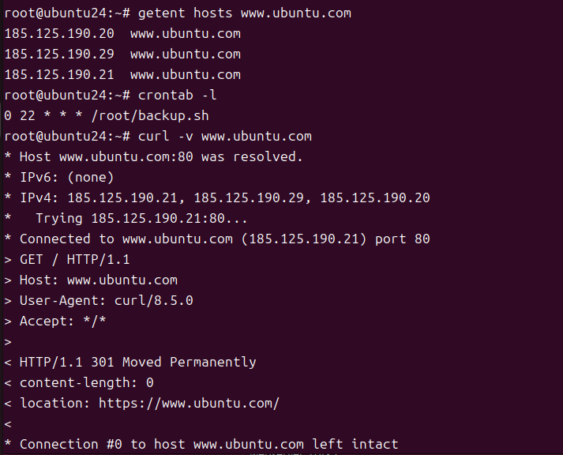
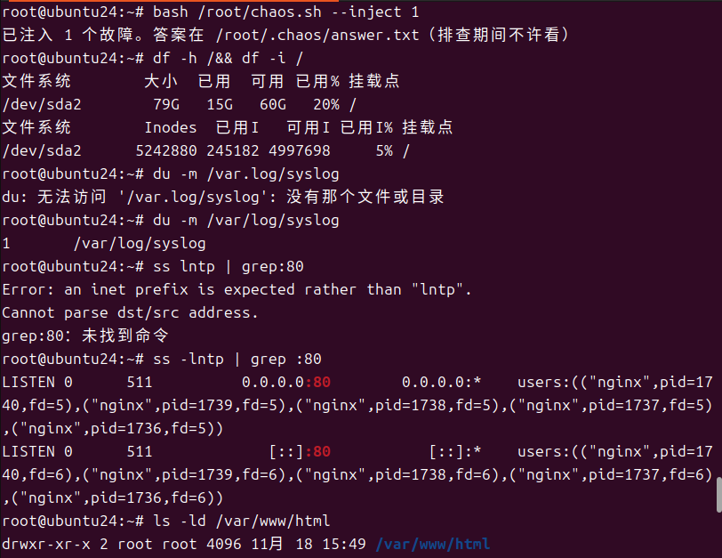
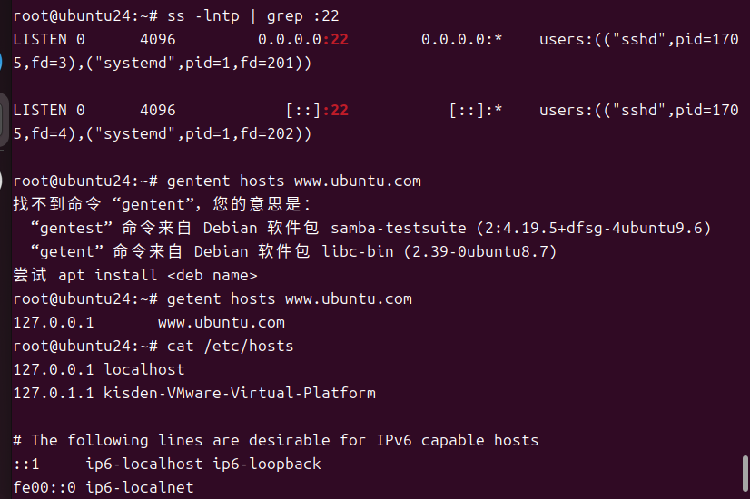
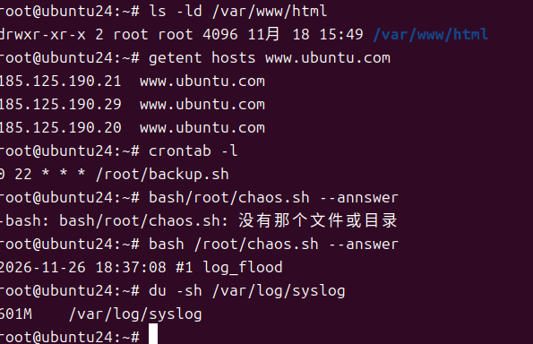
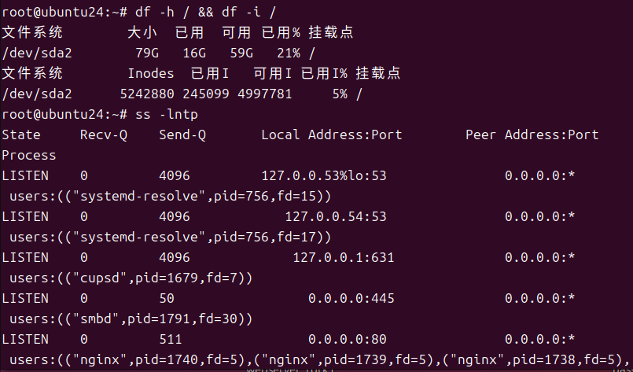
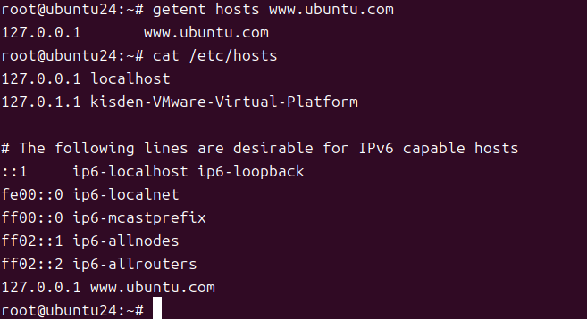

# Linux 盲盒对抗与复盘：不给答案的排障训练

> 前五册都是「知道答案再动手」，本册反过来：**先注入、后猜、限时、不许看答案**。题库 6 类，注入器自己写，故障自己查，答案锁在 `/root/.chaos/answer.txt` 里。
> 两轮实测的结论都写在这句话里：**排障能力的分水岭不在命令，在「从现象生成候选假设」这一步**。第一轮唯一那个故障（`log_flood`），命令我全都会——`df`、`du`、`ss` 一条不少地敲了，但方向里根本没有「容量/日志」这一项，于是全程在看端口和权限，最后靠看答案才知道 `/var/log/syslog` 已经被写到 **501 MB**。第二轮换成 `hosts_wrong`，`getent` 一条命令就把方向锁死，第 2 条命令确认根因。
> 第二条结论是技术性的：**渐变型故障单次采样等于没采样**。开局 `df` 读到 20%、`du` 读到 1 MB，这两个数字在那一刻都是真的，但故障正在持续写入——20 分钟后同一台机器是 21% / 501 MB。采样只描述瞬间，不描述趋势。

**快速导航**：[训练方式对照](#21-为什么必须做盲盒训练方式与能力的对照) · [三条纪律](#22-盲盒的三条纪律) · [四个指标](#23-四个指标比修好了几个故障更可信) · [注入器的两个硬约束](#24-注入器的两个硬约束自检与对称恢复) · [题库为什么只有-6-类](#25-题库为什么只有-6-类) · [单次采样为什么不够](#26-单次采样为什么不够渐变型故障的判据) · [R1-未定位的那个故障](#32-r1log_flood未定位的那个故障) · [R2-hosts-劫持](#33-r2hosts_wrong两条命令锁定) · [误判与踩坑复盘](#4-误判与踩坑复盘) · [命令速查表](#5-常用命令速查表)

---

## 1. 实验环境与基线状态

| 角色 | 主机 / 位置 | 说明 |
|---|---|---|
| 被测主机 | ubuntu24（VMware 虚拟机） | 所有故障注入在这里，必须可回滚 |
| 操作台 | VMware 窗口（控制台） | 注入必须在窗口里做，否则 `ssh_down` 会切断你自己的 SSH 会话 |
| 客户端（可选） | Windows 11 宿主机 | `ssh -v kisden@192.168.153.128`，从外部观察客户端现象 |
| 回滚点 | 快照 `r1-clean` | 环境没回到基线就回滚，不硬撑 |

| 项目 | 实测值 |
|---|---|
| 虚拟化平台 | VMware Workstation 17.6.3（VMnet8 NAT） |
| 操作系统 | Ubuntu 24.04.4 LTS |
| 登录用户 | `kisden`（`sudo` 需输密码，注入器强制 root） |
| 内网 IP / 网卡 | `192.168.153.128/24`，网卡 `ens33`（DHCP，每轮开始要重新确认） |
| nginx | `active`，版本 **1.24.0**，站点根目录 `/var/www/html`，首页 `index.nginx-debian.html` |
| SSH | openssh-server **9.6p1**，22 端口监听，**socket 激活**（`ssh.socket`） |
| 时间同步 | `systemd-timesyncd`——**本机没有 chrony**，`chronyc` 一律用不了 |
| 磁盘 | 79 GB，基线已用 15 GB，可用 60 GB，使用率 20% |
| inode | 5242880 总量，已用 245099，使用率 5% |

基线不是一个数字，是**一组**能判「环境干净」的锚点：

| 基线项 | 实测值 |
|---|---|
| `df -h /` | `/dev/sda2 79G 15G 60G 20% /` |
| `df -i /` | `5242880 245099 4997781 5% /` |
| `:80` 监听 | `LISTEN 0 511 0.0.0.0:80`，`nginx` 五个 fd：PID 1740 / 1739 / 1738 / 1737 / 1736 |
| `:22` 监听 | `sshd` PID 1705 `fd=3` **+ `systemd` PID 1 `fd=201`** |
| 解析结果 | `getent hosts www.ubuntu.com` → `185.125.190.20` / `.29` / `.21` 三个地址 |
| `curl -v` 外网 | `Connected to www.ubuntu.com (185.125.190.21) port 80` → `HTTP/1.1 301 Moved Permanently` → `location: https://www.ubuntu.com/` |
| `curl -I 127.0.0.1` | `HTTP/1.1 200 OK`，`Server: nginx/1.24.0 (Ubuntu)`，`Content-Length: 615`，`ETag: "6afd588e-267"` |
| 定时任务 | `crontab -l` 只有一条：`0 22 * * * /root/backup.sh` |



*正常态长什么样，必须先记下来。这张图是本册所有「异常」的参照物：解析返回公网地址、只有一条定时任务、外网 301。后面 R2 的 `getent` 返回 `127.0.0.1`，就是与这一行对比出来的。*



*开局的 `df` 与 `du` 都是干净的。问题在于——**这个干净只属于这一秒**。故障正在往同一个文件里持续写，20 分钟后同一台机器就是 21% / 501 MB。*

**开盲盒之前必须确认三件事**，任意一条不成立就不开始：

1. 快照还在（`vmrun listSnapshots` 能看到 `r1-clean`）；
2. 控制台能进（`ssh_down` 一旦注入，SSH 进来的路全断）；
3. 宿主机可用内存留 2 GB 以上（VM 被宿主挤占时，故障现象会失真，这条在分册五做 OOM 时已经吃过一次）。

**为什么操作台是硬条件而不是偏好**：本册题库里 `ssh_down` 会把 22 端口停掉。如果你从 SSH 会话里注入它，注入成功的那一刻你自己就被踢出局了——命令还没返回，连接已经断，你连「注入成功没有」都验不了。这不是谨慎问题，是**执行通道的单点故障**。

---

## 2. 核心底层原理

### 2.1 为什么必须做盲盒：训练方式与能力的对照

前五册每一步都「先看答案再操作」，这会制造一种危险的错觉：觉得自己会了。真实排障的起点永远是一个**没有标签的现象**——用户只会说「网站打不开」，不会告诉你卡在 DNS 还是端口还是证书。

| 训练方式 | 实际训练的能力 | 能迁移到现场吗 |
|---|---|---|
| 照步骤做（分册一至五） | 操作熟练度、命令记忆 | 部分可以 |
| 盲盒（本册） | 现象 → 假设 → 验证的跳跃 | 可以 |
| 只看答案 | 记忆 | 不能 |

差别就在「候选假设从哪来」。照步骤做时，候选集由教材替你列好了，你只是执行；盲盒里没人给候选集，你得自己从现象里长出方向。

**本册的验收标准只有一条：在不知道故障是什么的前提下，首次假设的命中率。**

| 命中率 | 判定 |
|---|---|
| ≥ 50% | 具备独立排障能力 |
| 25% – 50% | 能查，但方向靠试，需要继续练 |
| < 25% | 前三册的知识没有形成条件反射，建议重做分册一、二 |

### 2.2 盲盒的三条纪律

| 纪律 | 为什么 | 怎么执行 |
|---|---|---|
| 不许看答案文件 | 看了就退化成「照步骤做」，本轮作废 | `/root/.chaos` 权限 `700`、`answer.txt` 权限 `600`，排查期间不 `cat` |
| 限时 | 现场没有无限时间，慢就等于不可用 | 单个故障 20 分钟封顶，超时记「未定位」并跳过 |
| 必须恢复 | 下一轮要在干净环境上开始 | 每轮 `--restore`，再跑一遍 6 维巡检确认 |

第一条是唯一一条**无法自证**的纪律：没人能证明你没偷看。所以答案文件的隔离要靠机制，不能靠自律——`700` 目录 + `600` 文件，至少保证「误 `cat`」不会发生。

### 2.3 四个指标，比「修好了几个故障」更可信

| 指标 | 定义 | 怎么算 |
|---|---|---|
| 首次假设命中率 | 第一次给出的方向就是正确答案的比例 | 命中数 ÷ 故障总数 |
| 平均定位耗时 | 从看到现象到说清根因的时间 | 总耗时 ÷ 故障数 |
| 定位层级 | 第几条命令确定根因 | 越小越好，≤ 3 条为熟练 |
| 误判次数 | 方向错、回退重来的次数 | 每次回退记 1 次 |

四个指标里，**「定位层级」是最难作假的一个**：耗时可以靠手快，命中率可以靠运气（题库小），但「第几条命令锁定」直接反映你的判断链有多长。第 2 条命令就锁定，说明假设是从现象直接推出来的；第 8 条才锁定，说明前面 6 条都在试。

面试时同样的两句话，可信度差一个量级：

- 「我做过 Linux 排障实训，修好过十几个故障。」——无法验证。
- 「盲盒训练：首轮命中率 0%，第二轮 100%，定位层级从 5 条降到 2 条，暴露的短板是不做容量趋势。」——每个数字都能追问，也经得起追问。

### 2.4 注入器的两个硬约束：自检与对称恢复

这是本册真正的工程部分。注入器写错，训练数据全废，而且**错得很安静**。

**约束一：每个注入函数必须自己验证「注入成功了」。**

没有自检的注入器会让你在盲盒里查一个根本不存在的故障——查不到不是你不行，是题没出。反过来，自检写得不严会更糟：它告诉你「注入成功」，你带着错误的前提排查 20 分钟。

自检失效有三种形态，本册都遇到过或规避过：

| 形态 | 例子 | 为什么恒真/恒假 | 正确写法 |
|---|---|---|---|
| **锚点漂移** | `perm_denied` 的自检写成 `test -r index.html`，而本机首页叫 `index.nginx-debian.html` | 文件不存在 → `test -r` 恒假 → 取反恒真，**没注入也报成功** | 用服务视角验证：`curl` 应返回 **403** |
| **环境缺陷** | `dns_bad` 的 `! timeout 3 getent ...` 在本来就断网的机器上恒真 | 断网时解析本来就失败，与注入无关 | 注入前先 `precheck`：能解析才允许注入 |
| **只查命令返回** | `systemctl stop nginx; echo $?` | `stop` 返回 0 只说明「信号发出去了」 | 查内核事实：`ss -lntH` 里 `:80` 是否真的没了 |

**约束二：恢复必须与注入严格对称。**

少恢复一项，下一轮的现象就是叠加的——你会对着两个故障找一个根因；多恢复一项，可能把基线改坏（例如把 `chmod 755` 写成 `chmod 777`，问题被掩盖，下一轮 403 再也复现不出来）。

本册做法：`do_inject` / `verify_one` / `do_restore` 三段分离，`FAULTS` 数组里的每一类在三段里各有一个分支，**数量必须一一对应**。改动任何一段，都要回头数一遍分支数。

> 为什么单独拆出 `verify_one`：一开始我把自检写在 `do_inject` 末尾，结果 `--status` 想复用就只能再调一次注入函数——`hosts_wrong` 会再追加一行、`log_flood` 会再写 500 MB。**读操作和写操作必须共用判据、不共用代码路径**，这是写注入器时踩到的第一个坑。

### 2.5 题库为什么只有 6 类

参考实现有 8 类，本册移除 `disk_full` 与 `cron_broken`：

| 故障类型 | 去留 | 理由 |
|---|---|---|
| `log_flood` | 保留 | rsyslog 正常，`/var/log/syslog` 存在 |
| `port_busy` | 保留 | nginx 已装、python3 可用、80 端口空置 |
| `perm_denied` | 保留 | 站点根目录与 `www-data` 就绪，自检锚点已改为 `index.nginx-debian.html` |
| `ssh_down` | 保留 | sshd 9.6p1，22 在听 |
| `dns_bad` | 保留 | `systemd-resolved` active，`resolvectl` 可用，默认网卡 `ens33` |
| `hosts_wrong` | 保留 | `/etc/hosts` 可写 |
| `disk_full` | **移除** | 79 GB 盘要到 95% 还需再写约 **57 GB**，宿主机空间与耗时都不划算；容量类判据已在分册一完整演练 |
| `cron_broken` | **移除** | 注入用 `crontab -` 覆盖、恢复用 `crontab -r` 清空，会**永久删掉本机那条真实备份任务**，为一次训练破坏基准环境不划算 |

判断依据不是「哪类简单」，是**「这类故障的判据是否已在别处练过」+「注入代价是否可逆」**。`disk_full` 属于前者（判据同 `log_flood`，都是容量方向），`cron_broken` 属于后者（不可逆地改基线）。

### 2.6 单次采样为什么不够：渐变型故障的判据

这是本册最贵的一课，用 501 MB 换来的。

故障按「现象随时间的行为」分两类：

| 类型 | 例子 | 判据 | 陷阱 |
|---|---|---|---|
| **阶跃型** | `port_busy`、`ssh_down`、`perm_denied`、`hosts_wrong` | 一次取证即可定性：`ss` / `curl -I` / `getent` | 几乎没有——现象稳定，重复查结果一样 |
| **渐变型** | `log_flood`、内存泄漏、连接数爬升 | 必须**两次采样求差**：`df` 间隔 1 分钟再读 | **单次采样看起来完全正常** |

渐变型的判据公式很简单：

```bash
# 间隔采样：差值才是证据，绝对值不是
df -h / | awk 'NR==2{print $3, $5}'; sleep 60; df -h / | awk 'NR==2{print $3, $5}'
```

本册 R1 的实测差值：开局 `15G / 20%`，后段 `16G / 21%`，同期 `du -sh /var/log/syslog` 从 **1 MB 涨到 501 MB**。三条命令就能定性，但我一条都没在「后段」重跑。

**为什么「涨 1%」容易被判成正常**：1% 在直觉上属于「噪声」。判据必须换成**绝对量与增速**：`du -sh /var/log/* | sort -h | tail -3` 给出「谁在涨」，`df` 两次差值给出「涨多快」。只问「谁可能在写」，永远会得到「大概是那个备份任务」这种无法证伪的答案。

### 2.7 开局三连与四层切分：本册的标准动作

**开局三连**（30 秒内跑完，先读现场再提名）：

```bash
ss -lntp                                   # 谁在听：80/22 两层一次切干净
curl -I http://127.0.0.1/                  # 服务给不给答案：200 / 403 / 5xx / 000
df -h / && df -i /                         # 容量与 inode：块满了还是索引满了
```

**四层切分**（多个故障叠加时决定先查哪个）：

| 顺序 | 层 | 命令 | 一次能切掉什么 |
|---|---|---|---|
| 1 | 监听层 | `ss -lntp` | `ssh_down`、`port_busy`（80/22 有没有人听、听的是谁） |
| 2 | 应用层 | `curl -I http://127.0.0.1/` | `perm_denied`（403）、配置错（5xx）、服务不对（Server 头变了） |
| 3 | 解析层 | `getent hosts <域名>` + `resolvectl status` | `dns_bad`、`hosts_wrong` |
| 4 | 容量层 | `df -h /` + `du -sh /var/log/* \| sort -h \| tail -3` | `log_flood`（以及分册一的磁盘类） |

排序原则：**判定成本低、影响面广的先做**，一次只动一处。改完立刻复验，否则「恢复了哪个」说不清。

### 2.8 一个反直觉点：22 端口的监听者可能不是 sshd

R2 排查时顺手截了 22 端口，它的形态值得单独说：

```
LISTEN 0 511 0.0.0.0:22 0.0.0.0:*
  users:(("sshd",pid=1705,fd=3),("systemd",pid=1,fd=201))
```

一条监听记录里有**两个**持有者：`sshd` 的 fd=3，和 **`systemd` 的 fd=201**。`fd=201` 是 `ssh.socket` 持有的监听套接字，`sshd` 只是被 socket 激活起来的服务进程。



*这张图是分册三结论的现场复现：`systemctl stop ssh` 之后 22 端口仍然在听，因为端口不在 sshd 手里。写 `ssh_down` 注入时必须先停 `ssh.socket`，否则「注入了但端口还在」，自检立刻失败。*

判据：

| 形态 | `ss -lntp` 特征 | `stop ssh` 后端口 |
|---|---|---|
| socket 激活 | `("systemd",pid=1,fd=...)` 与 `sshd` 并列 | **仍在听** |
| 常驻模式 | 只有 `("sshd",pid=N,fd=...)` | 立即消失 |

这就是注入器里那段判断的来由：

```bash
if systemctl cat ssh.socket >/dev/null 2>&1; then
    systemctl stop ssh.socket ssh.service
else
    systemctl stop ssh
fi
```

**「停服务」和「停端口」在 systemd 里是两件事**，这一条从分册三一直贯穿到本册的脚本实现。

---

## 3. 分故障实操记录

### 3.1 注入器落地：三个设计决定

完整代码见文末 [`scripts/chaos.sh`](#1-scriptschaosh)。在写它的时候做了三个决定，每一个都对应一次「不这么做就会错」：

1. **注入后立刻自检，失败自动回退。** `precheck` 先确认前提，`do_inject` 改状态，`verify_one` 判事实，三步缺一不可。自检失败不是「报个错」，是**调用 `do_restore` 把状态改回去**——否则环境里留下半个故障，下一轮开始就是脏的。
2. **`--inject N` 不许重复抽取。** 参考实现用 `RANDOM % 6` 取 N 次，可能同一个故障注入两遍，看起来注入了 4 个实际只有 3 种。本册用洗牌后取前 N 个（Fisher-Yates），保证互不重复。
3. **答案与状态分开存。** `answer.txt` 记「注入了什么、什么时间」，`--status` 靠 `verify_one` 判断「现在还在不在」。两者不一致（例如你手工改回了某个配置）时，`--status` 会说「现象已消失」，而不是继续骗你。

自测顺序（这一段不能省）：

```bash
bash -n /root/chaos.sh                  # 语法闸门，无输出即通过
sudo ./chaos.sh --list                  # 应列出 6 类
sudo ./chaos.sh --inject 1              # 单发一轮
sudo ./chaos.sh --status                # 现象应「仍在」
sudo ./chaos.sh --restore               # 恢复并复核
./blindbox-audit.sh                     # 6 维巡检，回到基线才算干净
```

### 3.2 R1：`log_flood`——未定位的那个故障

**注入**：

```bash
sudo bash /root/chaos.sh --inject 1
# 已注入 1 个故障。答案在 /root/.chaos/answer.txt（排查期间不许看）
```

**现象**：什么都没有。`curl -I 127.0.0.1` 返回 200，`ss` 里 nginx 五个 fd 正常，`ls -ld /var/www/html` 是 `drwxr-xr-x`，只有 `df` 从 20% 变成 21%。没有报错、没有 404、没有拒绝连接——**唯一的异常是一个 1% 的数字**。

**当时的排查路径**（按截图逐条还原）：

| # | 命令 | 输出 | 我的判读 |
|---|---|---|---|
| 1 | `df -h / && df -i /` | `15G / 20%`，inode `5%` | 容量正常，排除磁盘类 |
| 2 | `du -m /var/log/syslog` | 首次 `无法访问 ... 没有那个文件或目录`；再执行得 `1` | 日志 1 MB，正常 |
| 3 | `ss lntp \| grep:80` | `Error: an inet prefix is expected rather than "lntp"` | 手误，重敲 |
| 4 | `ss -lntp \| grep :80` | `nginx` PID 1740/1739/1738/1737/1736 | 80 是 nginx，排除 `port_busy` |
| 5 | `ls -ld /var/www/html` | `drwxr-xr-x 2 root root 4096 11月 18 15:49` | 权限正常，排除 `perm_denied` |

五条命令，方向覆盖了「磁盘、端口、权限」三族——**唯独没有「日志/容量」这一族**。20 分钟封顶后标记未定位。

**看答案之后**：

```bash
bash /root/chaos.sh --answer
# 2026-11-26 18:37:08 #1 log_flood
du -sh /var/log/syslog
# 501M  /var/log/syslog
```



*这张图是本册最贵的一屏。`--answer` 与 `du -sh` 挨着执行，两个事实同屏：注入的是 `log_flood`，而文件已经 **501 MB**。同一台机器、同一个文件，我在开局读到的却是 1 MB。*

**后段复测的 `df`**：



*20 分钟后的现场：`16G / 21%`。除了这 1%，所有服务都正常。这就是渐变型故障的可怕之处——它不破坏任何功能，只吃容量，直到某一刻 `df` 跳红。*

**根因**：`log_flood` 持续向 `/var/log/syslog` 追加内容，共写入约 **501 MB**（`du -sh` 读数）。磁盘从 15 GB 用到 16 GB，占比 20% → 21%。

**为什么没找到**（这一条比根因重要）：

1. **方向缺一族。** 我的候选集是「服务没起来 / 端口被占 / 权限不对 / 解析坏了」，没有「磁盘在涨」。命令会，方向不会——`df` 我第一条就敲了，但敲它的目的是「排除磁盘类」，不是「测量增速」。
2. **单次采样当结论。** 开局读到 20% 与 1 MB，我把它当成「整轮的容量状态」，之后 20 分钟再没读过。**渐变型故障的第一次采样永远是正常的**，因为它就是从这个正常值开始涨的。
3. **`du` 的第一次报错被忽略。** 首次 `du -m /var/log/syslog` 返回「没有那个文件或目录」，第二次却返回 `1`。同一秒内文件「不存在又存在」，说明它正在被重建或轮转——这本身就是一个信号，我把它当成命令抖动跳过了。
4. **把「有人写盘」当成「写的是正常东西」。** 本机 `crontab` 只有一条 `0 22 * * * /root/backup.sh`，而当前是 18 点多——它**根本还没到执行时间**。我却用「大概是那个备份任务」解释了这个 1% 的涨幅。用一个时间点对不上的进程解释现象，是把自己骗过去。

**修复**：`truncate -s 0 /var/log/syslog`（或从注入前的备份回灌，见脚本 `syslog.bak` 逻辑），然后 `systemctl restart rsyslog` 确认继续写入。

**预防**：

```bash
# ① 间隔采样，差值才是证据
df -h / | awk 'NR==2{print $3,$5}'; sleep 60; df -h / | awk 'NR==2{print $3,$5}'

# ② 谁在涨：按体积排前三
du -sh /var/log/* 2>/dev/null | sort -h | tail -3

# ③ 日志轮转兜底，单文件不超过 200M
# /etc/logrotate.d/rsyslog:  size 200M / rotate 5 / compress / delaycompress
```

### 3.3 R2：`hosts_wrong`——两条命令锁定

**现象**：域名「解析不出来」。`curl -v` 停在 `Could not resolve host`，`getent hosts` 无输出。

**排查**：

```bash
getent hosts www.ubuntu.com
# 127.0.0.1       www.ubuntu.com
```

第 1 条命令就把方向定死了：**返回的是 `127.0.0.1`，不是空、不是超时、不是错误码**。

| 解析结果 | 含义 | 下一步 |
|---|---|---|
| 空 / 超时 | 解析链断，或上游不可达 | `resolvectl status`、`resolvectl query` |
| **`127.0.0.1` / 内网地址** | **本地有覆盖**（`/etc/hosts` 或本地 DNS） | `cat /etc/hosts`、`tail -5 /etc/hosts` |
| 错误但合法的公网 IP | DNS 记录被改 / 缓存被污染 | `dig @上游` 对照 |
| 正确 | 不在解析层 | 转 TCP / TLS / HTTP |

第 2 条命令确认：

```bash
cat /etc/hosts
# 127.0.0.1 localhost
# 127.0.0.1 kisden-VMware-Virtual-Platform
# ...（IPv6 段）
# 127.0.0.1 www.ubuntu.com        ← 注入的那一行，追加在文件末尾
```



*两条命令、一张图。`getent` 给出「本地覆盖」这个方向，`cat /etc/hosts` 给出那一行。注意注入行在**文件末尾**——`tail` 一眼可见，这也是为什么 `tail -5 /etc/hosts` 比 `cat` 更适合做快速判据。*

**根因**：`/etc/hosts` 被追加 `127.0.0.1 www.ubuntu.com`，应用解析走 glibc NSS，`hosts` 优先于 DNS，于是请求打到本机 nginx。

**为什么 `dig` 会「正常」**：`dig` 直接向上游 DNS 发包，**完全跳过 `/etc/hosts`**；`getent` / `curl` / `ping` / `ssh` 走 NSS 链（`hosts` → `resolve` → `dns`）。所以「`dig` 能解析、`getent` 不能」这个组合，几乎就是本地覆盖的铁证。

**修复**：

```bash
sudo sed -i '\|127\.0\.0\.1 www\.ubuntu\.com|d' /etc/hosts
sudo resolvectl flush-caches          # 有缓存时才需要
getent hosts www.ubuntu.com           # 复核：应回到三个公网地址
```

**预防**：`hosts` 文件做指纹基线（分册四的 `hosts-drift-check.sh`），定期比对；巡检里加一条「公网域名指向回环/内网」的规则。

### 3.4 恢复与复核：恢复不等于改回去

`--restore` 执行完只说明命令返回 0，不说明环境回到基线。复核清单固定四项：

```bash
ss -lntp | grep -E ':80|:22'        # 端口回来了，且监听者身份对
curl -I http://127.0.0.1/           # 200，且 Server 是 nginx
getent hosts www.ubuntu.com         # 三个公网地址
du -m /var/log/syslog               # 回到 MB 量级
./blindbox-audit.sh                 # 6 维全 OK 才算干净
```

四项里最容易漏的是**监听者身份**：端口回来了但占用者是 python 而不是 nginx，`curl` 一样返回 200，可你其实还在故障态。

### 3.5 把注入器的自检反过来当巡检

`do_inject` 里每一条 `verify_one` 的判据，反过来就是一条健康检查。这不是巧合——**「注入成功的判据」和「健康状态的反面」本来就是一回事**。

| 维度 | 判据 | 健康值 | 异常含义 |
|---|---|---|---|
| 容量 | `du -m /var/log/syslog` | < 200 MB | ≥ 500 MB 即 `log_flood` 形态 |
| 端口 80 | `ss -lntH` 有 `:80` + 持有者是 nginx | `LISTEN` / `nginx` | 无监听 = 服务没起；他人持有 = `port_busy` |
| 端口 22 | `ss -lntH` 有 `:22` | `LISTEN` | 无监听 = `ssh_down`（远程会全断） |
| 站点 | `curl -o /dev/null -w '%{http_code}'` | 200 / 301 / 302 | 403 = 权限；5xx = 上游；000 = 没起 |
| 解析 | `getent hosts` | 公网地址 | 空 = 链路断；`127.0.0.1` = 本地覆盖 |
| 时间 | `timedatectl show -p NTPSynchronized` | `yes` | `no` = 证书与日志排序都会坏 |

这份表就是文末 [`scripts/blindbox-audit.sh`](#2-scriptsblindbox-auditsh) 的全部逻辑，退出码直接可接监控：`0` 干净 / `1` 有 WARN / `2` 有 FAIL。

---

## 4. 误判与踩坑复盘

| # | 最初判断 | 实际原因 | 为什么错 | 后续规避 |
|---|---|---|---|---|
| 1 | `df` 20%、`du` 1 MB → 容量正常 | 故障正在持续写入，20 分钟后 501 MB | 把单次采样当整轮状态 | 渐变型一律间隔采样，比较差值 |
| 2 | `du` 报「文件不存在」是命令抖动 | 文件正被重建/轮转，第一次读到了瞬时状态 | 把异常输出当噪声跳过 | 同一条命令的输出不一致时，先解释不一致 |
| 3 | `ss lntp` 报错说明「端口查不到」 | `lntp` 少了 `-`，参数被当成地址前缀 | 手误输出与故障输出长得一样 | 命令报错先读报错文本，别急着下结论 |
| 4 | 涨幅 1% 是「每分钟备份任务在写盘」 | `crontab` 只有 `0 22 * * * /root/backup.sh`，当时 18 点 | 用一个时间点对不上的进程解释现象 | 先 `crontab -l` 核对执行时间，再谈「谁在写」 |
| 5 | 首轮候选方向覆盖了所有故障族 | 缺「容量/日志」整族，`df` 只是用来「排除」 | 把「会敲命令」当成「会有方向」 | 开局按四层切分走一遍，容量层必须落到 `du` 排序 |
| 6 | `systemctl stop ssh` 后 22 应该没了 | `ssh.socket` 持有监听 fd，端口仍在 systemd 手里 | 把「停服务」等同「停端口」 | 先 `ss` 确认端口消失，再算注入成功 |
| 7 | 自检写 `test -r index.html` 就够 | 本机首页是 `index.nginx-debian.html`，取反后恒真 | 自检锚点绑在具体文件名上 | 用服务视角自检：`curl` 必须是 403 |
| 8 | 断网机器上 `dns_bad` 注入成功 | 解析本来就失败，自检恒真 | 没做前置条件检查 | `precheck` 先确认「本来能解析」 |
| 9 | `--status` 直接复用注入函数 | `hosts_wrong` 会再追加一行、`log_flood` 会再写 500 MB | 读操作与写操作共用代码路径 | 拆 `verify_one`，只读判断单独实现 |
| 10 | 用 SSH 会话跑 `--inject` | `ssh_down` 会切断会话，注入结果无法验证 | 执行通道有单点故障 | 注入永远在 VMware 控制台做 |

**第 1 条与第 5 条是同一个错误的两面**：一个是「采样方式错」，一个是「方向集合不全」。两者叠加，就是 R1 的 0 命中——不是查不动，是**根本没往那个方向查**。

第 4 条值得单独记：它是我第一次意识到「解释力」也可以造假。一个「每分钟在写盘的任务」能解释任何缓慢增长，听起来完美，但它在这台机器上**不存在**。判据必须落到可验证的事实（`crontab -l` 的执行时间、`du` 的增量），而不是落到一个「听起来合理」的机制。

---

## 5. 常用命令速查表

| 场景 | 命令 | 关键看什么 |
|---|---|---|
| 开局三连 | `ss -lntp`；`curl -I http://127.0.0.1/`；`df -h / && df -i /` | 30 秒内切掉端口/应用/容量三层 |
| 谁在听端口 | `ss -lntp \| grep :80` | 进程名 + `users:((...))` 的 pid/fd |
| 端口持有者身份 | `ss -lntpH 'sport = :80'` | 出现 `systemd,pid=1` 即 socket 激活 |
| 服务健康 | `curl -I http://127.0.0.1/` | 200 / 403 / 5xx / 000 四档 |
| 完整交互 | `curl -v <url>` | 断点在哪一层：解析 / 握手 / 请求 / 响应 |
| 只看响应头 | `curl -sI <url>` | `Server` 头能识破「端口被别的服务占了」 |
| 状态码机器可读 | `curl -s -o /dev/null -w '%{http_code}' <url>` | 脚本判据用这个，不解析人读输出 |
| 容量趋势 | `df -h /` 间隔 60 秒两次 | **差值**，不是绝对值 |
| 日志体积 | `du -sh /var/log/syslog` | 与基线比，与上一分钟比 |
| 谁在涨 | `du -sh /var/log/* \| sort -h \| tail -3` | 排名前三，直接点名 |
| 目录权限断点 | `namei -l /var/www/html/index.nginx-debian.html` | 从上往下读，停在第一个缺位层级 |
| 服务身份读文件 | `sudo -u www-data test -r <file>` | 复现 403 的第一条命令 |
| 解析结果 | `getent hosts <域名>` | 空 / 127.x / 公网，三种含义完全不同 |
| 纯 DNS 答案 | `dig +short <域名> @<上游>` | 与 `getent` 对照，判断是否本地覆盖 |
| 本机解析配置 | `resolvectl status` | 当前网卡的上游 DNS |
| hosts 末尾 | `tail -5 /etc/hosts` | 注入行通常追加在末尾 |
| 时间同步 | `timedatectl`；`timedatectl show -p NTPSynchronized` | `synchronized: yes` |
| 定时任务 | `crontab -l` | 有几条、什么时候跑（别凭空假设） |
| 语法闸门 | `bash -n script.sh` | 改完脚本第一件事 |
| 自检注入 | `ss -lntH \| awk '$4 ~ /:80$/'` | 读内核事实，不读 `systemctl` 的返回码 |

---

## 6. 思考题解答

### Q1 为什么「知道答案再操作」的训练，无法转化为现场排障能力？

现场缺的不是操作，是**从现象生成候选假设**这一步。照步骤做的时候，这一步由教材替你做完了，你练的只是执行；盲盒里没人给候选集。

R1 的 `log_flood` 就是证据：`df`、`du`、`ss`、`ls -ld` 我全会敲，一条也没少，但方向里没有「日志/容量」这一项，于是五条命令全在排除别的族。**会命令不代表会有方向**，这两件事在不同的层。

### Q2 如果 4 个故障同时存在、现象相互叠加，该按什么策略决定先查哪个？

按「判定成本低 + 影响面广」排序，一次只动一处：

1. `ss -lntp` 与 `curl -I http://127.0.0.1/` 先把 80/22 这层切干净（覆盖 `port_busy`、`ssh_down`、`perm_denied`、服务没起）；
2. `getent hosts` 与 `resolvectl status` 切解析层（覆盖 `dns_bad`、`hosts_wrong`）；
3. `df -h /` 与 `du -sh /var/log/* | sort -h | tail -3` 看容量层（覆盖 `log_flood`）；
4. 最后才进配置文件。

**为什么容量层放最后**：它最慢（要间隔采样），而且不影响前两层的判据——`log_flood` 不会让 `ss` 或 `getent` 的输出变形。反过来，如果先查容量，前两层的问题会一直在干扰你。

### Q3 你的 `chaos.sh` 里，哪一类自检最不可靠？为什么？

`perm_denied` 最不可靠，`dns_bad` 次之。

- `perm_denied` 的自检绑在具体文件名上。参考实现写 `index.html`，本机首页叫 `index.nginx-debian.html`，文件不存在 → `test -r` 恒假 → 取反恒真，**没注入成功也报成功**。改成 `curl` 必须返回 403 之后才可靠：403 是服务视角的事实，与文件名无关。
- `dns_bad` 的 `! timeout 3 getent ...` 在本来就断网的机器上恒真，把「环境缺陷」当成「注入成功」。修法是加 `precheck`：先确认 `getent` 本来能解析，才允许注入。

最可靠的是 `ssh_down` 和 `port_busy`：它们读内核监听表（`ss -lntH`），不依赖任何业务文件，也不依赖网络。

### Q4 题库从 8 类减到 6 类，会削弱训练效果吗？

会削弱**覆盖面**，不削弱这条训练的主线。依据是「判据是否已在别处练过」：

- `disk_full` 的判据（`df -h / df -i`）与 `log_flood` 同属容量方向，而容量方向恰恰是我唯一失手的方向——说明这条判据练得不够，但缺的不是「另一种故障」，是「趋势采样」这个动作。
- `cron_broken` 的判据（`crontab -l`）已写进本册速查表，且它的注入代价不可逆（会删掉真实定时任务），不适合做题库。

真正的损失是「容量打满后服务怎么表现」这种**复合现象**没演练到。补法不必写 57 GB：用 `dd` 造 200 MB 小文件 + 调低 `df` 关注阈值即可模拟同样的判据。

### Q5 为什么 `df` 和 `du` 会给出不同的结论？什么时候必须两个都看？

因为统计对象不同：

| 命令 | 统计的是 | 数据来源 |
|---|---|---|
| `df` | **文件系统**层面已分配块 | 文件系统的超级块 / 块位图 |
| `du` | **文件**层面实际占用块 | 遍历目录 + `stat` 的 `st_blocks` |

三种典型不一致：

1. **已删除但被进程持有**：`df` 显示占用，`du` 找不到那个文件（分册一的 `lsof +L1` 场景）；
2. **稀疏文件 / 预分配**：`ls -l` 大小很大，`du` 只算实际块；
3. **页缓存未回写**：刚写入的大文件，`du` 的块统计可能滞后于真实占用。

本册的用法很简单：**`df` 判「还剩多少」，`du` 判「谁占的」**。要判断「是不是在涨」，两个都要间隔采样——`df` 给趋势，`du` 给嫌疑人。

---

## 7. 总结与方法论沉淀

### 核心原则

1. **排障的难点是「方向」，不是「命令」。** 命令可以查手册，方向只能从现象里长出来。盲盒训练的就是这一步。
2. **渐变型故障必须间隔采样。** 单次采样描述瞬间，趋势才描述故障。`df` 的差值和 `du` 的排名，是容量类的两条腿。
3. **注入器没有自检，等于没有题库。** 自检失败要自动回退，而不是只报错——半个故障比没有故障更难查。
4. **恢复必须与注入对称。** 三段分离（`do_inject` / `verify_one` / `do_restore`），改一段就数一遍分支。
5. **读操作与写操作不能共用代码路径。** `--status` 复用注入函数会二次注入，这是设计问题，不是手滑。
6. **自检的锚点要选「服务视角的事实」**：`curl` 的 403 比 `test -r` 稳，`ss` 的监听表比 `systemctl` 的返回码稳。
7. **前置条件不满足时，宁可不注入。** 断网环境注入 `dns_bad` 只会得到恒真自检，制造假阳性。
8. **解释力不等于正确性。** 「每分钟备份任务在写盘」能解释任何缓慢增长，但 `crontab -l` 一查就知道它 22:00 才跑。判据要落到可验证的事实。
9. **复盘的价值在「我当时为什么这么想」**，不在「正确答案是什么」。事后补不出思路，所以必须在当时记。
10. **指标比形容词可信。** 命中率、定位层级、误判次数，三个数字就能说清一轮训练的质量。

### 排查优先级（本册版）

**开局**：`ss -lntp` → `curl -I` → `df -h / && df -i /`。三连跑完再提名，不要先猜再验。

**按现象分流**：

| 现象 | 第一条命令 | 能直接排除 |
|---|---|---|
| 页面打不开 | `curl -v <url>` | 定层：解析 / TCP / TLS / HTTP |
| 返回 403 | `sudo -u www-data test -r <file>` + `namei -l` | 是 DAC 还是 ACL/AppArmor |
| SSH 连不上 | `ssh -v -p <port>` | `refused`（没人听）还是 `timeout`（被丢包） |
| 域名解析不了 | `getent hosts` | 空 / 127.x / 公网，三档三方向 |
| 磁盘莫名少了 | `df` 两次 + `du -sh /var/log/* \| sort -h \| tail -3` | 谁在涨、涨多快 |
| 服务莫名消失 | `echo $?` + `dmesg -T \| grep -i 'killed process'` | 137/143 与 OOM |

### 常见误区

- **「`df` 正常 = 容量没问题」**：渐变型故障的第一次采样永远正常。
- **「`du` 报错 = 命令有问题」**：报「文件不存在」而紧接着又能读到，说明文件在重建/轮转，是线索不是噪声。
- **「`dig` 能解析 = DNS 没问题」**：`dig` 跳过 `/etc/hosts`，本地覆盖它看不见。
- **「`stop ssh` = 22 端口关闭」**：socket 激活下端口归 systemd，服务停了端口还在。
- **「自检返回 0 = 注入成功」**：返回值 0 只说明命令跑完了，事实要另查。
- **「恢复命令跑完 = 环境干净」**：要看监听者身份，不只看端口是否在听。

### 可迁移的一件事：怎么证明「我会排障」

本册给了一个可复用的答题结构——**先给指标，再给证据，最后给短板**：

> 「盲盒训练两轮：第一轮 0 命中，唯一那个故障是日志暴涨到 501 MB，我五条命令都在端口和权限上，方向里没有容量；第二轮换 hosts 劫持，`getent` 一条命令定性、两条命令定位。所以我现在的固定开局是三连 + 四层切分，容量层必须落到 `du` 排序。」

这三句话里没有任何形容词，但每一句都能被追问，也经得起追问。比「熟悉 Linux 排障」有力得多。

### 与后续训练的接口

- **`chaos.sh` 的 6 类故障** → 项目一的 Wazuh / OpenSearch 环境里同样是这六类的高频故障，注入思路可直接迁移（尤其 `port_busy` 与 `perm_denied`）。
- **6 维巡检** → 可并入分册五的 `resource-baseline-check.sh`，形成「容量 + 资源 + 服务 + 解析」的统一巡检。
- **指标记录法** → 后续每一轮盲盒按 `blindbox-score.sh` 的 CSV 记账，间隔 2–3 天做一轮，让遗忘发生；忘了步骤还能靠方法找出来，才算真的会了。

---

## 本章节产出脚本

### 1. `scripts/chaos.sh`

**盲盒故障注入器（6 类题库，含自检与对称恢复）**

三段分离：`do_inject`（改状态）→ `verify_one`（只读判断）→ `do_restore`（改回来）。注入后立刻自检，验不过自动回退；`--status` 只调 `verify_one`，不会二次注入。

**判据**：`--inject N` 的输出必须每个都是 `[OK] ... 注入成功（自检通过）`；`--restore` 后复核行应为 `:80 LISTEN  :22 LISTEN  HTTP 200  syslog <阈值`。

**使用**：

```bash
# 题库与单发
sudo ./scripts/chaos.sh --list
sudo ./scripts/chaos.sh --inject 1

# 查状态（只读，不会二次注入）
sudo ./scripts/chaos.sh --status

# 对答案与恢复（排查结束后）
sudo ./scripts/chaos.sh --answer
sudo ./scripts/chaos.sh --restore

# 改注入体积（默认 500MB，小磁盘用 200）
sudo CHAOS_LOG_MB=200 ./scripts/chaos.sh --inject 1
```

**全文**：

```bash
#!/usr/bin/env bash
# chaos.sh —— 盲盒故障注入器（6 类题库，每类带注入自检与对称恢复）
#
# 设计约束（这三条决定了它能不能用来做训练）：
#   1. 注入必须有自检：注入完自己验一遍，验不过就自动回退，绝不留下"看起来注入了"的状态
#   2. 恢复必须与注入严格对称：少一项，下一轮现象叠加；多一项，可能改坏基线
#   3. 答案必须隔离：/root/.chaos 权限 700、答案文件 600，排查期间不许看
#
# 三段分离：do_inject（改状态）→ verify_one（只读判断）→ do_restore（改回来）
# --status 只调 verify_one，绝不会二次注入。
#
# 用法：
#   sudo ./chaos.sh --list            列出题库
#   sudo ./chaos.sh --inject 4        随机注入 4 个（互不重复）
#   sudo ./chaos.sh --status          查看当前注入了什么、每条是否仍然成立
#   sudo ./chaos.sh --answer          查看本轮答案（排查结束后才允许）
#   sudo ./chaos.sh --restore         按答案逐项恢复，可重复执行
#
# 环境变量：CHAOS_DIR（默认 /root/.chaos）、CHAOS_LOG_MB（默认 500）、CHAOS_SITE
# 退出码：0 成功 / 1 用法或权限错误 / 2 有注入项自检失败已回退

set -u

ANS_DIR=${CHAOS_DIR:-/root/.chaos}
ANS="$ANS_DIR/answer.txt"
LOG_MB=${CHAOS_LOG_MB:-500}
SITE=${CHAOS_SITE:-/var/www/html}
INDEX="$SITE/index.nginx-debian.html"
MARK='chaos-injected'
FAULTS=(log_flood port_busy perm_denied ssh_down dns_bad hosts_wrong)

c_ok()   { printf '\033[32m[OK]\033[0m   %s\n' "$*"; }
c_bad()  { printf '\033[31m[FAIL]\033[0m %s\n' "$*"; }
c_info() { printf '\033[36m[..]\033[0m   %s\n' "$*"; }

require_root() {
    [ "$(id -u)" -eq 0 ] || { echo "请用 sudo 运行" >&2; exit 1; }
}

iface() {
    local i
    i=$(ip route 2>/dev/null | awk '/^default/{print $5; exit}')
    [ -n "$i" ] || i=$(ip -4 route show default 2>/dev/null | awk '{print $5; exit}')
    printf '%s' "$i"
}

# 端口是否处于 LISTEN。awk 读完整个输入，避免 grep -q 提前退出造成 SIGPIPE 误判
has_listen() {
    ss -lntH 2>/dev/null | awk -v want=":$1" '$4 ~ (want "$") {found=1} END{exit !found}'
}

listen_owner() {
    ss -lntpH "sport = :$1" 2>/dev/null | head -1 | sed -n 's/.*users:((\([^,]*\).*/\1/p'
}

http_code() {
    curl -s -o /dev/null -m 5 -w '%{http_code}' "http://127.0.0.1/" 2>/dev/null || echo 000
}

syslog_mb() {
    local v
    v=$(du -m /var/log/syslog 2>/dev/null | awk '{print $1}')
    printf '%s' "${v:-0}"
}

unit_exists() {
    systemctl cat "$1" >/dev/null 2>&1
}

# ---------- 前置条件：环境不具备就跳过，不制造"恒真自检" ----------
precheck() {
    case "$1" in
    log_flood)   [ -w /var/log/syslog ] || { echo "syslog 不可写"; return 1; };;
    port_busy)   command -v python3 >/dev/null || { echo "缺 python3"; return 1; }
                 unit_exists nginx.service || { echo "本机没有 nginx 单元"; return 1; };;
    perm_denied) [ -f "$INDEX" ] || { echo "缺少自检锚点文件 $INDEX"; return 1; }
                 command -v curl >/dev/null || { echo "缺 curl，无法用状态码自检"; return 1; };;
    ssh_down)    unit_exists ssh.service || { echo "本机没有 ssh 单元"; return 1; };;
    dns_bad)     command -v resolvectl >/dev/null || { echo "缺 resolvectl"; return 1; }
                 getent hosts www.ubuntu.com >/dev/null 2>&1 \
                     || { echo "断网环境：解析本来就失败，注入无意义"; return 1; };;
    hosts_wrong) [ -w /etc/hosts ] || { echo "/etc/hosts 不可写"; return 1; }
                 getent hosts www.ubuntu.com >/dev/null 2>&1 \
                     || { echo "断网环境：解析本来就失败，注入无意义"; return 1; };;
    *) return 1;;
    esac
}

# ---------- 改状态 ----------
do_inject() {
    local f=$1 i
    case "$f" in
    log_flood)
        # 先留原件：truncate 会连真实日志一起丢掉，回滚要靠这份备份
        [ -f "$ANS_DIR/syslog.bak" ] || cp -p /var/log/syslog "$ANS_DIR/syslog.bak" 2>/dev/null
        yes 'chaos: engine failed' 2>/dev/null | head -c "${LOG_MB}M" >> /var/log/syslog
        ;;
    port_busy)
        systemctl stop nginx >/dev/null 2>&1
        setsid nohup python3 -m http.server 80 --directory "$SITE" >/dev/null 2>&1 &
        for i in 1 2 3 4 5; do sleep 1; has_listen 80 && break; done
        ;;
    perm_denied)
        chmod 700 "$SITE"
        ;;
    ssh_down)
        # ubuntu24 是 socket 激活：只 stop ssh.service，22 端口仍在 systemd 手里
        if unit_exists ssh.socket; then
            systemctl stop ssh.socket ssh.service >/dev/null 2>&1
        else
            systemctl stop ssh >/dev/null 2>&1
        fi
        ;;
    dns_bad)
        resolvectl dns "$(iface)" 10.255.255.1 >/dev/null 2>&1
        resolvectl flush-caches >/dev/null 2>&1
        ;;
    hosts_wrong)
        printf '127.0.0.1 www.ubuntu.com # %s\n' "$MARK" >> /etc/hosts
        ;;
    esac
}

# ---------- 只读校验：--status 与注入自检共用 ----------
verify_one() {
    local f=$1
    case "$f" in
    log_flood)   [ "$(syslog_mb)" -ge $((LOG_MB * 9 / 10)) ];;
    port_busy)   has_listen 80 && listen_owner 80 | grep -q python3;;
    perm_denied) [ "$(http_code)" = "403" ];;
    ssh_down)    ! has_listen 22;;
    dns_bad)     ! timeout 3 getent hosts www.ubuntu.com >/dev/null 2>&1;;
    hosts_wrong) getent hosts www.ubuntu.com 2>/dev/null | grep -q '^127\.0\.0\.1' \
                     && grep -q "# $MARK\$" /etc/hosts;;
    *) return 1;;
    esac
}

# ---------- 改回来 ----------
do_restore() {
    local f=$1
    case "$f" in
    log_flood)
        if [ -f "$ANS_DIR/syslog.bak" ]; then
            cat "$ANS_DIR/syslog.bak" > /var/log/syslog   # 保留 inode，rsyslog 无需重开
            rm -f "$ANS_DIR/syslog.bak"
        elif [ "$(syslog_mb)" -ge "$LOG_MB" ]; then
            truncate -s 0 /var/log/syslog                # 无备份时才截断，且只在确实变大时
        fi
        ;;
    port_busy)
        pkill -f 'http.server 80' >/dev/null 2>&1
        sleep 1
        systemctl start nginx >/dev/null 2>&1
        ;;
    perm_denied)
        chmod 755 "$SITE"
        ;;
    ssh_down)
        if unit_exists ssh.socket; then
            systemctl start ssh.socket >/dev/null 2>&1
        else
            systemctl start ssh >/dev/null 2>&1
        fi
        ;;
    dns_bad)
        resolvectl revert "$(iface)" >/dev/null 2>&1
        resolvectl flush-caches >/dev/null 2>&1
        ;;
    hosts_wrong)
        sed -i "\|# $MARK\$|d" /etc/hosts
        ;;
    esac
    return 0
}

# ---------- 无重复抽取的洗牌 ----------
pick_faults() {
    local n=$1 i j tmp
    local pool=("${FAULTS[@]}")
    for ((i = ${#pool[@]} - 1; i > 0; i--)); do
        j=$((RANDOM % (i + 1)))
        tmp=${pool[i]}; pool[i]=${pool[j]}; pool[j]=$tmp
    done
    printf '%s\n' "${pool[@]:0:n}"
}

# ---------- 主程序 ----------
cmd=${1:-}
require_root
mkdir -p "$ANS_DIR"; chmod 700 "$ANS_DIR"

case "$cmd" in
--list)
    printf '%s\n' "${FAULTS[@]}"
    ;;

--inject)
    n=${2:-1}
    case "$n" in ''|*[!0-9]*) echo "注入数量必须是正整数" >&2; exit 1;; esac
    [ "$n" -ge 1 ] && [ "$n" -le ${#FAULTS[@]} ] || { echo "数量必须在 1..${#FAULTS[@]}" >&2; exit 1; }
    : > "$ANS"; chmod 600 "$ANS"
    injected=0; failed=0
    while read -r f; do
        [ "$injected" -ge "$n" ] && break
        [ -z "$f" ] && continue
        if ! precheck "$f"; then
            c_info "$f 前置条件不满足，跳过"
            continue
        fi
        do_inject "$f"
        if verify_one "$f"; then
            injected=$((injected + 1))
            printf '%s #%d %s\n' "$(date '+%F %T')" "$injected" "$f" >> "$ANS"
            c_ok "$f 注入成功（自检通过）"
        else
            failed=$((failed + 1))
            do_restore "$f"
            c_bad "$f 自检失败，已自动回退"
        fi
    done < <(pick_faults "${#FAULTS[@]}")

    echo
    echo "已注入 $injected 个故障，答案在 $ANS（排查期间不许看）"
    [ "$failed" -gt 0 ] && echo "另有 $failed 个因自检失败被回退，本轮不计入" >&2
    [ "$injected" -eq 0 ] && exit 2
    ;;

--status)
    [ -s "$ANS" ] || { echo "当前没有注入记录"; exit 0; }
    while read -r d t no f; do
        [ -n "${f:-}" ] || continue
        if verify_one "$f"; then
            printf '%s %s  %-12s 现象仍在\n' "$d" "$t" "$f"
        else
            printf '%s %s  %-12s 现象已消失（可能被手工改回或未生效）\n' "$d" "$t" "$f"
        fi
    done < "$ANS"
    ;;

--answer)
    [ -s "$ANS" ] || { echo "没有答案文件，先 --inject"; exit 1; }
    cat "$ANS"
    ;;

--restore)
    if [ -s "$ANS" ]; then
        while read -r _ _ _ f; do
            [ -n "${f:-}" ] && do_restore "$f"
        done < "$ANS"
        rm -f "$ANS"
        echo "已按答案全部恢复"
    else
        echo "没有注入记录，按题库全量兜底恢复"
        for f in "${FAULTS[@]}"; do do_restore "$f"; done
    fi
    echo "复核："
    printf '  :80 %s   :22 %s   HTTP %s   syslog %sMB\n' \
        "$(has_listen 80 && echo LISTEN || echo -)" \
        "$(has_listen 22 && echo LISTEN || echo -)" \
        "$(http_code)" "$(syslog_mb)"
    ;;

*)
    echo "用法: chaos.sh --list | --inject N | --status | --answer | --restore"
    exit 1
    ;;
esac
```

### 2. `scripts/blindbox-audit.sh`

**盲盒前后的 6 维健康巡检**

把注入器的自检条件反过来写成健康判据：容量、端口、站点、解析、时间、调度六组。开盲盒前跑一遍确认干净，结束后跑一遍确认恢复彻底。

**判据**：退出码 `0` 全通过 / `1` 有 WARN / `2` 有 FAIL，可直接接监控。

**使用**：

```bash
./scripts/blindbox-audit.sh            # 全部输出
./scripts/blindbox-audit.sh --quiet    # 只打 WARN / FAIL，适合脚本调用
sudo ./scripts/blindbox-audit.sh       # 多拿到 :22 监听者身份
```

**全文**：

```bash
#!/usr/bin/env bash
# blindbox-audit.sh —— 盲盒前的 6 维健康基线巡检
#
# 这个脚本是 chaos.sh 的"反面"：注入器的每一段自检，反过来就是一条健康判据。
# 开盲盒之前跑一遍，确认环境干净；盲盒结束后再跑一遍，确认恢复彻底。
# 判据全部来自分册二至五的实测结论，不是凭感觉设的阈值。
#
# 用法：
#   ./blindbox-audit.sh              正常输出（OK / WARN / FAIL）
#   ./blindbox-audit.sh --quiet      只打印 WARN 与 FAIL
#   sudo ./blindbox-audit.sh         多拿到 :22 的监听者身份与 syslog 体积
#
# 退出码：0 全部通过 / 1 有 WARN / 2 有 FAIL（可直接接监控）

set -u

QUIET=0
[ "${1:-}" = "--quiet" ] && QUIET=1

FAILS=0
WARNS=0

ok()   { [ "$QUIET" -eq 1 ] || printf '\033[32m[OK]\033[0m   %s\n' "$*"; }
warn() { WARNS=$((WARNS + 1)); printf '\033[33m[WARN]\033[0m %s\n' "$*"; }
fail() { FAILS=$((FAILS + 1)); printf '\033[31m[FAIL]\033[0m %s\n' "$*"; }
head_() { [ "$QUIET" -eq 1 ] || printf '\n\033[1m%s\033[0m\n' "$*"; }

has_listen() {
    ss -lntH 2>/dev/null | awk -v want=":$1" '$4 ~ (want "$") {found=1} END{exit !found}'
}

listen_owner() {
    ss -lntpH "sport = :$1" 2>/dev/null | head -1 | sed -n 's/.*users:((\([^,]*\).*/\1/p'
}

mb_of() {
    local v
    v=$(du -m "$1" 2>/dev/null | awk '{print $1}')
    printf '%s' "${v:-0}"
}

echo "盲盒环境巡检  $(date '+%F %T')  $(hostname)"

# ---------- 1. 容量：日志体积 ----------
head_ "1/6 容量（日志）"
if [ -r /var/log/syslog ]; then
    SZ=$(mb_of /var/log/syslog)
    if [ "$SZ" -ge 500 ]; then
        fail "syslog ${SZ}MB ≥ 500MB：log_flood 残留，或 rsyslog 正在被刷"
    elif [ "$SZ" -ge 200 ]; then
        warn "syslog ${SZ}MB ≥ 200MB：增长异常，看 du -sh /var/log/* 排前三"
    else
        ok "syslog ${SZ}MB"
    fi
else
    warn "读不到 /var/log/syslog（权限或路径不同），改用 journalctl --disk-usage"
fi

# ---------- 2. 端口：80 / 22 各自的监听者 ----------
head_ "2/6 端口"
if has_listen 80; then
    OWN=$(listen_owner 80)
    case "$OWN" in
    nginx*) ok ":80 由 $OWN 监听";;
    "")     warn ":80 在听，但取不到进程名（非 root 运行？）";;
    *)      fail ":80 被 $OWN 占用，不是 nginx —— port_busy 形态";;
    esac
else
    fail ":80 无人监听 —— nginx 没起来"
fi

if has_listen 22; then
    if systemctl is-active --quiet ssh.socket 2>/dev/null; then
        ok ":22 在听（ssh.socket 激活，端口归 systemd 持有）"
    else
        ok ":22 在听（$(listen_owner 22)）"
    fi
else
    fail ":22 无人监听 —— ssh_down 形态，控制台之外的连接会全断"
fi

# ---------- 3. 站点：状态码 + Server 头 ----------
head_ "3/6 站点"
CODE=$(curl -s -o /dev/null -m 5 -w '%{http_code}' http://127.0.0.1/ 2>/dev/null || echo 000)
SRV=$(curl -sI -m 5 http://127.0.0.1/ 2>/dev/null | sed -n 's/^[Ss]erver: *//p' | tr -d '\r' | head -1)
case "$CODE" in
200|301|302) ok "HTTP $CODE，Server: ${SRV:-未知}";;
403)         fail "HTTP 403 —— perm_denied 形态（先 sudo -u www-data test -r，再 namei -l）";;
404)         warn "HTTP 404 —— 站点在，但首页不存在（配置或文件缺失）";;
5??)         fail "HTTP $CODE —— 上游或配置错误";;
000)         fail "连不上 127.0.0.1:80（服务未起，或本机回环被拦）";;
*)           warn "HTTP $CODE";;
esac

# ---------- 4. 解析：getent + hosts 异常条目 ----------
head_ "4/6 解析"
DNS=$(getent hosts www.ubuntu.com 2>/dev/null | awk '{print $1}' | paste -sd, -)
if [ -z "$DNS" ]; then
    fail "getent 无输出 —— 解析链断（先看 resolvectl status，再看 /etc/hosts）"
elif printf '%s' "$DNS" | grep -qE '(^|,)(127\.|10\.|192\.168\.|172\.(1[6-9]|2[0-9]|3[01])\.)'; then
    fail "getent 返回本地/内网地址（$DNS）—— hosts 被改写或上游被指向内网"
else
    ok "getent 返回 $DNS"
fi

BADHOSTS=$(awk '!/^#/ && NF>=2 && $1 ~ /^(127\.|10\.|192\.168\.)/ {
        for (i=2; i<=NF; i++) if ($i ~ /\.(com|cn|net|org)$/) {print $1" "$i; break}
    }' /etc/hosts 2>/dev/null)
if [ -n "$BADHOSTS" ]; then
    warn "hosts 里有公网域名指向本地/内网：$(echo "$BADHOSTS" | paste -sd'; ' -)"
else
    ok "hosts 无公网域名劫持条目"
fi

# ---------- 5. 时间：同步状态 ----------
head_ "5/6 时间"
if command -v timedatectl >/dev/null; then
    SYNC=$(timedatectl show -p NTPSynchronized --value 2>/dev/null)
    NTP=$(timedatectl show -p NTP --value 2>/dev/null)
    if [ "$SYNC" = "yes" ]; then
        ok "synchronized: yes（NTP=$NTP）"
    else
        fail "synchronized: ${SYNC:-unknown} —— 时间未同步，证书与日志排序都会受影响"
    fi
else
    warn "没有 timedatectl"
fi

# ---------- 6. 调度：定时任务 ----------
head_ "6/6 调度"
if command -v crontab >/dev/null; then
    N=$(crontab -l 2>/dev/null | grep -vcE '^[[:space:]]*(#|$)')
    if [ "$N" -eq 0 ]; then
        warn "当前用户没有定时任务（若基线本来有，说明被清过）"
    else
        ok "当前用户 $N 条定时任务"
        crontab -l 2>/dev/null | grep -vE '^[[:space:]]*(#|$)' | sed 's/^/       /'
    fi
else
    warn "没有 crontab 命令"
fi

echo
printf '结论：FAIL %d 项，WARN %d 项\n' "$FAILS" "$WARNS"
[ "$FAILS" -gt 0 ] && exit 2
[ "$WARNS" -gt 0 ] && exit 1
echo "环境干净，可以开盲盒"
exit 0
```

### 3. `scripts/blindbox-score.sh`

**把盲盒记录表算成四个指标**

输入一张 CSV（`round,id,hit,cmds,minutes,misjudge`），按轮聚合出命中率、平均耗时、平均定位层级、误判次数，并按「≥50% 命中率」判定是否达标。

**判据**：命中率 ≥ 50% 退出码 0；< 50% 退出码 1。未定位的记录按 `--cap`（默认 20 分钟）计入。

**使用**：

```bash
# 生成空模板
./scripts/blindbox-score.sh --template > record.csv

# 填完后统计
./scripts/blindbox-score.sh record.csv

# 未定位按 15 分钟封顶
./scripts/blindbox-score.sh --cap 15 record.csv
```

**全文**：

```bash
#!/usr/bin/env bash
# blindbox-score.sh —— 把盲盒记录表算成四个可比较的指标
#
# 为什么需要它：手感是骗人的。"这轮感觉比上轮顺"不能写进复盘，
# 但"命中率 0% → 100%，平均定位层级 5 条 → 2 条"可以。
#
# 输入 CSV（首行表头，字段顺序固定）：
#   round,id,hit,cmds,minutes,misjudge
#   R1,1,0,5,20,1
#   R2,1,1,2,4,0
#
#   hit      1=首次假设命中，0=未命中
#   cmds     定位到根因用了第几条命令（未定位按 --cap 计）
#   minutes  从看到现象到说清根因的分钟数（未定位填封顶值）
#   misjudge 本轮方向错、回退重来的次数
#
# 用法：
#   ./blindbox-score.sh record.csv
#   ./blindbox-score.sh --template > record.csv    生成空模板
#   ./blindbox-score.sh --cap 15 record.csv        未定位按 15 分钟封顶
#
# 退出码：0 达到"具备独立排障能力"（命中率 ≥ 50%）/ 1 未达到 / 2 输入错误

set -u

CAP=20
TEMPLATE=0
CSV=""

while [ $# -gt 0 ]; do
    case "$1" in
    --template) TEMPLATE=1; shift;;
    --cap) CAP=${2:-20}; shift 2;;
    -h|--help) sed -n '2,26p' "$0"; exit 0;;
    *) CSV=$1; shift;;
    esac
done

if [ "$TEMPLATE" -eq 1 ]; then
    echo "round,id,hit,cmds,minutes,misjudge"
    echo "R1,1,0,${CAP},${CAP},1"
    exit 0
fi

[ -n "$CSV" ] || { echo "用法: blindbox-score.sh [--cap N] record.csv" >&2; exit 2; }
[ -r "$CSV" ] || { echo "读不到文件: $CSV" >&2; exit 2; }

# 逐轮聚合：行数 / 命中数 / 命令总和 / 分钟总和 / 误判总和
AGG=$(awk -F, -v cap="$CAP" '
    NR == 1 { next }
    NF < 6 || $1 == "" { next }
    {
        r = $1
        hit = ($3 + 0 == 1) ? 1 : 0
        cmd = ($4 + 0 > 0) ? $4 + 0 : cap
        min = ($5 + 0 > 0) ? $5 + 0 : cap
        mis = $6 + 0
        if (!(r in n)) { order[++k] = r }
        n[r]++; h[r] += hit; c[r] += cmd; m[r] += min; x[r] += mis
    }
    END {
        for (i = 1; i <= k; i++) {
            r = order[i]
            printf "%s,%d,%d,%.1f,%.1f,%d\n", r, n[r], h[r], m[r] / n[r], c[r] / n[r], x[r]
        }
    }
' "$CSV")

[ -n "$AGG" ] || { echo "没有可统计的记录（检查表头与字段数）" >&2; exit 2; }

echo "逐轮指标"
echo "--------"

TOTAL_N=0; TOTAL_H=0; TOTAL_M=0; TOTAL_C=0; TOTAL_X=0

while IFS=, read -r r n h avgm avgc mis; do
    rate=$(awk -v h="$h" -v n="$n" 'BEGIN{printf "%.0f", h * 100 / n}')
    verdict="需继续练（方向靠试）"
    [ "$rate" -ge 50 ] && verdict="具备独立排障能力"
    [ "$rate" -lt 25 ] && verdict="建议重做分册一、二"
    printf '%s：%s 个故障，命中 %s 个，命中率 %s%%\n' "$r" "$n" "$h" "$rate"
    printf '      平均耗时 %s 分钟 / 平均层级 %s 条 / 误判 %s 次  ->  %s\n' \
        "$avgm" "$avgc" "$mis" "$verdict"
    TOTAL_N=$((TOTAL_N + n)); TOTAL_H=$((TOTAL_H + h))
    TOTAL_M=$((TOTAL_M + $(awk -v a="$avgm" -v b="$n" 'BEGIN{printf "%d", a * b}')))
    TOTAL_C=$((TOTAL_C + $(awk -v a="$avgc" -v b="$n" 'BEGIN{printf "%d", a * b}')))
    TOTAL_X=$((TOTAL_X + mis))
done <<< "$AGG"

echo
RATE=$(awk -v h="$TOTAL_H" -v n="$TOTAL_N" 'BEGIN{printf "%.0f", h * 100 / n}')
AVGM=$(awk -v m="$TOTAL_M" -v n="$TOTAL_N" 'BEGIN{printf "%.1f", m / n}')
AVGC=$(awk -v c="$TOTAL_C" -v n="$TOTAL_N" 'BEGIN{printf "%.1f", c / n}')

echo "合计：$TOTAL_N 个故障，命中 $TOTAL_H 个"
echo "  首次假设命中率  ${RATE}%      目标 ≥ 50%"
echo "  平均定位耗时    ${AVGM} 分钟   目标 ≤ 15 分钟"
echo "  平均定位层级    ${AVGC} 条     目标 ≤ 3 条"
echo "  误判总次数      ${TOTAL_X} 次      目标 ≤ 2 次/轮"

# 达标判定只看命中率：另外三项是诊断用的，不达标说明方法还要磨
[ "$RATE" -ge 50 ] && exit 0 || exit 1
```

---

## 附：本册实测数据汇总

| 指标 | 实测值 |
|---|---|
| 环境 | Ubuntu 24.04.4 LTS，VMware 17.6.3，`192.168.153.128/24`（`ens33`，DHCP） |
| 磁盘基线 | `79G 总 / 15G 已用 / 60G 可用 / 20%` |
| inode 基线 | `5242880 总 / 245099 已用 / 5%` |
| 基线 `:80` | `nginx` 1.24.0，五个 fd：PID 1740 / 1739 / 1738 / 1737 / 1736 |
| 基线 `:22` | `sshd` PID 1705 `fd=3` + `systemd` PID 1 `fd=201`（socket 激活） |
| 基线解析 | `getent hosts www.ubuntu.com` → `185.125.190.20 / .29 / .21` |
| 基线外网 | `curl -v` → `Connected ... port 80` → `301 Moved Permanently` → `https://www.ubuntu.com/` |
| 基线站点 | `curl -I 127.0.0.1` → `200`，`Server: nginx/1.24.0 (Ubuntu)`，`Content-Length: 615`，`ETag: "6afd588e-267"` |
| 基线定时任务 | `crontab -l` 仅 `0 22 * * * /root/backup.sh` |
| 题库 | 6 类，保留 6 / 移除 2（`disk_full`、`cron_broken`） |
| R1 注入 | `--inject 1` → `log_flood`（答案时间 `2026-11-26 18:37:08`） |
| R1 开局 | `df 15G / 20%`，`du -m syslog` → `1`（首次报「文件不存在」） |
| R1 后段 | `df 16G / 21%`，`du -sh syslog` → **501M** |
| R1 用量 | 5 条命令（`df`、`df -i`、`du`、`ss`、`ls -ld`），**0 命中**，20 分钟封顶 |
| R1 方向 | 磁盘 / 端口 / 权限三族，**缺容量族** |
| R2 注入 | `hosts_wrong`（`/etc/hosts` 追加 `127.0.0.1 www.ubuntu.com`） |
| R2 现象 | `curl -v` 停在 `Could not resolve host`；`getent hosts` → `127.0.0.1` |
| R2 定位 | **2 条命令**（`getent hosts` + `cat /etc/hosts`），命中 |
| R2 关键 | 注入行追加在 `/etc/hosts` **末尾**，`tail -5` 可见 |
| 两轮命中率 | R1 **0%**（0/1）、R2 **100%**（1/1） |
| 定位层级 | R1 > 5 条未锁定；R2 **2 条** |
| 耗时 | **未记录**（截图为静态屏，无时间戳；R1 按 20 分钟封顶记） |
| 未覆盖 | 4 故障叠加轮次、`disk_full`、`cron_broken` 均未演练 |
